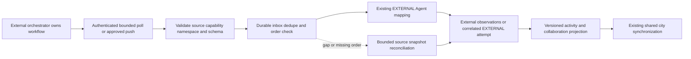

# Proposed external adapter and event boundary

**Final Phase 5 status (2026-10-29): ACCEPTED for the approved local scope; T01-T12 complete.** See [canonical acceptance, current contracts and limitations](acceptance.md). Task-date proposals, checkpoints, counts and future-task statements below are historical, not additional implemented capabilities or current roadmap status.

**T08 checkpoint (2026-10-28):** [LangGraph reference integration](reference-integration.md) adds one observation-only compiled adapter, explicit discovery/approval/poll/result commands, real pinned-server verification and T07 inbox reconciliation. No external dispatch/cancel, public webhook, scheduler, activity API or city/UI change. Earlier task snapshots below are historical.

**T07 checkpoint (2026-10-28):** [External mappings and ingestion](external-ingestion.md) implement durable source incarnations, explicit identity approval, authenticated internal receipt, conservative ordered observation and bounded replay. External data never mutates native work. Real providers/public webhooks/polling and activity/UI integration remain deferred. Earlier task/planning snapshots below are historical.

**T06 checkpoint (2026-10-28):** [External adapter foundation](adapter-foundation.md) implements provider-neutral contracts, capability/ownership gates, trusted configuration and bounded transport with an empty production registry. No real provider, external persistence/ingestion or dispatch is implemented. Earlier planning/task snapshots below are historical.

**PROPOSED. No adapter, package, credential or external service is installed/configured.** Refines the existing [provider-neutral orchestration contract](../orchestration-contracts.md); it does not claim that older sketches are implemented.

## Capability architecture

Use an explicit server-side `OrchestratorAdapter` registry keyed by reviewed adapter type/version; never load a browser-supplied module/URL. Required operations: describe configured identity/capabilities and bounded health. Optional operations: discover Agents, poll/read events, subscribe to authenticated events, read Execution/result, dispatch and cancel. Each receives trusted owner/provider context, correlation, deadline and AbortSignal, never browser credentials.

`OrchestratorCapabilities` refines existing sketch fields: observation transport none/poll/push, paginated discovery, status/results support, dispatch support, cancellation none/best-effort/confirmed, multi-Agent relationship visibility, progress, ordered-source version domain, replay/cursor, idempotent dispatch and lookup-by-submission-key. Effective capability = adapter implementation intersect remote deployment/version/credential scope intersect local policy. Missing/expired discovery disables actions. Snapshot negotiated config generation on accepted dispatch; health alone cannot grant permissions.

`ExternalAgentDescriptor` carries opaque source ID/namespace/name/capabilities; `ExternalExecutionDescriptor` carries source run/Task identity, optional parent identity, source status, source version and actual timestamps. `ExternalActivityEvent` carries source event ID, source incarnation, schema version, normalized kind, source status, occurredAt when supplied, receivedAt, correlation/causation and safe bounded references. Unsupported fields/statuses remain explicit; no arbitrary raw runtime state is forwarded.

An observation-only adapter must reject dispatch/cancel without network mutation even if its SDK supports them. Unsupported calls return explicit capability errors, never successful no-ops. Dispatch is disabled without an independently reviewed side-effect/idempotency/recovery contract. A source without safe lookup or idempotent dispatch remains read-only for the MVP.

## Feasibility review - documentation evidence only

Official documentation checked 2026-10-27; no live integration test or interoperability certification. These are candidate deployment surfaces, not evidence that every application using the library exposes them.

| Candidate | Confirmed documented surface | Must verify before implementation | Unknown / not assumed |
| --- | --- | --- | --- |
| Hermes Agent | Official [API server](https://hermes-agent.nousresearch.com/docs/user-guide/features/api-server) documents OpenAI-compatible HTTP access; [ACP](https://hermes-agent.nousresearch.com/docs/user-guide/features/acp) documents a stdio host integration | Pinned installed version, authentication/deployment boundary, stable Agent/run identifiers, result/status retrieval and usable integration permissions | Neither surface establishes a complete multi-Agent orchestration/event API, ordered handoff stream, replay or safe dispatch idempotency. A completion-compatible response is not a collaboration graph |
| LangGraph-based deployment | [Agent Server](https://docs.langchain.com/langsmith/agent-server) documents assistants, threads, runs and deployment APIs; [infrastructure](https://docs.langchain.com/langsmith/data-plane) describes server workers and persistence | Actual deployed server/version/auth, run/thread-to-Agent mapping, status/stream schemas, cancellation/replay and licenses/costs | A bare LangGraph library application does not automatically expose that server or universal Agent discovery. Remote infrastructure does not become Elyqreth infrastructure |
| CrewAI-based deployment | Official [kickoff](https://docs.crewai.com/en/api-reference/kickoff) returns kickoff ID; [status](https://docs.crewai.com/en/api-reference/status) documents authenticated status lookup for the documented deployed API | Exact deployment product/version, Agent-level identities, output/relationship visibility, event authentication and token permission scope | A local CrewAI process is not automatically this hosted API. Cancellation, ordered events, durable submission-key lookup and cross-framework equivalence remain unverified |
| Generic custom endpoint | No universal protocol assumed | T08 selects an owned reviewable endpoint with stable source IDs, authenticated bounded snapshots, health and deterministic recorded work | Mock fixtures cannot prove real source compatibility; provider advertising is not a capability contract |

Inference/recommendation: a generic authenticated read-only snapshot/poll reference is the lowest-risk first integration. Select the actual accessible target only after the T08 compatibility/security spike; no production provider is chosen now. Hermes is not mandatory. If no real supported target is available, T08/T11/T12 external acceptance is BLOCKED rather than substituting a mock pass. Product-name aliases and third-party tutorials are not authoritative protocol specifications.

## Identity and authority

Resolve the [namespaced mapping](domain-model.md) before accepting observations. Source credentials bind owner/orchestrator/config generation. Payload ownerId/internalAgentId are not trusted. Unknown Agent discovery produces reviewable candidates, not active administrative identities. Re-registration/disconnection preserves tombstones and mapping history; rotated credentials/config generation invalidate old cursors and event acceptance.

External observations update external-authority records only through a dedicated service. For a real correlated Task, reuse EXTERNAL Execution persistence only after verifying ownership, representable transition/timestamps and immutable authority. Never call native admission/finalization or apply a generic status PATCH from an event. Unmapped/unrepresentable remote work remains an external observation; no fabricated Task or liveness is needed to draw a marker.

## Normalization, ordering and replay

1. Authenticate the source, check namespace/config generation, content type/body/schema limits and rate budget before processing.
2. Validate known event kinds (Agent observation, work started/waiting/completed/failed, delegated/accepted/rejected, collaboration terminal, connection state). Preserve safe raw status separately. Disconnect is connection health, not execution failure.
3. Atomically insert inbox receipt and apply mapping/projection state; acknowledge only after commit. SourceEventId uniqueness is scoped to owner/provider/incarnation, with payload-hash conflict detection.
4. Compare sequences only within their declared source aggregate/incarnation. Lower versions are stale; equal version with different content is quarantined. Per-provider cursor is not automatically a per-run version. Owner streamPosition represents local committed order, not remote causal time.
5. Without ordered metadata, treat events as refresh hints and reconcile a bounded authoritative snapshot before replacing confirmed terminal state. Source/receive timestamps alone cannot establish strict order. Missing/conflicting evidence becomes stale/UNKNOWN.
6. Commit checkpoint with applied receipts; reconnect from supported cursor with overlap/dedupe, bounded pages/backoff/jitter. If replay is unsupported, perform bounded snapshot reconciliation and disclose the history gap. Never invent missing handoffs.

Terminal external evidence is immutable within a source run incarnation unless a documented source revision model explicitly permits a correction with audit. Reused run IDs require a new namespace/incarnation. Raw event retention is not required; store safe metadata/hash and authorized sanitized normalized facts under a defined retention policy.

## Optional controlled dispatch

Persist command intent/submission key and source configuration before sending. Network dispatch cannot share a transaction with the remote system. Lost acknowledgement stays OUTCOME_UNCERTAIN: query exact remote submission key/run reference, never blind retry. At-least-once outbox delivery requires proven remote dedupe; without it manual resolution remains necessary. Cancellation is a separately gated request, not proof of termination. Do not import source tools/secrets into the native Tool Registry or grant external admin access to Elyqreth.
