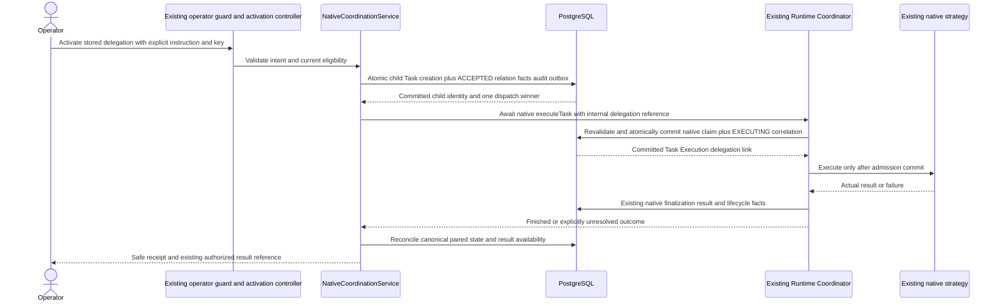

# T04 - Bounded native collaboration coordination

**Final Phase 5 status (2026-10-29): ACCEPTED for the approved local scope; T01-T12 complete.** See [canonical acceptance, current contracts and limitations](acceptance.md). Task-date proposals, checkpoints, counts and future-task statements below are historical, not additional implemented capabilities or current roadmap status.

**T05 checkpoint (2026-10-27):** [Lifecycle and recovery](lifecycle-recovery.md) adds bounded operator reconciliation, durable cancellation intents, conservative aggregate state and explicit recovery of never-admitted children. Native uncertain outcomes remain quarantined; no worker, scheduler, terminal reset or external integration is introduced. Earlier task checkpoints below are historical.


Reviewed 2026-10-27, Asia/Bangkok. **T04 COMPLETE: verified native backend vertical slice only.** An authorized operator explicitly activates a persisted T03 delegation; one child Task/Execution runs through the existing Runtime Coordinator. No scheduler, worker, broker, outbox consumer, adapter, city projection or frontend feature is added.

## Repository findings and boundaries

The [T02 persistence foundation](persistence.md) and [T03 request contracts](native-delegation-api.md) were inspected against their code/test evidence. Their local-scope completion remains valid. Current scope is fixed-owner, trusted loopback development/test, not production account/tenant authentication. No applicable AGENTS.md was found; Git status/diff are unavailable (128/129, no supplied metadata). A 445-file pre-edit hash baseline protects unrelated work.

RuntimeCoordinator executes synchronously with one active call per instance, existing PostgreSQL per-Agent/Task fencing, bounded deadlines, cooperative cancellation and native result/audit persistence. There is no durable work consumer or automatic crash repair to reuse. Task creation previously owned its own transaction; the same validation/persistence was extracted into `TasksService.createInTransaction` while standalone `create` retains early validation and its original transaction wrapper. Native strategies/providers/tools and Task/Execution lifecycle enums remain unchanged.

## Implemented contract

`POST /api/v1/collaborations/:sessionId/delegations/:delegationId/activate`

```typescript
type ActivateDelegation = {
  instruction: string;    // explicit operator-approved child input, existing Task validation/limits
  idempotencyKey: string; // same logical activation key on every retry
};
```

The instruction limit is 16,000 UTF-16 code units, with the existing required-text/control-character and credential-pattern checks, plus a 32,768-byte JSON input bound; activation keys allow 1-128 characters from `A-Z a-z 0-9 . _ : -`.

Requires the same existing operator Bearer/loopback/Host/Origin/development-or-test boundary as T03. Limited city interaction/read tokens are not broadened. IDs must be valid and owned; nested delegation/session mismatches are 404. Unknown fields, child IDs, Execution IDs, lifecycle statuses, ownership/provider/tool configuration, invalid keys and invalid/oversized instructions are rejected. No existing Task or result is silently copied as child input. The child instruction is stored only in the existing Task input, not again in Delegation/audit/event payloads.

Before the first activation, the service revalidates the open NATIVE session, distinct active native source/target Agents, enabled native routes, both active participants, terminal successful exact parent/source attempt, current route association and bounded ancestry. T03's two-participant, depth-two, three-work-Task/no-fanout policy remains. Target runtime binding/type must be configured; the existing coordinator independently validates actual strategy/provider/tool readiness and capacity at admission. Eligibility at request creation is insufficient.

An activation receipt contains safe existing `delegation`, `childTask`, `childExecution` DTOs, `dispatchState`, `resultAvailable` and an authorized local `resultPath` or null. Instructions, command keys/hashes, lease tokens, provider credentials/configuration and result payloads are omitted.

| Receipt state | HTTP / meaning |
| --- | --- |
| SETTLED | 200; coordination observation is terminal. Inspect delegation/Execution status: this includes failure/cancellation, not just success |
| RUNNING | 202; recorded native RUNNING state with an unexpired lease/deadline. It is not a promise of continuous process liveness |
| RECOVERY_REQUIRED | 202; identities retained but dispatch/completion is not confirmed, or a known finalization uncertainty was returned |
| NOT_ACTIVATED | Internal observation state for a REQUESTED record with no child; the detail endpoint still returns its existing DTO shape |

Validation/auth/eligibility/preparation persistence failures retain T03's safe 400/401/403/404/409/503 envelope. A runtime rejection after the activation transaction committed is recorded as a settled FAILED coordination receipt when absence of any admitted attempt is proven; no fake failed Execution is created. HTTP 200 means the activation observation was processed, not that work succeeded.

Existing `GET /api/v1/collaborations/:sessionId/delegations/:delegationId` retains its DTO shape and now performs bounded read-through reconciliation of the exact child. There is no general status PATCH, new polling loop or result-body endpoint. Reads never redispatch work. The owner operator can fetch the child result using existing `GET /api/v1/tasks/:childTaskId/executions/:childExecutionId/result` and cancel with the existing versioned exact-target cancellation API.

## Commit and execution flow



### Preparation transaction

`NativeCoordinationService.prepare` uses the T02 repository transaction/owner fence. It resolves the authorized persisted request, validates current source/target/membership/parent rules, creates the target Task through `TasksService.createInTransaction`, then attaches it and transitions REQUESTED -> ACCEPTED in the same transaction. Task facts, delegation facts, audit and trigger-created outbox commit together. A failed attachment rolls back the new Task and all those facts. No runtime/provider call runs inside this transaction.

The attached child identity is also a durable activation fence. Only the call that committed the first child receives permission to dispatch. Concurrent/repeated activation sees the existing child and never invokes the coordinator again. There is no process-local activation map or detached promise.

### Native admission transaction

The existing internal ExecuteTaskCommand adds an optional validated `delegationId`; public standalone execute DTOs do not accept it. A small authority-specific admission hook recognizes delegated child Tasks. It rejects generic standalone start/queue bypass, validates the matching ACCEPTED relation with no prior child Execution, takes the same owner fence and rechecks current source/target/membership/parent policy. Queuing through this delegated path is deliberately unsupported; T04 explicitly executes one step.

The existing RuntimePersistenceService still resolves trusted definitions/strategy, checks native capacity/configuration, creates the Execution and claims it through existing lifecycle services. Before the admission transaction commits it also attaches the exact Execution ID and transitions ACCEPTED -> EXECUTING through T02's repository facade on that same transaction. Correlation failure rolls back the native claim and prevents strategy invocation. Tests query PostgreSQL from inside strategy entry to verify that the correlation is already committed.

No second execution allocator, lease, strategy registry, provider call path or scheduler is introduced. A second API instance with an independent coordinator observes the same durable activation and does not dispatch again. Existing generic cancellation remains available for the exact correlated child; generic standalone Start cannot bypass the collaboration admission fence.

## Idempotency and uncertainty

The existing Task idempotency field stores a bounded server-derived key hashing owner, delegation ID and client activation key. Existing Task requestHash covers target and explicit input. Replays must match both; changed input/key is a conflict. No sensitive activation instruction is duplicated outside Task input, and no new idempotency table/migration is required. A pre-created unrelated Task with the derived key is rejected rather than silently adopted.

| Interruption/failure | Actual behavior |
| --- | --- |
| Before preparation commit | Transaction rolls back; same logical request may be retried, no orphan child/facts |
| After child commit, before native admission | ACCEPTED child identity survives. Retry returns RECOVERY_REQUIRED with no new execution. No worker resumes it automatically |
| Native rejection before any claim | Under the owner fence, verify CREATED child/no attempt/no Execution reference; mark coordination FAILED and record safe dispatch-rejected audit. Child remains a durable CREATED intent, not a fabricated failed Execution |
| Admission/link transaction failure | Native Task/Execution mutations roll back before dispatch. A provably unstarted activation can become FAILED as above |
| Lost acknowledgement after actual native commit | Inspect canonical persisted Task/Execution/result; preserve success/cancellation/failure or uncertainty, never retry the native call blindly |
| Finalization unavailable | Keep persisted EXECUTING/RUNNING or other actual state and return RECOVERY_REQUIRED for the known uncertainty; no success/result is invented. Later reads use finite lease/deadline evidence and cannot prove a process is alive |
| Process dies during/after work | Existing native lease/quarantine semantics remain authoritative. Exact references survive; read-through observation can settle a committed terminal outcome, but does not resume/repair unfinished work |

This is durable intent, transactional admission correlation and conservative at-most-one activation through this API, **not guaranteed eventual dispatch, exactly-once external effects or autonomous crash recovery**. A caller abort/HTTP close cancels waiting native execution through the existing signal semantics; it is not detached work. The controller retains the established 30-second request budget and cleans up timers/listeners.

The admission hook must remain present while activated children are unresolved. Disabling activation routes is safe; downgrading to older runtime code without the delegated-child admission guard requires a separate review/resolution of pending work. No destructive rollback or database reset is performed.

## Outcomes, results and parents

Observation reads existing canonical Task/Execution state, never client status or an uncommitted strategy candidate. Successful completion requires Task COMPLETED + Execution SUCCEEDED + a validated AVAILABLE result through the existing result service. It records EXECUTING -> AWAITING_RETURN -> COMPLETED. For this T04 slice, return means the durable authorized result reference is available for inspection; it does not mean a parent LLM consumed output or continued. This explicitly narrows T01's broader manual return/continuation proposal to the current task's child-outcome goal.

Paired FAILED/TIMED_OUT outcomes produce delegation FAILED; paired CANCELLED produces CANCELLED. Mismatched/unknown/unavailable outcomes are left unresolved. Terminal delegation history is never reopened or overwritten by stale reads. Cancellation acknowledgement alone is not used as terminal evidence, and completion/cancellation races preserve the actual native winner. No new Execution WAITING state exists.

The parent Task/Execution remain their original completed identities. There is no paused parent, restart, automatic instruction/result merge, continuation Task or aggregate result rewriting. Parent workflows inspect the delegation's child IDs/result path through existing authorized contracts. Session completion/cancellation aggregation remains T05; T04 does not invent aggregate success because one child succeeded.

The awaited native completion and bounded exact-detail reads provide observation; there are no new event consumers, per-Agent timers or per-NPC requests. Agent-wide city activity remains Phase 3's existing projection of native Tasks/Executions. No frontend/sprite/map/movement code changes.

## Audit, security and tests

T02 facts/audit/outbox record Task creation, child association, EXECUTING correlation and terminal transitions with source/target/parent/child references, actor and correlation. Native lifecycle facts are reused, not emitted twice. The first activation correlation is passed through Task creation/native admission; later read-through reconciliation has its request correlation and stable aggregate/child identities. Known pre-dispatch failures record safe allow-listed runtime codes. No raw provider, instruction or driver text is logged by the new coordination path.

Operator-only authorization remains unchanged; foreign owners/nested IDs and forged lifecycle/child references are denied. Tenant/user accounts are not implemented. Shared policy is checked at both preparation and admission to close disable/membership/status races. Finalization/observation does not require Agents to remain enabled after work was admitted. Whole-owner locking and strict first-recipe bounds are local safety choices, not a production throughput guarantee.

The deterministic backend E2E executes the parent and child with the genuine rule-based strategy and actual NestJS/PG/runtime/result services. Controlled barriers/faults supplement it for commit visibility, cross-instance duplicates, cancellation/completion races, deadline/failure, capacity rejection, commit-ack loss, transaction rollback and unresolved finalization. The pre-dispatch interruption test commits preparation then restarts the API; it does not claim an OS hard-kill or automatic recovery-worker test.

Actual commands/counts, initial failures/corrections and preservation checks are in [T04 verification evidence](verification-evidence/t04-verification.json). New tests are registered in the existing PostgreSQL harness/CI path, with no new framework or paid provider requirement. Hosted CI is not claimed executed.

## Explicit T05 prerequisites

T05 must define operator recovery for ACCEPTED/no-attempt and quarantined RUNNING work, explicit retry policy/new identities, failure cleanup of unstarted child intents, safe session aggregation/cascading cancellation and advanced reconcile policy. It must not reset terminal Task/Execution states, redispatch solely because a response was lost, or assume a stale lease proves side effects did not happen. Automatic parent continuation, external adapters and UI remain later/out of scope.

## Interrupted-session recovery checklist

The continuation recovered the existing implementation rather than replacing it. Before continuation, all coordination code, four focused unit tests and fourteen PostgreSQL/native-runtime scenarios were saved. The existing unit suite passed 214 tests and frontend regression suite passed 209. The direct Node database invocation passed all fourteen new cases but failed one older CLI acceptance case because npm_execpath was absent (158/159); canonical npm verification is required below. No product assertion was weakened.

| T04 requirement group | Recovered status | Continuation requirement |
| --- | --- | --- |
| Coordination boundary, explicit activation, current eligibility | COMPLETE in focused tests | Preserve; include full regression run |
| Child Task, parent integrity, native Execution and Runtime Coordinator | COMPLETE in real PostgreSQL/native E2E | Preserve; include full regression run |
| Durable activation fence, duplicate/concurrent dispatch prevention | COMPLETE in real PostgreSQL, including independent API instances | Preserve; no automatic recovery implementation |
| Lifecycle observation, authorized result reference, parent semantics | COMPLETE in genuine success/failure and race cases | Preserve |
| Immediate failures, cancellation, ownership and audit | COMPLETE in focused tests | Preserve; include full regression run |
| Unit tests and frontend compatibility | COMPLETE, 214 and 209 passed | Reuse logs; no subsequent source changes |
| Full backend/database/browser regressions | PARTIAL, one incorrect direct invocation | Run canonical npm test:db with isolated PostgreSQL |
| Documentation, evidence and roadmap | PARTIAL | Finish links, scope refinements and verified completion status |

There are no missing runtime modules to recreate. The final verification record supersedes this recovered pre-completion checklist. T05 advanced recovery remains intentionally deferred, not silently implemented here.

## Reproducible verification

Run from the repository root with the supported Node 24/npm installation and Docker Desktop Linux engine available:

```powershell
npm.cmd run lint
npm.cmd run build
npm.cmd run test:api
npm.cmd run test:db
npm.cmd test
```

`lint` includes maintained JavaScript syntax, frontend runtime contract typecheck and backend no-emit typecheck. `test:api` rebuilds and runs backend unit tests. `test:db` rebuilds and owns an isolated PostgreSQL container, random credentials and disposable volume; it applies existing migrations and runs the registered native-coordination integration/E2E cases alongside prior backend and real-browser regression cases. It does not consume a developer/production DATABASE_URL. Docker health and test labels govern readiness/cleanup. Do not replace this npm command with direct Node for the complete suite: an existing CLI acceptance test intentionally uses npm_execpath.

Earlier successful unit, lint/build and frontend logs are reusable because no source/test changes followed those runs. The continuation re-executed the full database/browser suite using its canonical script. Its first attempts were blocked by unavailable Docker; Docker Desktop was started and the isolated suite then rerun. Exact outcomes, command working directories and local log hashes are recorded in the evidence JSON. No hosted CI, paid-provider or new frontend collaboration E2E execution is implied.

## Completion checkpoint

**COMPLETE (2026-10-27, Asia/Bangkok).** Canonical `npm.cmd run test:db` exited 0 with 159 passed, zero failed/skipped, including all fourteen new native coordination cases and existing Phase 1-4 database/browser regressions. Backend lint/typecheck/build and all 214 backend unit / 209 frontend regression tests passed. No source code was changed during continuation; it finished canonical verification, documentation and evidence. Test-owned containers/volumes were absent after cleanup. The recovered PARTIAL verification/documentation rows above are now COMPLETE for T04's stated scope. T05-T12 remain PLANNED.
