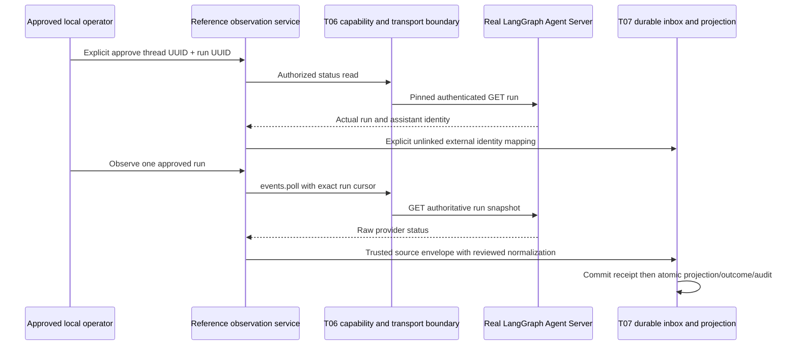

# T08 - LangGraph reference external integration

**Final Phase 5 status (2026-10-29): ACCEPTED for the approved local scope; T01-T12 complete.** See [canonical acceptance, current contracts and limitations](acceptance.md). Task-date proposals, checkpoints, counts and future-task statements below are historical, not additional implemented capabilities or current roadmap status.

Reviewed 2026-10-28, Asia/Bangkok. **T08 COMPLETE for the approved pinned local reference scope.** Final [evidence](verification-evidence/t08-verification.json) records commands, failures/corrections, fixture/live distinctions and preservation. T09-T12 remain planned. This is an observation-only reference against a real Agent Server, not a general orchestration engine or a production deployment approval.

## Repository audit and selection

T01 ownership/ADR decisions and actual T02-T07 code/evidence were reviewed. The project has PostgreSQL/Drizzle, owner-scoped transactions, immutable audit and a durable external inbox. It has no message worker, broker or provider poll scheduler. T06 has bounded pinned-IP GET transport, capability intersection and redacted credentials. T07 has durable incarnations/mappings/receipt/replay and explicitly trusted internal approval. Native services and city source remain unchanged. Git metadata is absent; status/diff/staged inspection cannot establish version-control state. Applicable AGENTS.md searches found none; a pre-edit SHA-256 inventory protects existing files.

Exactly one provider is selected: **LangGraph Agent Server**, Python development deployment, verified API 0.16.8 / graph 1.2.18. This is a remotely accessible runtime API, not merely the graph library. Its local server runs an actual asynchronous graph through its own run queue and checkpointing. The fixture is deterministic and has no LLM/provider/tool dependency.

| Candidate | Evidence and decision |
| --- | --- |
| LangGraph Agent Server | Official deployed assistant/run APIs, documented local dev command and actual accessible local runtime. Selected. SDK/framework licensing and API server deployment terms differ; installed API metadata declares Elastic-2.0. Standalone production deployment has separate license, PostgreSQL/Redis and operational requirements |
| CrewAI AMP | Official introduction documents deployed crew URLs, bearer auth, kickoff/status/results. No owned deployment/token was available; hosted operational dependency was unnecessary for this local reference. Not selected or implemented |
| Hermes | A definitive compatible runtime API/deployment was not established in this review; official-source fetch was rate limited. NOT VERIFIED, not selected, no guessed routes |

Primary references reviewed:

- [Agent Server API and authentication](https://docs.langchain.com/langsmith/server-api-ref).
- [Local development versus production-like deployment](https://docs.langchain.com/langsmith/local-dev-testing).
- [Assistant search and official SDK implementation](https://github.com/langchain-ai/langgraph/blob/main/libs/sdk-py/langgraph_sdk/_async/assistants.py).
- [Get run](https://docs.langchain.com/langsmith/agent-server-api/thread-runs/get-run), [join run](https://docs.langchain.com/langsmith/agent-server-api/thread-runs/join-run), [list runs](https://docs.langchain.com/langsmith/agent-server-api/thread-runs/list-runs), [server info](https://docs.langchain.com/langsmith/agent-server-api/system/server-information).
- [Official run schema/status definitions](https://github.com/langchain-ai/langgraph/blob/main/libs/sdk-py/langgraph_sdk/schema.py).
- [Standalone prerequisites](https://docs.langchain.com/langsmith/deploy-standalone-server), [CrewAI API](https://docs.crewai.com/en/api-reference/introduction).

Live responses were captured from the installed pinned runtime, not invented from documentation. The sanitized fixture retains real assistant/run/schema fields and benign output, omitting request internals and input. The full optional Python lock records the tested environment; current main-branch docs are references, not a claim of compatibility with every server version.

## Capability matrix

The status column describes the implemented adapter. Provider API availability does not imply enabled local permission.

| Capability | Adapter status | Boundary/evidence |
| --- | --- | --- |
| Configuration validation | SUPPORTED | OBSERVATION_ONLY only; reviewed endpoint/pins; public endpoints require a secret reference |
| Health/connectivity | SUPPORTED | GET /info, bounded version-field validation; safe unauthorized/unavailable codes |
| Agent/workflow discovery | SUPPORTED | POST /assistants/search with limit/offset; assistant UUID identifies configured graph instance, not a fabricated individual Agent |
| Global execution discovery | UNSUPPORTED | A run requires explicit thread+run identity; no global scan or thread/result fanout |
| Execution status | SUPPORTED | GET /threads/{thread}/runs/{run}; UUID pair, assistant identity and raw status validated |
| Result retrieval | SUPPORTED, restricted | Successful latest thread run only; GET join plus before/after latest-run and exact completed-checkpoint checks, bounded SHA-256 result reference. No raw output/result history API |
| Controlled dispatch | UNSUPPORTED | No local capability/method; durable remote idempotency/recovery not reviewed |
| Cancellation | UNSUPPORTED | Provider has cancel APIs, but this observation tier deliberately offers no mutation permission or route |
| Event subscription/webhooks | UNSUPPORTED | No public ingress, signatures, stream consumer or subscription |
| Polling | SUPPORTED | One explicitly selected mapped run per bounded call; no scheduler or background/per-Agent loop |
| Hosted deployment/authentication live | NOT VERIFIED | Documented X-Api-Key implemented and wire-tested; no hosted key/deployment used |

## Adapter and authorization architecture

LangGraphAdapter is compiled reviewed server code registered in the existing AdapterRegistry through Nest DI. No dynamic module/provider input can load code. Import/startup does not contact a provider. LangGraphReferenceModule composes the existing adapter and ingestion modules with LangGraphObservationService. No native runtime strategy/coordinator dependency is injected.



The operator session is the existing T07 opaque expiring local approval. Discovery, approval, result and polling authorize its exact connection, owner/incarnation and approved phase domain. Observe additionally requires a separate same-connection ingestion session. Forged/copied/cross-owner/cross-source grants fail before provider access. Capabilities are the connection/adapter/approved-operation intersection. There is no public adapter invocation route, generic webhook, tenant impersonation, production principal architecture or frontend secret exposure.

An approval verifies the real run first, then idempotently records an unlinked external assistant mapping and an external run mapping. It never creates an internal Registry Agent, Task, native Execution, collaboration, participant or NPC. A crash between mapping steps leaves an approved harmless Agent mapping; retry converges. Optional internal/collaboration links still require the existing separate T07 ownership/correlation policy and are not inferred from labels.

## Configuration, authentication and transport

Use the existing EXTERNAL_ORCHESTRATORS_ENABLED flag and trusted EXTERNAL_ORCHESTRATORS JSON profiles. See the [safe example](../../../tools/langgraph-reference/connection.example.json) and [local setup](../../../tools/langgraph-reference/README.md). The connection UUID must match an existing same-owner ENABLED orchestrators row with type langgraph.v1. A profile alone does not grant durable registration. Provision it through reviewed database administration, not model text or a public endpoint:

```sql
-- Replace these placeholder UUIDs with an authorized existing owner and chosen connection UUID.
INSERT INTO orchestrators (id, owner_id, name, type, registration_status)
VALUES ('11111111-1111-4111-8111-111111111111',
        '22222222-2222-4222-8222-222222222222',
        'Local LangGraph reference', 'langgraph.v1', 'ENABLED');
```

For hosted APIs set credentialRef to an EXTERNAL_SECRET_* environment reference. The transport emits X-Api-Key only for the reviewed langgraph.v1 adapter; other adapters retain bearer behavior. The key never enters adapter context, DTO, audit or CLI argv. Trusted loopback development server was verified without provider credentials; this is not a production unauthenticated deployment recommendation.

T06 endpoint policy remains enforced: exact origin, explicit trusted local or public HTTPS addresses, bounded DNS result set, all-answer allowlist, pinned destination and peer verification, verified TLS hostname, no redirects, no proxy or TLS bypass. The only new POST seam is /assistants/search for langgraph.v1 with exact numeric limit/offset keys (1-20 rows, offset 0-10000). It cannot create threads/runs, cancel work or send arbitrary bodies. All other transport operations remain GET. Bounds remain 1-second connect, 5-second total, four concurrent operations/requests, 64 KiB response and no retries. Abort cleans resources. Discovery offset cursors are bounded but do not promise snapshot-consistent pagination while assistants change.

The local command loads existing server configuration and operator credential; it never accepts owner or secret flags:

```powershell
npm.cmd run langgraph:observe -- health CONNECTION_UUID
npm.cmd run langgraph:observe -- discover CONNECTION_UUID
npm.cmd run langgraph:observe -- approve CONNECTION_UUID THREAD_UUID:RUN_UUID
npm.cmd run langgraph:observe -- observe CONNECTION_UUID THREAD_UUID:RUN_UUID
npm.cmd run langgraph:observe -- result CONNECTION_UUID THREAD_UUID:RUN_UUID
npm.cmd run langgraph:observe -- replay CONNECTION_UUID
```

Configure/migrate an authorized development database first. Approval and observe are separate commands; provider work must already exist. Each observe reads one run once and exits. Operators may repeat it deliberately; there is no automatic polling or mutation retry. Five-minute sessions are reauthorized on each command. Opaque run identity is the canonical lowercase UUID thread/run pair, scoped by owner/connection/namespace/generation. No name matching, global ID assumption or native permission inheritance is used.

## Lifecycle normalization, ordering and recovery

Migration 0008_external_normalized_observation.sql forward-replaces only the external observation evidence guard. It allows a separately validated normalizedStatus while preserving raw sourceStatus; existing canonical T07 envelopes and records retain their behavior. No table/column/native lifecycle changes, data rewrite or historical migration edits occur. The new snapshot mirrors the previous schema with a new migration identity.

The reviewed LangGraph adapter maps pending to QUEUED, running to RUNNING, success to COMPLETED, error/timeout to FAILED. timeout retains its actual raw category; no native timeout state is invented. interrupted is resumable provider state and remains UNKNOWN, never a guessed CANCELLED. Unknown future states remain UNKNOWN and are retained as receipt evidence without claiming terminal success.

The approved per-run ordering domain is langgraph-run-phase-v1. Sequence values are **lifecycle phase ranks**, not provider event versions or receipt timestamps: unknown=0, pending=1, running=2, terminal=3. One invocation's progress can advance; lower phases are stale and equal-phase incompatible statuses are deferred. This is a partial-order snapshot policy with terminal preservation, not total temporal ordering. A running-to-interrupted hint is retained without replacing the last accepted projection. Last accepted status is not guaranteed current liveness. Changed terminal outcomes, unrecognized source semantics and equal-phase conflicts need investigation; no speculative override/automatic retry exists.

Stable event identity hashes the exact provider run/assistant/status tuple. Repeated snapshots survive restart as compatible duplicates. ReceivedAt remains server receipt time and is excluded from content identity; it never establishes source order. Backend outages do not synthesize failed/cancelled status. Explicit bounded T07 replay resumes committed pending receipts after process/projection interruption; mappings, identity generation, terminal guards and audits remain durable. There is no worker, broker, OS hard-kill or remote-event delivery guarantee claimed.

The event envelope's optional normalizedStatus is accepted only inside the existing trusted-source boundary and checked against the closed observation enum. Its original sourceStatus is mandatory for this adapter. SQL requires the projected normalized and raw values to match durable inbox evidence. Trusted server adapter code owns semantic mapping; provider payloads never supply internal ownership or normalized lifecycle commands directly.

## Results and source provenance

The adapter checks successful status, verifies the selected run is latest before/after GET join and checks a stable completed checkpoint with exact run/thread/source=loop metadata and matching values hash, reads bounded JSON, returns only a content hash reference, then discards the payload. Pending runs do not call join. Older/mismatched latest-run contexts return UNAVAILABLE; native results remain untouched. The provider's retained-stream/thread-fallback behavior does not offer general immutable historical result retrieval, so this adapter makes no such claim. Manual state updates, mismatched run provenance or changed checkpoint/output return UNAVAILABLE. Provider retention/schema variants without matching checkpoint provenance remain unavailable. No large/raw provider result is persisted or served by a new UI/API.

## Audit, tests and limitations

Existing external.operation logs include connection, adapter, operation, mode, correlation, duration, safe outcome/error category. T07 immutable audit records capture identity approval and effective receipt/projection transitions. No raw body, instruction, API key, authorization header, stack trace or unrestricted metadata is logged. Fixture tests assert auth header placement/redaction, rate/auth/server errors, malformed/large responses, unsupported commands, request bounds and cleanup. Existing T06 SSRF/redirect/TLS/DNS tests remain active.

Ordinary deterministic CI uses the captured 0.16.8 response shapes over a real pinned HTTP fixture plus actual Nest/PG mappings/inbox. The separate live tier uses real LangGraph Agent Server, isolated PostgreSQL, no paid models and disposable provider-side work. The established CI script already runs these new deterministic test files; it does not need Python/hosted secrets. No hosted CI, live hosted authentication or production compatibility is claimed. Final command/test counts and initial environment failures are in the evidence file.

T09 prerequisites: consume existing external read-model observations with provenance, authority, stale/UNKNOWN/deferred semantics and versioned city compatibility. T08 does not implement activity APIs, frontend inspection, NPC binding/visualization, collaboration completion propagation, multiple adapters, external dispatch/cancel or a scheduler. Public multi-tenant identity/ingress remains blocked by earlier deployment prerequisites. Native runtime, collaboration, city animation and frontend are preserved.

## Remaining risks and follow-up

| Risk | Severity / scope | Mitigation and follow-up |
| --- | --- | --- |
| Public multi-tenant identity is absent | High; blocks public production exposure, not this approved local tier | Fixed-owner loopback approval and no public integration endpoints. Separate principal/tenant security review before exposure |
| Hosted auth/deployment and other API versions lack live evidence | Medium; non-blocking for pinned local reference | Wire-level X-Api-Key/error tests and documented version. Run a separately authorized disposable hosted compatibility test before enabling a hosted profile |
| Snapshot partial order cannot establish general source revisions | Medium; non-blocking with explicit stale/UNKNOWN semantics | Durable hints, phase ranks, terminal preservation and deferred conflicts. T09 must not present last accepted observations as guaranteed live liveness |
| Result retention/checkpoint metadata differs across deployments | Medium; non-blocking for the verified single-run checkpoint flow | Return UNAVAILABLE if exact successful run, completed checkpoint or values hash cannot be verified. No historical-result promise |
| No periodic observation/recovery scheduler | Low; intentional explicit boundary | One operation per command and bounded inbox replay. Define a reviewed bounded source sweep only if a future task requires it |

No known T08-local acceptance-blocking defect is being deferred as a provider mock. Live reference evidence is required for COMPLETE. Native uncertain execution recovery, UI activity and external command protocols retain their existing phase boundaries.

## Final verification checkpoint

Backend build and lint/typechecks pass. Full backend unit/contract/security suite: 266 passed, zero failed/skipped. Focused final LangGraph adapter/security suite: 11 passed. Full PostgreSQL/Nest/native/browser regression plus real LangGraph live tier: 197 passed, zero failed/skipped, including seven new deterministic T08 database/command/migration cases and one real external workflow. Drizzle metadata check passes and generation reports no schema changes. Live API 0.16.8 and graph 1.2.18 yielded QUEUED, RUNNING and COMPLETED; result hash/checkpoint provenance, restart duplicate behavior and unchanged native Agent/Task/Execution counts were verified. Test-owned Docker resources were absent after cleanup; the reference runtime was stopped and the captured disposable thread removed. No source changes followed this final run, only documentation/evidence. Hosted CI and hosted provider authentication were not executed.
