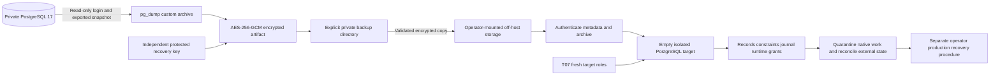

# Backup, restore and recovery readiness

Phase 6 T08, 2026-11-05 (Asia/Bangkok). Implements a local, restore-tested recovery path for the [T01 architecture](production-architecture.md) and [T07 roles](database-migrations.md). Nothing is deployed or scheduled remotely. See [current verification evidence](verification-evidence/backup-recovery-verification.json). Provider selection, approved RPO/RTO and actual off-host storage remain operational decisions.

## Audit and durable inventory

The audit found no existing backup/restore tooling, scheduler, dedicated worker, message broker, Redis, upload store or off-host backup destination. PostgreSQL 17 is authoritative. API startup never runs migrations or automatically resumes interrupted native work. Existing cancellation, timeout, recovery quarantine, external inbox deduplication and read-only projections are reused. Git metadata is absent; a pre-change SHA-256 baseline preserves the supplied workspace instead of assuming a clean checkout. No AGENTS.md was present.

| Data | Durable source / recovery dependency |
| --- | --- |
| Owners, orchestrators, Agent Registry | public.owners/orchestrators/agents; stable IDs and ownership constraints |
| Tasks, Executions, results, runtime claims | public.tasks/executions/execution_results; terminal outcomes, attempts, cancellation/deadline/lease evidence; never infer external effects from a restored lease |
| Collaboration and delegation | collaboration_sessions/participants/delegations; parent/child/continuation references, lifecycle, idempotency and recovery audit |
| External connections and identity | external_sources/agent_mappings/execution_mappings; source incarnation, connection-scoped IDs, accepted status/order and correlation |
| Trusted receipts | external_event_inbox; deduplication hashes, deferred receipts and replay state |
| Audit and event order | command_audit, agent_events, owner_streams, event_outbox; append-only facts and committed owner ordering |
| Local authentication | local_accounts, auth_sessions, auth_login_limits; password/token hashes and revocation history are sensitive; restored revocations may be older than real-world revocations |
| Agent-to-NPC bindings | city_agent_bindings; rendering assets remain immutable source/image content |
| Migration compatibility | drizzle.__drizzle_migrations and its sequence; release hash history is required, not synthesized |
| Access roles and credentials | Bootstrap-owned elyqreth_ops contract, cluster roles, secret files, CA and external credentials are deliberately **not** in the logical archive. Recover from approved provisioning/configuration/key procedures |
| Projection caches/frontend state | Rebuildable from restored authorized persistence; close browser sessions, discard cursors/caches and reload snapshots after cutover |
| External provider state | Provider-owned, outside this backup. Its retention/backups and reconciliation remain independent |

All 21 public application tables plus the Drizzle schema are dumped. No secondary database, disk upload service or broker volume is invented. The unpublished outbox is durable PostgreSQL data; it is not proof that a downstream side effect did or did not happen. No automatic outbox publisher/consumer exists to restart.

## Architecture and limits

Use PostgreSQL 17 custom-format logical exports as an independent portable recovery path. Managed snapshot/PITR or self-hosted base-backup/WAL protection remains a separate approved hosting capability; this tooling does not claim PITR or cluster/global-role backup. It never copies a live PostgreSQL volume as a backup.



The CLI requires Node 24 plus native `pg_dump` and `pg_restore` major 17 on PATH. The API image remains minimal and does not acquire PostgreSQL client binaries or backup secrets. The rehearsal runs the actual pinned T05 PostgreSQL clients as UID 999 inside an owned container, with verify-full TLS for backup/restore and a negative invalid-CA test; its test-only transport is not a production command override. Operators can run the CLI in a separately prepared maintenance environment with the same Node/client versions and private connectivity. No privileged application container, new public port, production Compose service or remote agent was introduced.

Operations are bounded: five-minute PostgreSQL client deadline, ten-second client connect timeout, five-second client lock timeout, ten-GiB encrypted artifact limit, two-MiB listing output limit and 8-KiB stdin request limit. SQL metadata checks use the existing validated database pool/statement limits. Large installations must measure these bounds and approve another protection design instead of assuming this pilot path scales indefinitely.

## Recovery checklist

| Area | Before T08 | Delivered verification |
| --- | --- | --- |
| Durable inventory / recovery dependencies | PARTIAL: T01 design and existing persistence | COMPLETE: authoritative/rebuildable/external inventory above |
| Backup architecture | PARTIAL: logical/PITR proposal | COMPLETE for implemented encrypted logical path; managed PITR remains a hosting gate |
| Backup scripts / metadata / integrity | MISSING | COMPLETE: explicit target, consistent snapshot, PG17 clients, authenticated versioned artifacts and failure tests |
| Least-privilege export identity / secret isolation | MISSING | COMPLETE: separate read-only login and existing private configuration/file contracts |
| Retention / encrypted copy | MISSING | COMPLETE: validated copies, failed-attempt guard, dry-run and last restore-tested point protection |
| Restore target / destructive-operation protection | MISSING | COMPLETE: explicit isolated confirmation, fresh roles, empty target and transactional restore |
| Isolated data/recovery verification | MISSING | COMPLETE: all 21 tables compared, constraints/history/grants checked, interrupted native state and external deduplication preserved |
| Runtime/collaboration/external runbooks | PARTIAL: Phase 5 recovery existed | COMPLETE for T08: reused uncertainty/authority contracts, no automatic replay, session/effect reconciliation |
| Messaging/cache recovery | COMPLETE: PostgreSQL inbox/outbox only | PRESERVED: no new worker/broker/cache introduced |
| Recovery objectives / operations | PARTIAL: unapproved T01 targets | COMPLETE as documented proposals/runbooks; approvals and real remote operations remain gates |
| Off-host provider / schedule / production cutover | NOT PROVISIONED | Remain explicit operator/deployment gates; no remote action authorized or claimed |

## Credentials, files and encryption

`provision` is an explicit bootstrap-owner command. It adds a third, dedicated backup LOGIN and binds it in the bootstrap-owned operational access contract; API and migration credentials remain unchanged. It has CONNECT, schema USAGE, table SELECT and sequence SELECT on public/drizzle, plus read-only access to the contract. Future tables/sequences created by the actual migration role receive backup SELECT. It has no superuser/CREATEDB/CREATEROLE/replication/BYPASSRLS/membership, DDL or DML privileges. A default read-only transaction setting adds defense in depth; tests disable it and still prove writes/DDL are denied. This login can read sensitive authentication hashes and must be protected as a privileged export identity. Runtime credentials cannot substitute for it.

Role provisioning changes are transactional under the existing T07 maintenance lock. New passwords use the shared SCRAM verifier helper; existing credentials are never overwritten. Re-execution omits password and requires the matching role binding and safe attributes. A hosted bootstrap account must demonstrate these permissions before adoption.

Use existing DATABASE_URL or DATABASE_URL_FILE and DATABASE_SSL_MODE/CA contracts for the selected operator process only. Production backup requires the existing production profile and verify-full TLS. No URL/password is put in PostgreSQL argv: transient libpq child environment contains the required connection fields. Privileged process inspection can read that environment; restrict the maintenance account/host. Raw client stderr/SQL/driver errors are never printed by the CLI. Neither key material nor credentials appear in metadata or public endpoints.

The separate `keyFile` request field points to 64 lower-case hex characters representing a randomly generated 32-byte key. Production reuses T05 secret-file validation under `/run/secrets`; it is not a frontend or new process environment variable. Inject/recover the key independently from backup storage. Losing it makes encrypted recovery points unusable. Rotate by creating a new protected key and directory, restore-testing a new point, and retaining old keys until all corresponding retention obligations expire; mixed-key pruning is deliberately unsupported.

An artifact is `elyqreth-<UTC timestamp>-<UUID>.backup`, with a `.json` sidecar. The archive has a versioned header, random 96-bit nonce, backup-ID-bound authenticated context and AES-256-GCM tag. Metadata is separately HMAC-authenticated using a domain-derived key, and binds the ID, creation/snapshot times, database name, PostgreSQL/client/application versions, schema hashes, table counts, constraint-structure fingerprint, byte size and SHA-256 of ciphertext. It contains no connection URL, password, key or raw business payload.

The explicit storage directory must already exist, be outside application/web source, have no symbolic-link path components and be private (0700 on Unix). Files are exclusively created with mode 0600, regular-file/hard-link checks and no silent replacement. Metadata/data are flushed; directory fsync is used where supported. Windows requires operator-enforced private ACLs and encrypted storage; Unix mode checks are not Windows ACL verification. Encrypted backups are ignored by Git and are never copied into web images.

Full authentication completes before any restore process receives the archive. A temporary decrypted file is needed for custom-archive inspection/restore; it lives in a private OS temp directory and is removed on normal success/failure. Use encrypted scratch storage or appropriately sized private tmpfs. A hard process/host crash can leave scratch material: inspect only the operation-owned `elyqreth-backup-*`, `elyqreth-verify-*` or `elyqreth-restore-*` directory after confirming the process stopped; do not recursively sweep unrelated temp directories. Application tmpfs defaults are not a ten-GiB scratch allocation.

## Exact operator workflow

Run commands only against an explicitly approved target. The examples name protected request files, not embedded credentials. The CLI accepts JSON on stdin and prints one safe JSON success result or a redacted failure with exit 1. Artifact-only commands do not load local `.env` or require database credentials.

```powershell
npm.cmd run build
# Each operation uses only its own private environment/secret mounts.
Get-Content -Raw -LiteralPath 'C:\protected\backup-role.json' | node apps/api/dist/database/backup-command.js provision
Get-Content -Raw -LiteralPath 'C:\protected\backup.json' | node apps/api/dist/database/backup-command.js backup
Get-Content -Raw -LiteralPath 'C:\protected\verify.json' | node apps/api/dist/database/backup-command.js verify
Get-Content -Raw -LiteralPath 'C:\protected\copy.json' | node apps/api/dist/database/backup-command.js copy
Get-Content -Raw -LiteralPath 'C:\protected\restore.json' | node apps/api/dist/database/backup-command.js restore
Get-Content -Raw -LiteralPath 'C:\protected\retention.json' | node apps/api/dist/database/backup-command.js retention
```

Request contracts (all fields required unless stated):

| Mode | Fields / result |
| --- | --- |
| provision | expectedDatabase, expectedHost, role, optional password only for a new login; uses bootstrap environment and no recovery key |
| backup | directory, expectedDatabase, expectedHost, keyFile; uses dedicated backup login; returns ID/size and BACKED_UP_NOT_RESTORE_VERIFIED |
| verify | directory, id, keyFile; checks metadata MAC, checksum/size, GCM authentication, PGDMP format and pg_restore listing; returns ARTIFACT_VALIDATED |
| copy | directory, destination, id, keyFile; copies only encrypted artifact/metadata without replacing existing files, flushes and validates destination; returns ENCRYPTED_COPY_VALIDATED |
| restore | directory, id, keyFile, expectedDatabase, expectedHost, environment=`isolated`, confirmation=`RESTORE ISOLATED <exact database name>`; uses fresh target migration credentials; returns RESTORED_VERIFIED_QUARANTINED |
| retention | directory, keyFile, anchor=latest completed backup/copy ID, keep=2..365, optional dryRun (default true); returns proposed/deleted and retained IDs |

Example backup shape:

```json
{"directory":"/recovery/elyqreth","expectedDatabase":"elyqreth","expectedHost":"<approved private host>","keyFile":"/run/secrets/recovery_key"}
```

These placeholder values do not provision or select a production service. Use distinct source backup, target migration and bootstrap environments. Never add them to application frontend configuration or reuse a development default to select a real target.

## Snapshot, verification, copy and retention

Backup first acquires the same bounded T07 session maintenance lock to exclude cooperating schema changes/parallel backups, then holds a read-only repeatable-read transaction, exports its snapshot, and passes that exact snapshot to pg_dump. Journal/count/constraint metadata and the archive therefore describe the same committed view even while later writes occur. The rehearsal commits a new owner after export and proves it is absent from the restored point.

Only public/drizzle are exported, without owners, ACLs, tablespaces, security labels, publications or subscriptions. A clean process exit, archive listing or checksum alone is not recoverability. `verify` means artifact validation only. Successful isolated restore additionally checks every known table's count, release journal, validated constraints, stable key/FK structure and explicit Execution/delegation routing, and writes an authenticated `.restored.json` receipt. The E2E compares all restored synthetic rows across all 21 tables, including authentication, audit, inbox/outbox and native/external relationships. CHECK deparser whitespace/AND parentheses are not semantic fingerprints; checks must exist and be validated, and the authenticated dump carries their definitions. This is not an arbitrary schema-drift or row-by-row production audit tool.

`copy` does not prove a directory is physically off-host, durable, immutable, geographically separate or backed by an approved cloud account. Mount/provision that storage separately, verify destination artifacts, restore-test points read from it, and monitor backup/copy/restore age and failures. Local mirror-directory tests are explicitly not evidence of an off-host service.

Retention is a separate explicit command, never an automatic consequence of a failed backup. It requires the latest successful backup/copy anchor and refuses after a failed/incomplete attempt. It is dry-run by default, inventories at most 4,000 directory entries, validates candidate artifacts, ignores foreign/corrupt files and keeps at least two recent valid points plus the newest successfully restore-tested point. It refuses all deletion when no restore-tested point exists. Deletion is restricted to authenticated matching artifact/metadata/receipt names inside the selected private directory; no recursive or symlink deletion occurs. A copied store needs its own successful restore receipt before pruning. Reviewed remote retention/immutability is additional protection, not this command's claim.

For an initial scheduler proposal, run once daily and after approved release changes, verify, copy, periodically rehearse restore from copied storage, then review retention dry-run before deletion. An operator-managed cron entry can execute `node /approved-release/apps/api/dist/database/backup-command.js backup < /protected/backup-request.json` with the already validated private environment. Chain subsequent commands only on exit 0; capture safe status and alert on nonzero/missing freshness. No scheduler, mail service, cloud credentials or remote job is installed by T08.

## Restore safeguards and isolated rehearsal

The generic command categorically refuses production profile restoration, non-loopback hosts, arbitrary database names, missing confirmation and occupied schemas. A target must be newly provisioned with T07 and named `elyqreth_restore_` followed by 24 lower-case hex characters. Supply its exact loopback host and database, its bound migration login, `environment: isolated` and the exact confirmation string. No source database name or host is inferred from metadata. The target stays disconnected from application services and provider egress during restore. Quarantine is workflow isolation: the CLI starts no application or worker and performs no provider calls; it does not introduce a permanent database admission flag. Keep the new target credentials and runtime configuration isolated until operator approval.

Workflow:

1. Validate the artifact/key from protected storage; recover the matching release and non-secret configuration references.
2. With separate bootstrap authority, create a **new disposable** PostgreSQL 17 target and provision its own runtime/migration roles using T07. Do not apply business migrations first: a full archive creates schema and data. Existing tables, even empty migrated ones, cause refusal.
3. Run restore with migration-only credentials and explicit isolated confirmation. The T07 session lock serializes maintenance. Only empty owned public/drizzle schemas can be removed without CASCADE; a concurrent object causes safe failure. The bootstrap-owned target contract is retained.
4. pg_restore runs with one transaction and exit-on-error, without --clean/--create/ownership or ACL replay. Existing data is never overwritten. After successful SQL, reapply the reviewed T07 runtime grants, then verify counts, relationships and migration compatibility.
5. Keep native admission, provider ingress/polling and any future outbox delivery disabled. Inspect recovery-sensitive records and resolve revocation/effect uncertainty before opening protected read-only inspection.
6. Review receipt, timings, original IDs and outcomes. Cleanup only resources whose exact names/labels were created by the rehearsal.

Production disaster recovery is a **separate operator-approved procedure**, not an extra flag on this development restore command: approve loss/cutover targets and backup/key provenance, fence every old writer and external ingress, restore and inspect in isolation, restore roles/private configuration, invalidate rolled-back local sessions as approved, reconcile native/external effects, test authorization/readiness, and obtain explicit cutover approval. No automatic production rename, replacement or promotion exists here.

## Runtime, collaboration and external recovery

- Preserve terminal states and results. CREATED/PENDING Tasks are not automatically dispatched. Restored RUNNING, expired lease, timeout/cancellation requests and uncertain outcomes require existing bounded inspection/reconciliation; they are not proof that remote side effects stopped. Never force-clear leases or edit lifecycle rows to manufacture retry eligibility.
- Retain collaboration participants, parent/child/continuation IDs and idempotency/control audit. Use existing [native recovery](../phase-5/lifecycle-recovery.md) only after independent effect review and restored authority checks; never blanket-activate delegations. A terminal collaboration remains terminal. T09 [drain/restart admission](runtime-drain.md) preserves this policy; neither task replaces the coordinator or authorizes blind replay.
- Source namespace/generation, identity mappings, accepted ordering and inbox deduplication are restored together. Providers remain authoritative. The rehearsal explicitly replays the same trusted event and verifies one inbox record and unchanged native Executions. After a real rollback, events/effects newer than the backup may be absent: obtain fresh provider observations and reconcile gaps before bounded replay; local restored deduplication cannot prevent an effect whose receipt was lost after the recovery point.
- Connection outage is not Execution failure. Preserve last observation timestamps and stale/unknown presentation; restore does not perform provider calls or advertise new dispatch/cancel capabilities.
- There is no separate worker/queue/cache to restore. PostgreSQL inbox/outbox history survives; uncertain external delivery must be reconciled before any future consumer resumes. Frontend cursors and caches are disposable: force session revalidation and full authorized snapshots after cutover.
- Restored auth_sessions can resurrect old tokens/revocations. Keep access closed, apply the approved invalidation/account/provider-key recovery procedure, rotate compromised credentials and bootstrap new trusted sessions before public access. Backup tools preserve recorded data; they do not silently rewrite auth or execution state.

## Failure runbooks

| Incident | Preconditions and response | Verification / stop condition |
| --- | --- | --- |
| Backup/client/connection failure | Preserve previous points; inspect safe error and role/TLS/tool/path/storage settings; failed-attempt marker blocks retention | Nonzero exit; no successful new metadata; rerun only after correction |
| Corruption/wrong key | Stop restore/copy; verify another protected point and matching independently stored key | MAC/checksum/GCM/list failure must remain nonzero; never bypass checks |
| Stale directory lock after crash | Verify exact operation/process has stopped and inspect only selected private directory | Operator may remove that exact stale lock; never steal a live lock or sweep directories |
| Restore/client interruption | Keep target quarantined; pg_restore SQL transaction rolls back, but initial empty-schema preparation and later grants are separate phases | Inspect history/data; use a fresh disposable target after correction. Do not retry into partially restored/occupied schemas or edit migration metadata |
| Post-restore integrity/grant failure | Keep access closed, preserve original backup and inspect release/grants/data | No new successful restore receipt/status; use reviewed T07 forward fix or fresh target, never mark failed verification successful |
| DB outage/API restart | Existing readiness removes workload eligibility; preserve liveness distinction and durable state | Existing DB/role/container regressions verify reconnect/restart; no claimed provider/native success from network failure |
| Container recreation | Reattach protected PostgreSQL persistence; do not delete existing volumes | Existing T05/T07 checks prove durable terminal work and one effective execution |
| Provider outage/replay | Preserve observation, identity and deduplication; reconcile with approved source identity after restoration | No native ownership change, fabricated failure or automatic external work |
| Production recovery request | Follow separately approved fenced restore/cutover procedure above | This generic CLI deliberately rejects it |

## Objectives, evidence and known limits

T01's **proposed, unapproved** private-pilot targets remain RPO ≤24h and RTO ≤4h, daily encrypted off-host points, seven daily/four weekly/three monthly recovery points, plus pre-change protection. These are not business SLAs. Count-based local retention is implemented; weekly/monthly tiering, approved off-host immutability and scheduling need a storage/operator decision. A daily dump cannot meet a minutes-level RPO; select and test PITR/WAL where required.

Propose restore rehearsal at least monthly and after client/schema/protection changes; owner approval is still required. Evidence records actual local synthetic dump/restore durations and bytes, not end-to-end production RTO, bandwidth, key retrieval, incident detection or business loss. Backup age must be measured from snapshot time, not upload completion. Actual managed snapshots/PITR, off-host durability, production-size load, OS ACL review, key escrow/recovery ownership, monitoring and cutover approval remain deployment gates.

Run `npm run test:backup` for encryption/metadata/corruption, safe retention/copy, restore-target protection and real PostgreSQL isolated recovery. `npm run test:database-roles` verifies T07 remains intact; `npm run test:db` covers native/collaboration recovery, provider disconnection/replay, readiness and browser authorization. No test consumes a production/user database URL. The [evidence file](verification-evidence/backup-recovery-verification.json) distinguishes executed scenarios from runbook-only procedures.

Primary PostgreSQL guidance: [pg_dump](https://www.postgresql.org/docs/17/app-pgdump.html) and [pg_restore](https://www.postgresql.org/docs/17/app-pgrestore.html). Dumps contain executable database definitions; accept only trusted source/key provenance and restore them into the isolated restricted target.
