# Deployment and artifact promotion - design with T12 preparation

**T12 update:** [candidate builds, immutable bundle validation and dry-run review plans](immutable-promotion.md) are implemented and locally verified. Publication/deployment transports remain closed by explicit user decision. The sequence below is a deployment design, not an executed or authorized deployment. See [access/audience gates](README.md#two-audience-gates) and [roadmap](implementation-plan.md). No existing Docker/Compose/CI configuration is changed in T01.

## Environments and artifacts

| Environment | Identity/data/configuration | Release and verification |
| --- | --- | --- |
| Local | Existing loopback dev/test capabilities, ignored local .env, explicit optional provider | Preserve current scripts and city behavior; never repurpose as public production mode |
| Automated test | Existing disposable random-owner PostgreSQL/Chrome fixtures; test-only tokens, no production secrets | Existing unit/integration/security/browser suites and metadata checks; deterministic external fixtures; live reference tier separately opt-in |
| Staging/UAT | Planned on-demand isolated environment using production-mode auth/TLS/network/config contracts, separate DB and provider sandbox | Promote the exact candidate digests; rehearse migration, drain, rollback, restore and identity failures; destroy only owned resources after evidence capture |
| Production | Independently scoped identities/secrets/DB/backups, confirmed audience, no test fixtures | Explicit approval and verified release manifest; no automatic production deploy from merge |

A permanent staging host is not justified by current traffic/budget information. Use an ephemeral or scheduled private rehearsal environment with isolated data and a cost cap approved before provisioning. Do not reuse the production DB, cookie domain, backup keys, signing credentials or integration grants in staging. Sanitized restore rehearsals must disable outbound execution/ingestion and protect private data. Retain secrets references and topology specifications separately from public artifacts.

Build the API, static web and edge images once from the same canonical versioned checkout. Existing build:web is only a temporary verifier; the initial deployable web artifact is the complete maintained dist/ tree copied by the existing Dockerfile web target. Preserve all dynamic sprite/asset paths. Do not promote a deleted Vite output directory or write build output into root dist/.

The release manifest should record source commit, API/web/edge image digests, dependency lock/SBOM/provenance, schema journal hashes and supported previous schema/API contract, non-secret configuration schema version, expected feature/capability flags, provider compatibility, test evidence and rollback digest. Registry (GHCR is a candidate, not provisioned), canonical repository, signing mechanism and environment approvers remain decisions. Current source snapshot lacks .git metadata: obtain the real trusted checkout before provenance/publishing, not a newly fabricated git history.

## CI/CD flow and trust boundary

```mermaid
flowchart LR
  Source[Canonical versioned checkout] --> CI[Existing lint types unit PG browser security verification]
  CI --> Build[PLANNED build web and API once]
  Build --> Registry[PLANNED immutable image digests and release manifest]
  Registry --> Stage[PLANNED isolated staging rehearsal]
  Stage --> Gate[Evidence and explicit production approval]
  Gate --> Drain[Stop admission and drain native work]
  Drain --> Backup[Verify recoverable backup and schema compatibility]
  Backup --> Migration[Existing locked one-shot migration with restricted role]
  Migration --> Deploy[Deploy the same tested digests and environment configuration]
  Deploy --> Health[Readiness plus authenticated read and disposable smoke checks]
  Health --> Cutover[Controlled traffic cutover and observation]
  Health --> Rollback[Compatible prior image or reviewed forward fix]
```

Retain the existing GitHub Actions verification job and safe artifacts. Later tasks add image build/scanning/SBOM/provenance and registry publication only after checks; then stage/promotion in separate protected workflows/environments. Untrusted PRs get no deployment/provider/backup secrets. Use short-lived federated credentials where the chosen provider supports them, otherwise narrowly scoped rotated tokens. Artifact read, staging deploy, migration, production deploy and backup restore are distinct privileges. Do not auto-publish environment secrets or rebuild artifacts for production. T01 made no CI/CD changes; T12 now extends verification and adds disabled manual preparation/review workflows, not a publisher or deployment engine.

A passing /health alone does not pass deployment. Verify production config validation, DB/schema readiness, authorization denials, safe owner-scoped reads, no stale client data across login/logout, expected feature flags, TLS/headers/assets, and bounded representative native/external workflows against disposable fixtures. Production mutation smoke requires a designated isolated owner and explicit approval; never create/cancel real user work just to check health. Optional external provider outage must not fail native readiness or trigger restart storms.

## Planned safe release sequence

1. Confirm scope/audience, budget/provider/region, named approver and maintenance window. Check application/DB/backup health, storage/headroom, provider credentials and the signed/digested release manifest. Fail closed if configuration or rollback compatibility is unknown.
2. Take a deployment mutex in the delivery/operations layer. Prevent competing migrators/deploys and new native mutating admissions, while preserving read access/cancellation that has an authorized exact target. T09 now implements private lifecycle/signals and admission drain; no new public operational endpoint is added.
3. Let admitted work settle where possible within its existing deadline. Inventory exact Task/Execution/delegation IDs and native uncertainty. T09 SIGTERM performs bounded drain/finalization; Linux SIGUSR2 requests native-only drain. It does not resume admission or prove uncertain effects safe. Pause new external observation/replay commands that could write across a migration boundary; no automatic runtime queue exists to pause.
4. Confirm a recoverable off-host backup/checkpoint and compatible old/new schema. After bounded drain, uncertainty review and stopping the old API with its45s grace, run the existing one-shot migrator with a separate role; its advisory lock/hash checks remain mandatory. Never run migration from every API replica or combine it with arbitrary app startup.
5. If migration fails, stop cutover. Inspect committed journal/SQL transaction outcome, do not assume DDL all rolled back or reset the database. Use a reviewed forward fix or the tested recovery path; never edit historical migrations to force a match.
6. Replace the single app instance under the agreed maintenance window with exact staged digests and secret references. Old and new native writers must not both accept work; blue/green is not initially permitted for execution admission. Incompatible-version controllers/workers must never run concurrently. A future worker split needs its own version/drain contract.
7. Verify bounded readiness, schema compatibility, pool/TLS/identity checks, protected denials and selected smoke. Publish/route the paired web artifact, verify cached-module compatibility and expected asset references. Do not retry POST dispatch/start/cancel automatically at the reverse proxy.
8. Re-enable admission only after exact persisted prior work is reconciled. Check error/latency/lease/inbox/backup signals during a pre-agreed observation window. If failure criteria trigger, apply the rollback matrix below. Keep old artifacts/config references available until retention policy allows removal.

This sequence deliberately accepts a short maintenance replacement if approved. No zero-downtime, HA or automatic work-resume guarantee is claimed. Runtime controller deadlines, browser execute timeout (currently 35s default), proxy response/idle limits and shutdown budgets need a staged end-to-end timing test. Current Node requestTimeout is incoming request receipt, not the execution duration. Extending a proxy timeout alone cannot fix synchronous disconnect/finalization behavior.

## Migration and rollback matrix

| Event | Safe response / required evidence |
| --- | --- |
| New image fails before DB change | Keep old service/admission state; verify no new attempt was admitted; correct config or redeploy prior digest |
| Expand-only compatible schema + new app fails | Roll back the API/web/edge image tuple/config only after old-version compatibility and persisted native work checks; retain expanded schema, do not run an invented down migration |
| Destructive/incompatible change requested | Split into expand/backfill/dual-compatible/contract releases; contract only after rollback horizon and backup/restore evidence. Not an initial-release shortcut |
| Migrator interrupted | Inspect journal/hash and actual schema under restricted operator procedure; advisory-lock cleanup is connection-bound, not proof no DDL committed |
| Hard kill/uncertain execution | Preserve exact durable identities/quarantine, fence stale claims and inspect authoritative outcomes; no blind retry after old image returns |
| DB restore needed | Isolate writers and provider effects; restore to a new private database, verify keys/ownership/journal/native and external correlation, reconcile possible post-backup side effects before reopening |
| Web/API mixed cached versions | Restore paired digests or use proven backward-compatible API; no-cache until versioned static namespace is tested; clear session/private caches on identity change |

A database restore is disaster recovery, not routine rollback. It can lose acknowledged post-backup Tasks/events and erase idempotency knowledge while external effects still exist. Restored Execution rows must not be treated as permission to replay old work. Credentials, DB endpoint references and source observation freshness also require review. No down/undo script or destructive schema reset is proposed.

## Promotion acceptance checklist

Production remains blocked until audience/principal ownership policy, secure browser mode/CSRF, exact proxy/network/CA trust, restricted DB roles, recoverable backups, migration compatibility, drain/crash fencing, provider authority/capability tests, telemetry/alert ownership, load/budget limits and operator runbooks pass. Formal production approval is separate from successful test scripts. T15 performs only an explicitly authorized promotion; without authorization it may prepare a release candidate, not silently deploy it.

T12 conservative rollback policy requires identical release migration-file inventories. That fingerprint is not a DB journal query; T07 actual preflight remains authoritative. Existing exact-history readiness means expand-only SQL compatibility alone does not prove an older image can become ready. No down migration or automatic restore is available.
