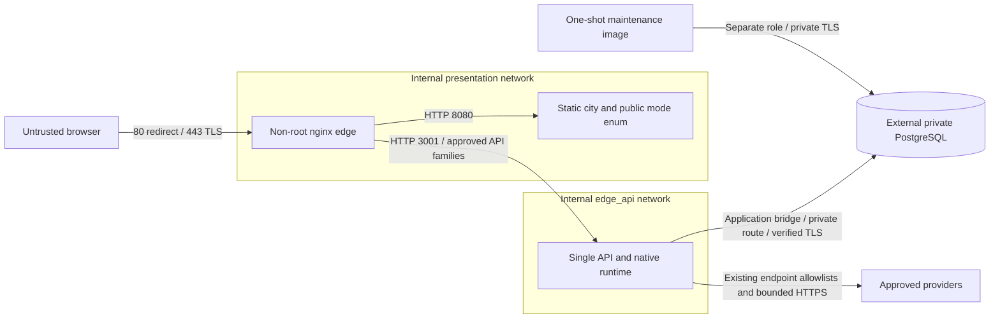

# T06 ? Edge and private network configuration

Review: 2026-11-05, Asia/Bangkok. **COMPLETE for locally verified private-operator edge/network packaging.** This is local production-like packaging, not permission to expose or deploy an installation. T02 audience, database supplier, DNS, renewal ownership, administrative access and host/provider firewall decisions remain deployment gates.

## Audit and scope

| Requirement | Before T06 | Implemented boundary |
| --- | --- | --- |
| Topology | COMPLETE: T01 one host/static web/single API/private external PG | Preserved; no worker, broker, Redis, new provider or runtime |
| Reverse proxy and TLS | MISSING | One pinned non-root nginx edge target and explicit production Compose overlay |
| API/web private networks | PARTIAL: T05 no published ports | Separate internal edge/API and edge/web networks, API-only database/egress bridge |
| Configuration and authentication | COMPLETE for private operators | T02 validation and T03/T04 bearer/owner contracts unchanged |
| Forwarded headers | PARTIAL: backend distrusts them | Edge overwrites forwarding metadata; backend proxy trust remains disabled |
| Ingestion | COMPLETE trusted internal adapter boundary | No public webhook/event route created or routed |
| Real-time transport | COMPLETE bounded polling | Ordinary authorized HTTP, no invented SSE/WS upgrade route |
| Limits/headers/logging | PARTIAL existing app bounds | Bounded edge budgets, verified CSP and minimal structured diagnostics |
| Container/integration evidence | MISSING | `test:edge` extends the disposable T05 TLS/PostgreSQL harness |
| Documentation | MISSING | This guide, ADR and verification manifest |

The maintained Canvas/ES module frontend is static, not Next.js/SSR. Default public viewing is decorative city only. Protected Agent, Task, Execution, collaboration and external-observation data still requires backend authorization. Native/external execution authority is unchanged. No source file in `dist/`, backend lifecycle, migration or external adapter is modified. The API HTTP parser receives one narrow compatibility fix: its bounded aggregate header budget is 24 KiB, accommodating the existing 16 KiB bearer plus edge metadata; a real HTTP test proves larger input is still rejected.

## Topology and trust



| Service | Exposure |
| --- | --- |
| Edge | Only published ports: host 80 to 8080, host 443 to 8443; no host networking or privileges |
| Web | Edge-accessible only, internal presentation network; no API/DB attachment or Internet egress |
| API | Edge-accessible on internal edge_api; separate application bridge for approved private DB/provider routes; no published port |
| Migrator | Maintenance profile only, application network and separate DB secret; no public route |
| PG | External private endpoint; no PG service/host port added. Isolated TLS PostgreSQL exists only in tests |
| Workers/messaging/cache | Not present; not fabricated |
| Ingestion/admin/readiness | Internal adapter/CLI/namespace boundaries, no public ingress |

The edge is not attached to the API's database network; the web cannot address API directly. Containers drop ALL capabilities, retain no-new-privileges/read-only roots and bounded tmpfs/CPU/memory/PIDs/log rotation. An internal Compose bridge isolates the attached services; it is not a domain-aware host firewall. The API application bridge intentionally retains outbound connectivity. Existing provider origin/DNS/address pinning, TLS/no-redirect checks and response/time limits still enforce application egress policy. There is no new open forward proxy. Operators must implement approved private routing, host/provider egress and administrative VPN/MFA rules for their selected host before exposure; this task does not provision those controls or claim the Docker host administrator is untrusted.

## TLS, configuration and certificates

Build the `edge` target in the existing Dockerfile. It shares T05's exact pinned nginx 1.30.6 Alpine slim digest and runs UID/GID 101:101, SIGQUIT and namespace-only health at 127.0.0.1:8081. There are no package/dependency upgrades, credentials or certificates in the image. The allowlisted build context excludes private PEM/key files.

New edge configuration:

| Variable | Class and contract |
| --- | --- |
| `EDGE_IMAGE` | Compose non-secret reviewed immutable image reference |
| `EDGE_HOST` | Public canonical lower-case DNS hostname, bounded labels; no URL, directives, wildcard, whitespace or substitution |
| `EDGE_HTTPS_PORT` | Edge-image public TLS authority port, integer 1?65535, defaults 443; production overlay fixes 443; random local test port only in the harness |
| `EDGE_HSTS` | Image enum `on`/`off`, defaults on; production overlay fixes on; disposable local certificate test disables it |
| `EDGE_TLS_CERTIFICATE_FILE` | Compose operator path to full-chain PEM, mounted read-only as `/run/secrets/tls_certificate` |
| `EDGE_TLS_PRIVATE_KEY_FILE` | Compose operator path to unencrypted matching PEM key, mounted read-only as `/run/secrets/tls_private_key`; never an environment value |

The shell entrypoint narrows hostname/port/HSTS before rendering a fixed template; there is no arbitrary `envsubst`, eval or nginx-directive input. It checks bounded regular non-symlink readable files and rejects permissive Linux key modes (only 0400/0440/0600/0640). The nginx master itself runs non-root: the operator must supply real compatible host owner/group ACLs, for example root:101 0440 on a Linux host. Compose file-backed secrets do not automatically translate UID/GID/mode or encrypt host files. Windows/Docker Desktop bind semantics are not certification of Linux host ACLs. Keys and full chains must each fit 64 KiB. `nginx -t` checks parsing, key/chain compatibility and readability before a listener starts. No certificate is generated automatically by production startup.

TLS 1.2/1.3 with explicit modern TLS1.2 AEAD suites, no session tickets, finite shared session cache and no early data. Unknown SNI rejects the handshake; unexpected HTTP authority cannot redirect to an attacker-controlled host. HTTP uses a fixed canonical HTTPS authority and preserves method/path/query with 308. This profile terminates TLS directly; it does not trust an upstream load balancer or add a second termination tier. HSTS is one year, without includeSubDomains/preload, on the production profile only. The disposable local test explicitly disables HSTS.

An operator must own real DNS, CA issuance, expiry monitoring and renewal before deployment. ACME/certbot, automated renewal, paid CA accounts and DNS provisioning are not introduced. Renew off-container into protected host files; validate the pair with the same image and `nginx -t` against the proposed mounts before switching. Replace the reviewed mounted pair together, test and perform controlled reload/recreation; keep the previous valid pair for rollback. Docker bind mounts can keep the old inode after atomic host replacement: prefer a controlled recreation with the reviewed pair rather than assuming a host rename updates mounts. Readiness of edge is not certificate-expiry or API-readiness monitoring.

## Routing, principal and origin contracts

Static directory slash redirects are relative (`absolute_redirect off`) so the private web port/HTTP scheme cannot leak into a public HTTPS Location. This was confirmed by a local probe of the previous behavior and verified through TLS after correction. Same-origin `/` and exact static paths go to web; `/api/v1/` retains its prefix. Only existing controller families auth/login, auth/me, auth/logout, agents, tasks, executions, cities, collaborations and collaboration-activity are routed. Unknown API families return 404. `/ready`, metrics, admin, internal, debug, webhooks and dot files are blocked. No provider webhook, account CLI, migrator or internal control route is added. Public `/health` is a constant minimal edge liveness result, not a DB/API/provider readiness claim. API's `/ready` remains a real-loopback-only probe, never a forwarded-header bypass.

The browser uses the unchanged backend bearer contract: JSON local login, `/auth/me`, memory-only Authorization, explicit logout/revocation; or an already-issued OIDC API access JWT. No cookies, provider redirect callbacks, refresh/PKCE or cookie CSRF scheme is invented. There is no provider secret in public config. `Origin` and Authorization are preserved; backend exact Origin/CORS/object authorization remains authoritative. The edge adds no conflicting CORS headers. Set the actual backend `CORS_ORIGINS` and `PUBLIC_ORIGIN` to `https://EDGE_HOST`; set the existing non-secret access mode enum to the selected backend mode. A mismatch fails closed rather than relaxing authorization.

The only trusted transport chain is direct client ? edge ? private API. Edge overwrites Host, X-Forwarded-Host, X-Forwarded-Proto, X-Forwarded-Port, X-Forwarded-For, X-Real-IP and X-Request-Id; it drops Forwarded, Upgrade/Connection and common spoofed identity headers. It never appends an untrusted forwarding chain. Express `trust proxy` remains disabled; no source CIDR or hop is implicitly trusted by backend authorization, client-IP or secure-cookie logic. Edge logs its actual socket peer. A future external LB/CDN requires separately reviewed peer authentication/IP policy; setting blanket trust-proxy or trusting a public header is unsupported.

Only ordinary bounded HTTP polling exists for runtime/collaboration snapshots/events/cursor recovery. Authorization is rechecked on each request/reconnect; buffering stays enabled, no upgrade is advertised. Upgrade attempts are rejected. No competing SSE/WebSocket transport or per-NPC connection is added. No automatic retry of a mutation is allowed at the proxy (`proxy_next_upstream off`); uncertain outcomes remain governed by existing idempotency/persistence/reconciliation.

## Limits, headers and diagnostics

64 KiB body limit matches the backend; client headers 10s, body inactivity 15s, keepalive 15s, upstream connect 3s, send 30s, API read inactivity 45s (native HTTP deadline 30s plus bounded cancellation), static upstream read 30s, downstream send inactivity 30s. These are nginx inactivity/phase bounds, not a new absolute Execution deadline. Header buffers are two 20 KiB buffers (accommodating the existing maximum 16 KiB bearer); oversized bearer/header input is rejected instead of unbounded allocation. No upload feature requires a larger request allowance. API per-peer budget 20 requests/sec plus burst 40, login 6/min plus burst 5, 32 simultaneous active requests, 429 rejection. These are conservative private-pilot controls, not capacity benchmarks; shared NAT fairness and tuned load acceptance are T14. The backend's durable installation login budget remains intact. Internal probes/maintenance do not traverse public rate limiting.

Security headers: nosniff, no-referrer, frame denial, restricted camera/microphone/geolocation, self-only scripts/connect, no objects/base/frame embedding/form destinations outside self, no worker. Inline styles remain explicitly allowed because the existing city/panels set dynamic styles; inline script/eval and third-party code remain denied. Self/data/blob images support existing canvas assets. No city HTML/CSS/renderer is changed. nginx retains current static caching behavior; no aggressive immutable caching scheme is invented.

Safe JSON access logs contain generated request ID, method, route class, status, duration, actual socket peer and upstream status. No URI/query, request body, Authorization, cookies, referrer or provider payload is logged. Error logging is critical-only to avoid nginx's default raw-request diagnostics; status/latency logs retain upstream failure visibility. API's safe route-template logs remain unchanged. The upstream static web server also uses minimal method/status/duration/generated-ID JSON and critical-only errors, replacing its raw combined request log so a static URL query cannot leak behind the redacted edge. A query-marker test checks both services. Proxy-generated transport failures become a generic 503 without exposing internal hostnames or a raw nginx error page; authoritative backend status/error bodies are passed unchanged, including safe lifecycle/deadline diagnostics. No auth redirects, CORS bypass or identity decisions are made by the edge.

## Local verification and operation

Do not run this against a production database or reuse real credentials. Existing development Compose remains unchanged. Production-like tests create labelled private networks, synthetic DB roles/accounts, one-day local TLS certificates, random loopback ports, real API/web/edge processes and Chromium with a certificate-specific SPKI pin. No global TLS verification disablement or production DNS/IdP is required. Cleanup verifies ownership labels and temp paths, never removes user volumes.

```powershell
docker build --target api -t elyqreth-t05-api:verification .
docker build --target web -t elyqreth-t05-web:verification .
docker build --target edge -t elyqreth-t06-edge:verification .
npm.cmd run test:edge
```

The first two local tags are reused T05 build/test targets, not release tags. The edge harness reuses its DB/schema/secret/native workflow and additionally tests TLS/redirect/host rejection, assets, CSP/browser login/polling/reconnect/logout, 401/403, CORS, request limits, forwarding-header replacement against a disposable echo peer, direct API/readiness/DB network isolation, outage classification, log redaction and the merged Compose model. Fixtures are test-only, never provider production functionality.

For an explicitly approved future environment, validate operator paths and references without printing secret values:

```powershell
docker compose --env-file PATH_TO_PRIVATE_COMPOSE_INPUTS -f docker-compose.production.yml -f docker-compose.edge.yml config --quiet
```

This validates the production overlay but does not deploy it. The same protected input file extends T05's existing variables with EDGE_IMAGE, EDGE_HOST and the two TLS file paths; it must contain no raw credential values. Only edge ports 80/443 are published. The maintenance profile remains separately invoked; API startup never launches migrations. Startup ordering waits for web/API health and edge config validation. Runtime dependency failures return 503; edge liveness does not silently claim backend readiness. Reconnection uses existing frontend session/snapshot recovery. A confirmed 401 clears protected state. As required by T04, an authentication recheck during a network outage suspends/clears protected access and requires explicit sign-in; the edge does not fabricate session continuity or retry credentials.

Troubleshooting: missing/unsafe key or malformed hostname stops startup; correct protected mounts rather than changing users/permissions broadly. A bad chain/name is a certificate issue, not a reason to disable verification. 401 requires reauthentication; 403 origin/scope mismatch must not trigger token fallbacks. 404 readiness/admin is expected externally. 413/429 requires bounded legitimate input/budget review, not unlimited settings. For 503 check private DNS, API namespace-local readiness and existing lifecycle/recovery state. Do not replay uncertain native work or create a second API writer as a traffic workaround.

## Evidence and limitations

Final commands, exit codes, historical failures, protected-file hashes and acceptance status are recorded in [T06 evidence](verification-evidence/edge-network-verification.json). The final manifest records completed local checks, including real Chromium and PostgreSQL; no live production verification is claimed. No production DNS/certificate/vendor/private database, external ingress protocol, remote service, firewall provisioning or paid resource is created. Live provider/IdP connectivity, backup, role hardening, full active-writer drain, production load and promotion remain their ordered roadmap gates.

Primary configuration references: [nginx proxy directives](https://nginx.org/en/docs/http/ngx_http_proxy_module.html), [nginx TLS directives](https://nginx.org/en/docs/http/ngx_http_ssl_module.html), [Docker Compose networks](https://docs.docker.com/compose/how-tos/networking/). Local behavior must pass the actual pinned-image tests; documentation alone is not acceptance.

## Final verification results

| Command | Exit | Outcome |
| --- | --- | --- |
| `npm.cmd run lint` | 0 | Frontend syntax/strict types and backend types |
| `npm.cmd run test:api` | 0 | 304/304, including the real header-budget regression |
| `npm.cmd test` | 0 | 238/238 frontend regressions |
| `npm.cmd run test:db` | 0 | 221/221 real persistence/native/external/authentication/browser tests |
| `npm.cmd run build` | 0 | Backend production compilation, also rerun by API/DB suites |
| `npm.cmd run build:web` | 0 | Disposable production bundle; maintained city source unchanged |
| `docker build --target api -t elyqreth-t05-api:verification .` | 0 | Final T06-compatible API image |
| `docker build --target web -t elyqreth-t05-web:verification .` | 0 | Unchanged static source in pinned web image |
| `docker build --target edge -t elyqreth-t06-edge:verification .` | 0 | Final pinned edge image |
| `npm.cmd run test:edge` | 0 | Complete TLS/network/auth/browser/renewal suite plus inherited T05 readiness/shutdown/persistence checks |
| `npm.cmd run test:docker` | 0 | Existing development Compose, eleven migrations and browser/city smoke, zero exceptions |
| `nginx -t -c /tmp/edge-nginx.conf` inside owned edge | 0 | Executed by edge suite, valid key/config; intentionally mismatched renewal pair separately rejected |
| Merged `docker compose ... config --format json` | 0 | Executed by edge suite with owned fixture paths, only edge publishes ports; maintenance remains separate |
| `python docs/ai-agent-platform/phase-6/verification-evidence/check_configuration.py` | 0 | Twelve documents, relative links, inventory and touched-file whitespace |
| `git status --short`, `git diff --check` | 128 / 129 | BLOCKED by absent Git metadata; baseline hashes and independent text checks used |

Failed development attempts are not passed acceptance: an encoding issue in the modified harness was corrected; nginx scratch paths and duplicated upstream security headers were fixed; a direct typed assignment to an undeclared Node server field did not compile and was replaced by the tested bounded runtime assignment. The actual preflight denial and city polling path replaced incorrect test assumptions. A browser online event sent before edge availability correctly cleared protected access; the test now waits for verified HTTPS before revalidation. The original frontend build attempt hit the sandbox filesystem boundary; the approved unrestricted build passed. The final successful commands above are recorded separately from these failures. No authorization checks/assertions were removed to pass a defect.

Code review also disabled upstream response interception: authoritative API lifecycle/error responses pass through, while nginx-generated transport errors receive the generic outage response. A disposable echo peer verifies both cases. The final edge/browser run verifies session expiry, reauthentication, CSP compatibility and certificate rollback/renewal; the separate development smoke verifies existing camera, simulation/NPC, mobile and account-component behavior. These are not FPS, visual-diff, long-duration, load or accessibility certification claims. The one narrow API header change is covered by a fresh real HTTP test and the complete backend/database regressions.

## T07 migration configuration compatibility

Compose configuration now additionally requires DATABASE_MIGRATION_TARGET for the maintenance service. Set it to the reviewed target database name; it is not an API or browser credential. Runtime, migration and bootstrap credentials remain isolated, with no new host ports or edge routes. See [database role/migration guide](database-migrations.md).
