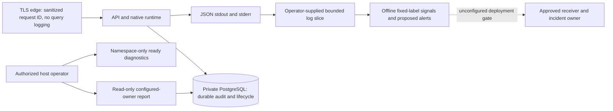

# T11 Observability and production runbooks

Status: **PARTIAL**. Local telemetry, diagnostics and runbooks are implemented and tested. A subsequent user request selected email; the optional [host monitor and SMTPS sender](email-monitoring.md) are now locally fixture-tested, while actual SMTP configuration, recipient delivery and operational ownership remain unconfigured. On 2026-11-06 the user chose to document these deployment gates. No external notifications are sent. [Executed evidence](verification-evidence/observability-verification.json) separates local fixtures, disposable infrastructure and unexecuted production operations. T12 now has separate [local immutable-artifact preparation](immutable-promotion.md), still PARTIAL with publication/deployment closed.

## Audit and implementation boundaries

| Area | Recovered state | T11 outcome |
| --- | --- | --- |
| Logging | JSON API/runtime/provider logs; arbitrary fields and envelope overrides possible | Closed event/field policy in the existing ApiLogger; credentials, payloads and arbitrary errors omitted |
| Correlation | Validated request IDs, AsyncLocalStorage, runtime UUID context, durable command/event correlations | Explicit response-close context, concurrent isolation tests; identifiers remain diagnostic data, never credentials |
| Runtime | T09 lifecycle, leases, drain logs and private runtime snapshot | Preserved; secondary finalization failures now observable without changing durable outcomes |
| Database | T05 bounded readiness and T07 schema/role validation | Categorized readiness transitions and safe in-process pool snapshot |
| Collaboration | Persisted sessions, delegations, audit and read APIs | Owner-scoped host report joins investigation through stable references; no lifecycle engine added |
| External ingestion | Authenticated grants, durable inbox, deduplication, operation duration/categories | Denial diagnostic without untrusted identity; projection outcome logged after commit, effective duplicate transitions suppressed |
| Metrics/traces | No exporter, collector, distributed tracing backend or monitor installed | Bounded offline log summary and deterministic alert fixtures; collection limits documented |
| Runbooks/responders | T07-T10 component procedures; no named incident owner/receiver | Consolidated incident procedures below; ownership, delivery, retention and production baselines remain gates |

Architecture remains one API process hosting native runtime plus static web, one TLS edge, private PostgreSQL and explicit maintenance commands. There is no separate worker, RabbitMQ, Redis, queue consumer, provider polling scheduler, public webhook, or new metrics/admin server. The browser uses existing authorized HTTP polling, not a new transport. Nothing here changes city rendering, NPC behavior, runtime ownership, provider capabilities or authentication.

### Reconstructed requirement status

COMPLETE below means the supported local implementation or documentation contract; it does not mean production monitoring is deployed.

| T11 requirement | Status | Evidence / limit |
| --- | --- | --- |
| Architecture audit | COMPLETE | Actual producers, stores, endpoints and absent infrastructure identified |
| Structured logging and redaction | COMPLETE | Closed policy, immutable envelope, request/config credential and payload tests |
| Request/execution correlation | COMPLETE | Concurrent request isolation and existing persisted runtime/audit correlation; no nonexistent queue boundary claimed |
| API diagnostics | COMPLETE | Template/status/duration, safe errors and actual HTTP tests |
| Native lifecycle/drain diagnostics | COMPLETE | Existing T09 snapshots/signals plus unresolved-finalization diagnostic and real PID1 tests |
| Task/Execution investigation | COMPLETE | Existing APIs/audit and bounded read-only host report; latest20 is not whole backlog |
| Collaboration/delegation investigation | COMPLETE | Durable parent/child references, audit and existing projection/recovery tests |
| External integration diagnostics | COMPLETE | Existing operation category/duration, fixtures and source-scoped metadata; production target closed |
| Trusted ingestion diagnostics | COMPLETE | Denial without untrusted IDs, committed outcomes, duplicate/stale tests |
| Database/messaging health | COMPLETE | Bounded private dependency/pool checks and actual outage; no messaging service exists |
| Health/readiness access | COMPLETE | Actual remote-container denial and edge isolation; no public metrics/admin route |
| Metrics architecture | COMPLETE | Fixed-label local detector and explicit collection limitations; no deployed exporter |
| Tracing readiness review | COMPLETE | Existing correlation foundation documented; no distributed tracing claimed |
| Security audit visibility | COMPLETE | Durable audit preserved, actor attribution and owner isolation tested |
| Incident categories/runbooks | COMPLETE | Sixteen procedures using supported commands and component recovery guides |
| Alert detection | COMPLETE | Local synthetic threshold, recovery, malformed-line and cardinality fixtures |
| Off-host alerts and responders | BLOCKED | Optional SMTPS sender/runner fixture-tested; actual SMTP sender/recipient and incident owner remain deployment gates, no external notifications |
| Failure verification | PARTIAL | Local dependency/drain/provider/auth/collaboration cases; no production delivery, storage-exhaustion or incident tabletop proof |
| Container/browser compatibility | COMPLETE | Existing TLS/session/city/drain/restart rehearsal with new diagnostic checks |
| Documentation and roadmap | COMPLETE | Guide, ADR015, accurate PARTIAL status and exact executed evidence |

No missing provider, broker or monitoring service is added to turn an inapplicable requirement into a new feature.



## Log contract and privacy

ApiLogger is the only application JSON logger. Records carry timestamp, level, service=elyqreth-api, environment, component and a fixed event name. Unknown names become telemetry.rejected. Envelope fields cannot be overridden. The policy in apps/api/src/common/log-policy.ts is the executable allowlist: validated UUID references, bounded request IDs/tokens, route templates, finite nonnegative counters/durations, lifecycle flags and restricted startup messages. Objects, arrays, errors, stack traces, getters, custom serialization, raw URLs, query strings, payloads, SQL parameters, model strings and arbitrary messages are omitted. Request-scoped Bearer/cookie values and configured DB, feature and provider credentials are excluded from string fields. Do not deliberately place credentials in identifiers; redaction is defense in depth, not authorization.

Authorization and Cookie headers are held only in a private request-context WeakMap for redaction, never serialized or persisted. Concurrent request contexts and asynchronous response-close logging retain the correct request ID. Incoming X-Request-Id is bounded/validated; at the production edge it is overwritten. A valid client ID is still untrusted correlation data. Existing correlation UUIDs persist through task/execution/delegation commands and audit. Use command_audit and lifecycle event history to follow an operation across retries; not every asynchronous event inherits an HTTP context. Correlation is not a distributed trace or proof of actor identity.

HTTP logs contain method, matched route template, status and duration. Unmatched paths have a fixed label. Bodies, query parameters, cookies and auth headers are absent. 401, 403, validation errors, rate rejection and 5xx remain distinguishable by status; denied resource details are not logged. Successful health requests are sampled at most once per minute and readiness requests omitted. Runtime logs describe actual admission, attempt, cancellation, timeout, drain and recovery outcomes. runtime.failure means diagnostic/context/finalization failure requiring durable-state inspection; it must not be counted as a completed Execution. provider.transport.completed records low-level transport separately from strategy provider.completed; neither proves durable execution success. A refused log write must not change an authorization decision or committed result.

Logs are operational evidence, not a replacement for durable command_audit, agent_events and inbox records. Host operator access to a bounded owner-scoped audit report is privileged maintenance access. Browser access continues through existing principal/object-authorized APIs. Audit details, prompts, tool outputs and provider result bodies are deliberately absent from the report and metrics. Keep raw diagnostic output private: it contains UUIDs, statuses and actor attribution. Log retention/export permissions and audit retention require approval. Existing Compose log rotation remains 10MB x3 per application container; this is not off-host retention or lossless archival. Synchronous write isolation does not guarantee delivery under disk exhaustion/process kill; sink failure and host disk monitoring need deployment verification.

## Safe operational access

Run from an authorized host with the reviewed non-secret Compose inputs and existing T05 secret mounts. Container exec is host administrative authority; it is not a public API permission. These commands only read state:

```powershell
docker compose -f docker-compose.production.yml -f docker-compose.edge.yml ps
docker compose -f docker-compose.production.yml -f docker-compose.edge.yml logs --no-log-prefix --since 5m api
docker compose -f docker-compose.production.yml -f docker-compose.edge.yml exec -T api node -e "fetch('http://127.0.0.1:3001/ready?diagnostics=true').then(async r=>{console.log(r.status);console.log(await r.text())})"
docker compose -f docker-compose.production.yml -f docker-compose.edge.yml exec -T api node apps/api/dist/operations/diagnostics-command.js
```

The existing /ready route accepts only actual namespace loopback GET/HEAD; spoofed forwarding headers, remote containers and public edge access do not grant access. diagnostics=true adds started/draining, last dependency observation, pool configured/total/idle/waiting/ended and the T09 runtime snapshot. It does not expose hostnames, database URLs, schema SQL, credentials or payloads. No additional dependency queries are run for the snapshot. A host report uses the validated configured owner and T07 runtime role, a read-only repeatable-read transaction, a 2s per-statement bound and the latest 20 metadata rows per section. It is explicitly a sample, not a complete backlog or a stuck-work detector; older work requires existing paginated authorized APIs and durable history. No arbitrary owner/SQL flags exist. The report process opens no HTTP listener and its database context closes afterward. On failure it exits 1 with a generic safe error. Current schema/role preflight still applies.

Liveness /health means the process can respond, not that the DB/provider is ready. Readiness requires completed initialization, compatible DB/access policy and native admission. Draining is not-ready while liveness may remain good. Dependency categories include UNKNOWN, READY, NOT_CONFIGURED (development only), DATABASE_ACCESS, DATABASE_PERMISSION, DATABASE_CAPACITY, DATABASE_TIMEOUT, DATABASE_UNAVAILABLE, SCHEMA_INCOMPATIBLE and CHECK_TIMEOUT. Probes share the existing in-flight check, 1s cache and 1.5s deadline. Readiness transition logs occur only while serving and on category changes. Categories describe the most recent probe; no background monitor is implied. Optional external providers do not block native readiness. Pool counts do not by themselves diagnose a leak or supply historical saturation rates.

## Metrics, tracing and alert readiness

After npm run build, analyze a bounded reviewed slice locally:

```powershell
docker compose -f docker-compose.production.yml -f docker-compose.edge.yml logs --no-log-prefix --since 5m api | node scripts/operational-signals.mjs
```

The offline detector accepts stdin only, no credentials, network destination or arbitrary selectors. The separate optional [host email monitor](email-monitoring.md) reuses this detector and existing private diagnostics; it is not installed or activated automatically. It emits fixed event counters, four HTTP status classes and six disjoint duration upper-bound buckets (100/500/1000/5000/30000/infinity ms). Labels never contain routes, IDs, users, tenants or connections. Lines over 8KiB and malformed JSON are counted/discarded. No input payload is echoed. Exit 0 means no proposed condition matched that slice, 2 means alerts detected, 1 means command failure. This is not a daemon, Prometheus endpoint, historical rate/percentile service or current-health oracle. Missing logs, restarted counters, mixed container slices, sampling and malformed lines limit interpretation. No telemetry proves successful backup restoration or external execution completion.

| Proposed condition in supplied slice | Severity | First action / runbook |
| --- | --- | --- |
| Latest dependency category is a failure | Critical | Probe current namespace readiness; database/API incident |
| At least 5 HTTP 5xx | Warning | Identify route templates/statuses and request correlations; API incident |
| Any drain deadline | Warning | Inspect durable attempts and runtime diagnostics; drain incident |
| Any runtime.failure or shutdown failure/deadline | Critical | Preserve uncertain work and investigate leases/finalization |
| At least 3 external auth failures | Warning | Check configured source/grants/rotation; external/auth incident |
| At least 3 external transient/timeout/rate failures | Warning | Respect existing bounded retry and provider authority |
| Any ingestion authorization denial | Warning | Check trusted grant without copying credentials |
| At least 3 deferred/failed projection transitions | Warning | Inspect source-scoped receipt/mapping history |
| Backup/restore command nonzero, stale verified recovery point | Proposed critical, not collected by detector | Existing backup receipts and scheduler exit status; backup/restore incident |
| API/runtime readiness absent, no logs, host storage or pool saturation | Proposed critical after approved duration, not collected by detector | Independent private probe/host monitor and owning runbook |

Counts are proposals, not approved production thresholds or SLAs. The operator chooses the slice (5m above is an example); no rate/window is silently inferred. Agree baseline, maintenance suppression, clear/recovery behavior, delivery exhaustion, silence detection, retention, storage alerts and escalation before enabling notifications. The user has no designated incident owner or receiver yet: name both, approve access/retention and exercise delivery/recovery before deployment. Only local synthetic detection is tested. The optional [email sender and monitor](email-monitoring.md) are implemented with local TLS SMTP fixtures. Real notification integration, off-host storage, real delivery failure, sustained disk-full behavior and production incident tabletop are **NOT RUN**.

There is no distributed tracing SDK/exporter/backend. Existing validated request IDs, runtime context and durable correlation UUIDs are tracing-readiness foundations only. W3C trace headers do not become authentication or unbounded metric labels; future tracing requires separate review, payload exclusion and bounded attributes. No external trace endpoint or vendor credential is added.

## Incident runbooks

Shared preconditions: authorized operator on the correct host/release, read-only diagnostic access first, known environment/owner, no secrets in terminal capture. Capture UTC timestamp, safe request/Execution/correlation IDs, component state and command exit status. The commands above are the supported first investigation for every incident. Inspect private output locally; do not paste raw artifacts into tickets. Escalation currently means preserve evidence and request a designated service/security/DB owner; do not assume someone receives a page. Every mitigation requires verifying readiness and the affected durable record through an authorized API/report afterward. Never delete Tasks/Executions, rewrite terminal states, force-clear leases, disable auth/verification, rerun uncertain effects or use a restore as an ordinary restart.

### 1. API startup or readiness failure

Purpose: distinguish invalid config, DB/schema/access failure and admission drain. Permission: host read/log access; change authority only for reviewed configuration. Run ps/logs and the namespace probe above. Expected: status ready/200, dependency READY and runtime READY when admission is enabled. Check safe startup_failed field names and categories, T02 required inputs and T07 schema compatibility. Correct only the identified configuration/secret reference using approved rotation, then restart under the [container procedure](container-hardening.md). Do not replace production settings with development defaults. Verify readiness and authenticated /auth/me. Escalate unexplained schema drift, repeated crashes or missing diagnostics.

### 2. Native worker responsibility unavailable

Purpose: diagnose native execution availability. Permission: same host/runtime access. There is no dedicated worker container; inspect api runtime snapshot and logs. Expected READY/admitting with bounded active work; DRAINING/STOPPING is intentionally unavailable. Inspect DB category first, then admission conflicts and lease/recovery records in the host report. Follow [runtime troubleshooting](runtime-drain.md), without starting a second writer. Verify one healthy native host and unchanged external observation authority. Escalate unresolved ownership or finalization failures.

### 3. Graceful runtime drain

Purpose: stop new native work while preserving in-flight state. Permission: explicitly authorized maintenance/restart. Capture namespace snapshot, then use the existing Linux native-only drain command:

```powershell
docker compose -f docker-compose.production.yml -f docker-compose.edge.yml kill -s SIGUSR2 api
```

Expected DRAINING, admitting=false, readiness503, liveness200; in-flight work may finish. Observe runtime.drain.started/completed/deadline. The signal name does not indicate an external cancellation. Use the [T09 drain contract](runtime-drain.md) and existing bounded policy; do not send repeated execution commands to compensate. Verify durable terminal/uncertain states. Escalate a deadline or finalization failure before resubmission.

### 4. Worker/API restart or deployment replacement

Purpose: bounded process replacement, not schema rollback. Permission: approved maintenance and compatible image/schema manifest. After drain inspection:

```powershell
docker compose -f docker-compose.production.yml -f docker-compose.edge.yml stop -t 45 api
docker compose -f docker-compose.production.yml -f docker-compose.edge.yml start api
```

Expected orderly drain/stopping/stopped or recorded deadline within container grace; startup revalidates config/schema and becomes ready. Never scale a second native writer as mitigation. Confirm pending/running/uncertain records and one effective attempt via [restart runbook](runtime-drain.md); do not automatically re-execute. Escalate nonterminal uncertain effects, failed shutdown or incompatible schema. Release promotion remains T12 work.

### 5. Stuck Execution investigation

Purpose: determine pending, running, cancelled, expired-lease or uncertain state. Permission: owner-authorized application read plus host report. Use taskId/executionId/correlationId from report/logs to inspect existing Task/Execution APIs and audit. Expected durable authority/status/lease, not a frontend-only status. Latest20 may omit older work; use existing pagination. Follow [native recovery](../phase-5/lifecycle-recovery.md) and [T09](runtime-drain.md). Do not infer success from transport completion or replay tools. Verify terminal stability or an explicit reconciliation requirement. Escalate possible external side effects for manual investigation.

### 6. Runtime recovery or drain timeout

Purpose: recover safely after interruption. Permission: authorized runtime operator. Gather runtime.failure/deadline/conflict, ownership/lease and reconciliation state. Existing recover policy preserves cancel/timeout intent and fences stale completions; a lease expiry is not permission to replay uncertain effects. Follow [T09 recovery procedure](runtime-drain.md) and use only supported authorized lifecycle controls. Verify no duplicate effective child work and terminal states unchanged. Escalate unresolved effects, repeated recovery failure or an increasing backlog; do not edit database statuses.

### 7. Collaboration or delegation failure

Purpose: retain parent/child attribution and accurate failure. Permission: configured-owner read/authorized collaboration controls. Inspect collaborations/delegations, child Task/Execution IDs and audit correlations in host report and existing collaboration inspection. Expected durable participant/parent/child relationships and authoritative terminal state. Follow [collaboration failure/recovery](../phase-5/lifecycle-recovery.md) plus [runtime admission](runtime-drain.md). No new child execution may bypass drain. Verify one effective child and correct parent summary after supported reconciliation. Escalate inconsistent references or ambiguous child effects; never delete delegation rows.

### 8. Database connectivity, capacity or permission failure

Purpose: identify dependency cause without exposing connection strings. Permission: host probe/log access; DB administrator for infrastructure changes. Inspect readiness category and pool waiting/total/idle, private DB route, TLS CA/hostname, file-secret presence and reviewed runtime role. Expected DB READY; liveness can remain200 during outage. Do not log URLs/passwords or grant runtime DDL. Follow [T07 access/preflight](database-migrations.md). Restore approved connectivity or correct role policy, then re-probe and inspect pending durable work. Escalate saturation, unexpected role elevation, repeated permission errors or storage faults.

### 9. Migration failure

Purpose: stop unsafe deployment progression. Permission: separate migration-role workflow, not runtime credentials. Capture safe error/exit, pending journal state and compatibility manifest. Read-only preflight command:

```powershell
docker compose -f docker-compose.production.yml --profile maintenance run --rm migrate node docker/api-start.cjs preflight
```

Expected compatible target, verified history and bounded lock behavior. Apply changes only through the [T07 approved migration sequence](database-migrations.md), with backup/recovery approval. Do not edit journal or auto-rollback irreversible changes. Verify journal/schema and application readiness before traffic. Escalate partial nontransactional changes, drift or unknown target identity.

### 10. Backup failure

Purpose: preserve last verified recovery point. Permission: dedicated backup workflow, protected input/key/storage access. Capture command nonzero, safe receipt/metadata and disk/private storage availability. Use exact [T08 backup/verify commands](backup-recovery.md), which accept protected JSON on stdin; never put credentials on command line. Expected encrypted artifact plus verified metadata; successful dump alone is insufficient. Do not run retention following a failed backup, remove last-known-good artifacts or expose recovery keys. Verify copied artifact and repeat isolated restore as scheduled. Escalate stale protection, key loss or failed off-host copy; no scheduler exists here.

### 11. Restore verification failure

Purpose: diagnose corruption or restore incompatibility without changing user data. Permission: isolated disposable target and migration/key authority. Record checksum/authentication/format/target/schema failure category, then follow [T08 isolated restore](backup-recovery.md). Expected empty explicit target, authentic artifact, preserved migration metadata/constraints/relationships and safe runtime state. Stop at failure; do not overwrite an existing DB or mark invalid artifact restore-tested. Verify alternative protected recovery point in isolation. Escalate missing keys, failed data integrity or any proposed production cutover, which requires separate explicit approval.

### 12. External orchestrator outage

Purpose: separate provider availability from execution outcome. Permission: source-scoped authorized operator. Inspect external.operation safe category/duration and latest mapping observation timestamps; verify connection credentials and provider policy privately. Expected bounded existing timeout/bulkhead and unrelated native readiness. Follow [T10 external incident runbooks](external-connectivity.md). Production activation remains closed with no approved target; use fixture evidence, not speculative live dispatch. Verify resumed observation only after approved reconnection. Escalate ambiguous dispatch/cancel outcomes; never fabricate external FAILED or resubmit uncertain work.

### 13. Ingestion authentication or webhook report

Purpose: investigate rejected trusted ingestion. Permission: source-scoped integration authority. Inspect external.ingestion.authorization_denied, HTTP status where applicable and configured grant identity through private configuration. There is no generic public webhook route or signature protocol: edge rejection is expected, not a missing feature. Follow [T10 credential/grant rotation](external-connectivity.md). Do not disable verification, print tokens/signatures or correlate by caller-supplied identity. Verify a newly authorized trusted command in safe fixtures; no production target exists. Escalate repeated denials, suspected compromise or unexplained source binding changes.

### 14. Event reconciliation backlog

Purpose: diagnose PENDING/deferred/out-of-order observations. Permission: source/owner read and supported reconciliation authority. Inspect source-scoped inbox status, processed time, mapping IDs and PROJECTION_* outcomes. Host report is latest20, not total backlog; existing activity pagination/history supplies context. Follow [T07 external inbox model](../phase-5/external-ingestion.md) and [T10](external-connectivity.md). Fix approved mapping/order conflicts and use only existing trusted replay; terminal receipts are idempotent and effective duplicate transitions are not logged again. Verify receipt/state/provenance without mutating native execution state. Escalate repeated processing failure or identity conflict.

### 15. Authentication or session incident

Purpose: separate401 invalid session,403 denied permission, network failure and intended logout. Permission: authorized private-operator security administration. Inspect route/status/requestId, safe principal contract and durable attribution; never collect browser bearer values. Follow [authentication modes](authentication-modes.md) and [frontend lifecycle](frontend-access.md). Preserve exclusive local/OIDC mode, exact issuer/audience and backend object authorization; do not disable auth or broaden CORS. Verify logout clears protected browser state and reauthentication loads only authorized data. Escalate cross-owner leakage, revocation failure or unknown credentials immediately.

### 16. Security incident investigation

Purpose: contain suspected credential/authorization compromise without destroying evidence. Permission: designated security/incident authority (currently unassigned deployment gate). Preserve private logs, timestamps, request/correlation IDs, scoped durable audit and release/config references. Use the report without audit.details; restrict export. Follow existing T03/T10 revocation/rotation contracts with explicit affected scope. Do not copy secrets into tickets, change terminal states, bypass signature checks, rerun external work or conduct destructive restores. Verify containment, revoked access and unchanged unrelated owner resources through authorized tests. Escalate to the designated security/service owner; until assigned, production operations must not be activated.

## Verification and remaining gates

The evidence file records exact commands, initial failures and corrections. Tests cover envelope protection, secret/cookie/token/query omission, asynchronous correlation, fixed cardinality, alert fixtures, real restricted-role owner isolation, duplicate/stale ingestion outcomes, namespace diagnostics and real database outage/recovery. Existing runtime/container/browser regressions exercise drain deadlines, forced termination, session cleanup, collaboration and city behavior. Local provider timeout/auth fixture coverage is distinguished from live provider operation. No production monitor, notification, ownership roster, disk-exhaustion drill, independent uptime probe, approved retention, business SLA or real incident tabletop is claimed.

T11 remains **PARTIAL** against the roadmap requirement for working off-host alerts and named responders. Required gates: designate incident/recovery/security owners and receiver; approve thresholds, retention and access; implement/rehearse loss/delivery/exhaustion/silence behavior in an authorized environment; establish production baselines. Next planned task is **T12 Immutable Artifacts & Controlled Promotion Pipeline**, subject to its D07/source-registry decisions and this unresolved operational gate. The T11 scope did not implement promotion; see the separate [current T12 preparation](immutable-promotion.md), which keeps publication/deployment closed.
