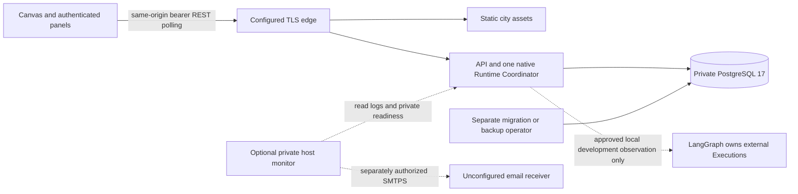

# Final acceptance and operations handover preparation

T16, 2026-11-07 (Asia/Bangkok). **Handover preparation COMPLETE; production acceptance NOT STARTED; production promotion CLOSED — DEFERRED BY PROJECT OWNER.** This prepares documentation, evidence and future checklists independently of private production configuration. It does not satisfy the original roadmap's deployed-acceptance gate, authorize production, or upgrade T02/T11/T12/T13/T14/T15.

Start with [local startup and Agent/provider connection](local-operations.md), then the [task/evidence/acceptance/deferred-prerequisite matrices](handover-evidence.md). The [machine-readable T16 report](verification-evidence/handover-verification.json) records exact commands, input hashes, scopes and limitations. The [T15 blocker register](verification-evidence/t15-blocker-closure-verification.json) remains authoritative for B01-B11; T16 P01-P13 are a deferred presentation of those requirements, not a second approval authority.

## Architecture and implementation inventory

The [architecture/ADR baseline](production-architecture.md) is a conditional design, not deployed infrastructure. Existing detailed [native](../phase-2/runtime-architecture.md) and [collaboration](../phase-5/architecture.md) diagrams remain applicable. This overview introduces no new services:

The edge/web/API relationships are container-tested locally. Actual hosting, DNS/TLS ownership, managed/private PostgreSQL and monitoring receiver are deferred. Development Vite can serve the city independently; do not expose it as a production edge. There is no separate worker, message broker, Redis/cache, upload store, public webhook or external dispatch implementation. PostgreSQL outbox/inbox rows are durable data, not an invented queue delivery guarantee.

| Component / source | Responsibility, dependencies and authority | Configuration / failure / operational entry |
| --- | --- | --- |
| `apps/api/src/main.ts`, `application.ts` | Nest API, validated startup and HTTP lifecycle | Backend-only environment/file inputs; invalid configuration/access/schema fails safely; [startup/security](authentication-modes.md), [health](observability.md) |
| `dist/`, runtime clients | Maintained static Canvas/NPC assets, protected panels and coalesced authorized polling | Public mode JSON only; session/401 clears protected data; [frontend](frontend-access.md). Preserve #F2F9FF design |
| `agents`, `tasks`, `lifecycle`, `executions` | Owner-scoped registry, optimistic versions, Task/Execution/result/history/audit persistence | Real owner/routes and principal; invalid state/foreign IDs denied; [registry](../agent-registry.md), [lifecycle](../phase-4/operations.md) |
| `runtime` | One native admission/coordination host, strategy/provider/tool execution, claims/leases/fencing and conservative recovery | RUNTIME_BINDINGS and explicit reviewed provider/tool profiles; business/provider/infrastructure failures remain distinct; [drain/recovery](runtime-drain.md) |
| `collaboration` | Durable participants, parent/child Tasks, delegation/continuation and cancellation/reconciliation | Same-owner bindings/version/capability limits; no arbitrary runtime or duplicate child creation; [coordination](../phase-5/native-coordination.md), [recovery](../phase-5/lifecycle-recovery.md) |
| `external-orchestrators` | One observation-only LangGraph adapter, source/identity mappings and authenticated internal receipt ingestion | Pinned endpoint/credential/source policies; external authority stays external; [connectivity](external-connectivity.md) |
| `city`, events/projections | Agent-to-NPC bindings, bounded activity/collaboration views, owner-stream cursors/outbox | Reads derive from canonical persisted outcomes, not frontend inference; [binding](../phase-3/npc-runtime-binding.md), [projection](../phase-5/collaboration-activity.md) |
| `auth`, `common` | Exclusive local accounts or OIDC verification, server-derived viewer/operator ownership, safe DTO/audit/log attribution | Memory-only browser bearer; no cookie/refresh/PKCE provider flow; [auth](authentication-modes.md), [principal policy](principal-authorization.md) |
| `database`, `apps/api/migrations` | PostgreSQL17 schema/journal/constraints and restricted runtime access; explicit migrator/bootstrap/backup identities | Migration command never runs inside API startup; fail-fast maintenance lock and exact journal; [T07](database-migrations.md) |
| Backup command and operational scripts | Encrypted custom dump, authenticated metadata, retention guard, explicit empty isolated restore | Independent key/target checks; off-host/escrow/scheduler not installed; [T08](backup-recovery.md) |
| Dockerfiles/Compose/edge | Non-root multi-stage images, private links, read-only runtime/resource caps, TLS edge | Secret mounts/private CA/production validation; readiness namespace-only; [T05](container-hardening.md), [T06](edge-network.md) |
| `.github/workflows`, `scripts/release*` | Read-only CI, manually gated candidate build/verify and promotion planning | OCI integrity and source/producer contracts; no publication or deployment transport; [T12](immutable-promotion.md) |
| Logger/operational-signals/private monitor | Bounded JSON logs, HTTP/execution/collaboration/source correlation, private diagnostics and optional SMTPS | No metrics server/tracing backend/real receiver claimed; [T11](observability.md), [email](email-monitoring.md) |

All component tests and older integration counts are indexed in the evidence matrix. Presence of a component is not evidence of a currently running service. No application source, dependencies, schema, renderer or behavior changes are part of T16.

## Security and operational responsibility

Current authentication is private single-owner access: local opaque DB-backed sessions or explicitly granted OIDC API tokens. Server principals derive owner/role; never trust user-supplied owner/Agent headers. Viewer access is private-team scope, not public self-service. Login/401/403/concealed404/revocation/version contracts remain authoritative. Browser bearer values/passwords are never stored in localStorage. There is no ambient session cookie or cookie-CSRF/refresh setting to configure. Use HTTPS for real deployments; do not invent signing keys for opaque sessions or disable TLS/origin/ownership checks to investigate a failure.

Runtime services receive runtime DB credentials only; migrator/bootstrap/backup identities stay separate. Secret *_FILE loading and verified CA/hostname rules do not prove an external secret manager or host ACLs exist. Rotate/revoke only using the exact [account/IdP procedure](authentication-modes.md), [external source/credential generation procedure](external-connectivity.md), [monitor procedure](email-monitoring.md) or [TLS procedure](edge-network.md), with actual operator authority. Do not print secret values, database URLs, prompts/tool outputs, session cookies, signatures or private payloads.

Only edge ports are intended to be public. Namespace-local readiness/diagnostics are not public admin APIs. Edge overwrites forwarding/request identity; API does not blindly trust proxy headers. Host/DNS/TLS/firewall/egress approval remains external. Structured logs/audit correlation is not authorization. Durable `command_audit`/events are not replaced by log files. Future named deployment, recovery, key, security and monitoring owners remain unassigned; use private contact references, not fabricated people. Production operational signoff is deferred.

## Native, collaboration and external recovery boundaries

Native Task creation/admission/claim/Execution/finalization remain separate. One coordinator may admit native work; drain synchronously closes admission, reports not-ready and allows bounded completion before conservative cancellation/quarantine. Liveness stays available during drain. Container grace/HTTP hard deadline are documented in T09. No queue consumer or fictional worker needs stopping. No resume signal exists; controlled restart follows the existing runbook. Cross-process lease/fencing and exact durable state prevent stale completion, but no general exactly-once external side-effect guarantee is claimed.

On a stuck/interrupted Task inspect canonical Task, attempts, Execution status/lease/deadline/cancellation, result/audit and known effects. Do not invent success from disconnect or retry uncertain work. The [collaboration recovery guide](../phase-5/lifecycle-recovery.md) distinguishes eligible never-admitted child recovery from uncertain effects. Check parent/child/delegation/continuation identities and observed versions; terminal states remain terminal. Do not mark a parent complete, duplicate a delegation, clear inbox deduplication, reset leases or manually edit lifecycle rows as a routine repair.

LangGraph owns its own work. Internal observation/receipt/replay can continue under their existing grants; native drain does not authorize external cancellation or new external work. A receipt can be duplicate, stale, deferred or rejected without changing provider truth. Keep connection/owner/namespace/incarnation identity through outages and rotations. No production source access/target exists, so external activation stays closed independently of the production deferral.

## Database, backup and recovery ordering

T07 migration identity owns schema and journal while runtime has explicit required DML and no DDL/role administration. Future objects deny runtime access until reviewed grant manifests allow them. Migration preflight verifies target/version/access/journal and takes the existing session advisory lock; conflicting runners fail predictably. Drizzle transaction/journal semantics and subsequent ACL transaction are not interchangeable. Permission/SQL/connection/hash/lock failures stop progression; no automatic down migration or metadata edits.

The T08 archive includes durable application/schema data, not cluster roles, credentials, external provider state or an off-host key vault. Verify authenticated metadata and ciphertext, then restore into an explicitly empty isolated target with the required roles. Preserve record relationships, inbox/idempotency/audit and terminal/uncertain runtime state. Recover roles/private CA/secret references separately; quarantine native admission and reconcile restored session revocations and external effects before a separately approved cutover. Local ciphertext validation is not restoration; local restore is not hosting-loss recovery.

Actual off-host backup destination, independent key escrow, schedule/retention, named custody and recovery objectives remain deferred. The [T15 key-recovery runbook](t15-blocker-closure.md#backup-secrets-and-key-recovery-runbook) explains key-loss consequences and ordering. Wrong/missing key means stop, not replace the key or bypass verification. T14's finite local capacity and source-DB-loss timing are measurements, not approved RPO/RTO or production guarantees.

## Release, monitoring and incident handover

Existing CI verifies local quality. T12 candidate tools require a real clean canonical commit, digest-bound API/web/edge OCI archives, inventory/schema compatibility and producer checks. Migrator shares API image. Provenance is structurally bound, not independently signature-verified by assumption. `plan` remains PLAN_ONLY_NO_DEPLOYMENT; operator JSON is not authenticated approval. No publisher, remote execution adapter, registry retention, protected environment settings or approver is verified. Local metadata A/B/A exercised actual replacement with the same code, not a previous approved release/schema downgrade. Keep the exact candidate/previous manifests and explicit compatibility evidence before any future rollback. Never rebuild/substitute mutable tags or reverse migrations automatically.

Telemetry implementation, locally observed signals, monitoring backend configuration, alert rules, actual external delivery and named recipient acknowledgement are separate milestones. Current optional host monitor has tested SMTPS/retry/dedupe/uncertainty behavior, not a configured real channel. No external mail was sent. Same-host monitoring cannot prove detection of total host loss. Backup/deployment exit outcomes still need an approved supervisor/pipeline. Metrics labels remain bounded; no monitoring/tracing platform is deployed or mandatory.

Use existing incident categories/severities and [sixteen incident runbooks](observability.md#incident-runbooks). Collect safe event/category/time/correlation and authorized resource IDs, contain admission when necessary, preserve evidence and use reversible documented recovery. Escalate credential compromise, inconsistent durable state, uncertain effects, missing keys, failed restoration or unavailable previous artifact. Do not disable auth/signature checks, expose diagnostics, delete Tasks, replay unapproved work or send notifications to unapproved receivers.

## Operational runbook index

These links reuse existing procedures. Preconditions/access are mandatory, not authorization. The verification column states what to check **when separately authorized**, not something newly executed in T16. Production-target actions are DEFERRED; local instructions are scoped to your deliberately selected local development resources.

| ID / purpose / procedure | Preconditions and required access | Safety, verification and escalation |
| --- | --- | --- |
| R01 [Local startup](local-operations.md) | Node24, reviewed local files; Docker only for DB | No public dev bind or existing-file overwrite; check city/liveness separately; stop on wrong target |
| R02 [Configuration validation](t15-blocker-closure.md#configure-decisions-yourself-current-continuation) | Private copy, local read/write permission | Offline worksheet cannot authorize; inspect missing/conflicting fields; owner decides unknowns |
| R03 [Health investigation](observability.md#incident-runbooks) | Authorized local namespace diagnostics/log access | Distinguish health/readiness/DB/drain; no public metrics port; escalate persistent dependency failure |
| R04 [Authentication](authentication-modes.md) | Chosen mode, real owner and accepted operator | No legacy-token fallback/cookie invention; verify principal/revocation; escalate compromise |
| R05 [Migration](database-migrations.md) | Explicit target, separate maintenance role, reviewed backup/window | Stop on lock/hash/permission failure; verify journal/runtime grants; never auto-down-migrate |
| R06 [Native drain/restart](runtime-drain.md#operator-runbooks) | Scoped Docker/process authority and maintenance plan; production deferred | SIGUSR2 before bounded stop in Linux fixture/profile; verify readiness/canonical work; no fictional worker |
| R07 [Stuck Execution](observability.md#incident-runbooks) | Owner-authorized read/audit, runtime/operator authority | Inspect lease/deadline/effects; no row edits or blind retry; escalate uncertainty |
| R08 [Collaboration recovery](../phase-5/lifecycle-recovery.md) | Same-owner participant/Task context, observed revisions | Only documented eligible recovery; verify one child/parent state; escalate inconsistent relationships |
| R09 [External outage](external-connectivity.md) | Reviewed dev connection/source/profile and provider access | No dispatch/cancel/authority transfer; inspect bounded failure codes; activation stays closed |
| R10 [Ingestion incident](observability.md#incident-runbooks) | Connection-scoped audit/receipt access | No public webhook to invent; preserve dedupe/ordering/identity; escalate cross-scope rejection |
| R11 [Backup verification](backup-recovery.md) | Explicit encrypted artifact/key and authorized maintenance process | Nonzero means stop; checksum alone insufficient; escalate missing/corrupt artifact/key |
| R12 [Isolated restore](backup-recovery.md) | Empty isolated target, explicit confirmation, roles and valid artifact/key | Never overwrite existing/shared DB; verify schema/relationships; production restore deferred |
| R13 [Key recovery](t15-blocker-closure.md#backup-secrets-and-key-recovery-runbook) | Accepted custodian and independent escrow/access; deferred | No key export/printing/replacement; prove restore availability; key loss escalates |
| R14 [Deployment preflight](production-readiness.md) | Approved target/read access and separate authorization; deferred | Do not contact production here; record unavailable checks as blocked, not PASS |
| R15 [Promotion plan](immutable-promotion.md) | Canonical source/digests, staging/scan/backup/approvals; deferred | Plan is not execution/authentication; no publisher/apply transport; all release gates remain |
| R16 [Rollback](t15-blocker-closure.md#rollback-real-local-fixture-not-a-released-version-claim) | Known-good exact artifact plus schema compatibility and authority; deferred | Fail if digest/readiness/drain/smoke fails; no tag fallback or down migration; preserve current identity |
| R17 [Monitoring/email](email-monitoring.md) | Private reviewed config/operator; external delivery authorization deferred | `check` is offline; dry-run sends nothing; uncertain DATA must not blindly resend; escalate no receipt |
| R18 [Disaster recovery](backup-recovery.md) | Independent backup/keys, isolated recovery, accepted cutover/session/effect policy; deferred | Restore data and reconcile identities/effects before opening; measure boundaries, never fabricate SLA |

## Future production activation checklist

**Preparation only. Do not execute these stages under T16.** The owner intentionally defers configuration/provisioning/deployment. No filled worksheet, successful test or this document is authorization.

Stage A — Decisions:

- [ ] Confirm canonical source/reviewed branch and actual clean commit.
- [ ] Approve registry/retention/access and hosting/private topology/storage/TLS.
- [ ] Approve target-bound digest-verifying deployment transport and named operators/approver.

Stage B — Security and operations:

- [ ] Separately authorize infrastructure/secret configuration; verify restricted roles, TLS/origin/auth and private boundaries.
- [ ] Verify independent monitoring and authorized email delivery plus acknowledgement/escalation.
- [ ] Verify off-host backup, independent key custody and actual host-loss recovery.

Stage C — Exact release:

- [ ] Build once from approved committed source; obtain actual immutable API/web/edge identities and producer evidence.
- [ ] Scan the exact artifacts and validate manifest/schema/migration, staging UAT and genuine previous-release rollback.
- [ ] Approve capacity/RPO/RTO and compare representative measured evidence, resolving critical/high blockers explicitly.

Stage D — Authorization:

- [ ] Bind authenticated approval to exact manifest, environment, operation/window and rollback authority.
- [ ] Require independent Go/No-Go, backup/migration/readiness/smoke/monitoring and operator gates. GO is not authorization.

Stage E — Only after separate authorized promotion:

- [ ] Use the reviewed transport and exact digests; coordinate native drain/migration/service startup without rebuild.
- [ ] Perform approved smoke tests and stabilization; retain actual timestamps, outcomes and rollback decision.
- [ ] Obtain actual operator handover and final production acceptance evidence; only then revisit original T16 deployed acceptance.

## Preparation decision and maintenance

**Handover preparation COMPLETE. Production acceptance NOT STARTED. Phase 6 HANDOVER PREPARED — PRODUCTION DEFERRED. Promotion CLOSED — DEFERRED BY PROJECT OWNER.** The original T15/T16 production gates remain unsatisfied; T02 and T11-T15 remain PARTIAL. No further phase/task begins automatically.

Fresh T16 verification, historical evidence scope, raw-log availability, input SHA256 references and task/prerequisite/acceptance mappings are in the linked evidence matrix/report. Documentation/hash checks prove consistency, not authenticity or deployment. Update this package when source/contracts/evidence/owner decisions change; do not silently reinterpret historical reports as fresh tests or approved production. Missing private configuration is not a failure of independent documentation preparation.
