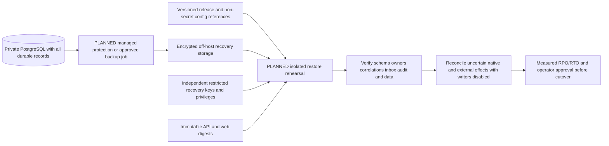

# Operations, recovery and risks - planning baseline with implementation updates

**T08 update:** [encrypted backup, isolated restore verification and runbooks](backup-recovery.md) are implemented locally. No remote storage, scheduler, production restore/cutover or monitoring stack is deployed. The design targets and hosting procedures below remain the T01 planning baseline.

No monitoring stack, backup scheduler, restore job or production service is configured by T01. Existing local [Phase 4 operations](../phase-4/operations.md), [native recovery](../phase-5/lifecycle-recovery.md), [external ingestion](../phase-5/external-ingestion.md) and [provider setup](../phase-5/reference-integration.md) are useful development procedures, not production runbooks or restore evidence.

**T11 update:** [implemented logging, private diagnostics, bounded local signal analysis and 16 incident runbooks](observability.md) supersede planned telemetry entries below where explicitly delivered. No monitoring backend or alert receiver is deployed. T11 remains PARTIAL: user selected deployment gates for incident ownership and off-host notification. Production thresholds/retention, delivery and failure drills remain unverified.

## Proportionate observability

Begin with existing safe JSON stdout/stderr, bounded host/container log rotation, provider DB dashboards and a small protected readiness/HTTP/host probe with an off-host alert channel. Select a managed log/alert destination only if its retention/access/cost fits the operating budget; a full Elasticsearch/Prometheus/Grafana cluster is not a baseline requirement. Optional metrics export is planned, not present. Tracing is optional after critical logs and alerts work.

| Signal | Current / planned evidence and response |
| --- | --- |
| API latency/errors/auth denials | Existing route-template/request-ID timing; plan low-cardinality rate/percentile counters, separate liveness vs readiness, alert only against agreed targets |
| Native work | Existing Execution/Task audit and leases; plan counts/age of admitted/pending/uncertain attempts, heartbeat/finalization failures and capacity denials; never mark a lease expiry as completed work |
| Collaboration | Existing session/delegation/correlation/control audit; plan age of WAITING/attention and recovery exhaustion; existing limit is three explicit never-admitted dispatch commands |
| External integration | Existing safe operation duration/category, source/mapping/receipt identity; plan auth/429/timeout/error rate, deferred/PENDING inbox age and observation lag. Provider unreachable is not Execution FAILED |
| DB/host | Plan storage growth, connection/lock/transaction saturation, slow SQL, RSS/CPU/event-loop lag and disk pressure. Use protected provider/host diagnostics, not task payload logging |
| Protection/delivery | Plan backup age, WAL archive lag where selected, last successful restore drill, certificate/credential expiry, schema/image manifest drift and deploy/drain failures |

Request, owner, Agent, Task, Execution, collaboration, delegation, source/connection and receipt IDs belong in redacted diagnostic logs/audit for correlation, not high-cardinality metric labels. Never log raw prompts/results/provider bodies, access cookies, auth headers, tokens, database URLs or decrypted secrets. Retention, who can search audit logs and the deletion/export policy require owner approval. Preserve durable command_audit/agent_events/inbox/outbox as governed data, not a replacement for operational log rotation.

Alert routes need named primary/backup responders, escalation and maintenance suppression tests. A dashboard without an exercised alert/incident path is not readiness. Monitor the actual native slot and pending/uncertain record ages; do not publish fake worker/queue-depth metrics for a nonexistent consumer.

## Database and persistent storage

PG owns Registry/Task/Execution/results, collaboration/delegation, mappings/inbox/outbox, audit and migration journal. No app upload/blob service or native queue volume exists. Static assets are immutable source/image content. App-local logs/caches are not authoritative. Provider data lives outside Elyqreth; its retention/backups are governed separately and cannot be restored by restoring PG.

Prefer a privately reachable managed PostgreSQL 17-compatible deployment if the full operating cost is approved. Verify minor version/extensions, CA/hostname verification with Node pg, least-privilege roles, maintenance windows, storage/autovacuum/index behavior, connection limits, PITR/export coverage, backup deletion rights and restore API/ownership. Managed != HA, tested restore, free backups or no operator responsibility. Do not add a pooler before session advisory-lock/migration semantics are tested. Existing pool maximum defaults to five; all instances/jobs need an explicit connection budget.

Option A needs operator-managed PG patching, encrypted durable disk, no published DB port, crash/storage monitoring, off-host recovery and tested host rebuild. Container restart/persistent volume alone is not backup. Neither A nor B may weaken verify-full TLS for production; current private-CA file configuration and role injection need T05/T07 verification. Tables/indexes and ten existing migrations remain intact; use controlled forward migrations, not development resets.

## Backup and disaster recovery proposal

**Unconfirmed design targets:** for an initial private pilot, propose RPO <=24h and RTO <=4h, daily encrypted off-host logical export, seven daily/four weekly/three monthly retained recovery points, plus a fresh recoverable pre-change point for schema releases. These values are planning candidates only; the service owner must approve loss/downtime/retention and actual restore measurements before production. A public-account service or stricter RPO may require a different tier and continuous WAL/PITR; do not pretend a daily dump meets a minutes-level loss target.

Select managed continuous backup/PITR where offered and required, verify its configured retention/restore behavior, and keep an independent export/recovery route to avoid relying solely on one account's mutable backup catalog. Self-hosted PITR requires managed base backups plus complete WAL archives and tested lifecycle/lag/retention; do not implement raw live-volume copying as backup. PostgreSQL documents distinct logical dump/restore and base-backup-plus-WAL recovery mechanisms ([logical backups](https://www.postgresql.org/docs/17/app-pgdump.html), [PITR](https://www.postgresql.org/docs/17/continuous-archiving.html)).

Backup/export identity should read only required data and write protected recovery objects; restore/delete/admin privileges are separately controlled. Protect off-host storage against host/account compromise, encrypt in transit/at rest, version/immutability where available and retain access audit. Recovery keys, configuration references and break-glass credentials must be recoverable outside the failed app host; never put decrypted keys inside the same sole backup. No new application encryption key is assumed to exist; if later added, its recovery/rotation joins the drill.

Rehearse restore before first production use, after material schema/key/topology changes and at a proposed monthly cadence until the owner approves a different interval. Use an isolated private target with separate credentials, no live provider dispatch and no automatic native admission. Verify restore completeness, journal hash/order, FK/ownership integrity, results, collaboration ancestry, inbox dedupe/order, external mapping generation, audit history and supported app version. Record elapsed recovery and latest recoverable transaction; compare to approved RPO/RTO. A successful archive upload or pg_restore exit alone is insufficient.

Real recovery sequence: restrict/drain writers, preserve evidence and incident IDs; choose approved recovery point and new isolated target; retrieve keys/release manifest; restore and validate; reconcile post-backup work against surviving audit/provider evidence without replay; validate scoped reads and mutation-denial defaults; obtain approver sign-off; update secret/endpoint references and cut over once. Old writers remain fenced. Test DNS/cache/cookie/credential cleanup, keep incident evidence and reassess data-loss notifications. Restoring a database cannot undo a provider action or resurrect a remote result it no longer retains.

## Runbook inventory and owners

| Runbook | Existing evidence / required production deliverable | Roadmap |
| --- | --- | --- |
| Initial deploy / restart / rollback | Existing local Compose/run scripts only; create signed release, drain, readiness, cutover and rollback checks with named release owner | T05/T06/T12/T15 |
| Native execution/process restart | Phase 2/5 explicit recovery and T11 hard-kill tests; create safe uncertain-work/quarantine diagnosis, no force reset/replay, and DB evidence checklist | T09 |
| Failed migration | Existing locked/hash-checked migrator; document journal inspection, compatible-image fallback vs forward fix, role access and stop conditions | T07 |
| Database loss/restore | No production restore tested; implement backup monitoring, isolated restore, key access and effect reconciliation, name recovery approver | T08 |
| Pending/deferred records or backlog | No broker/consumer; diagnose pending native work, inbox and unpublished fact outbox age separately; bounded explicit replay only | T09/T10/T11 |
| Failed delegation | Existing control/audit policy; exact source/child/cancel/outcome diagnosis, preserve unrelated work and terminal winners | T09 |
| Provider unavailable / invalid credentials | Existing safe categories and source freshness; separate provider outage from Execution failure, rotate credentials/re-authorize grants, avoid changing incarnation merely for rotation | T10 |
| Ingestion failure / duplicate or conflict | Existing durable receipt/replay and source sequence guards; mapping/owner/generation checks, bounded replay and escalation for conflicting evidence | T10 |
| Frontend sync / authorization/session failure | Existing stale/reconnect/logout logic; production session expiry/CSRF, cached-version mismatch, restore snapshots rather than mutation retry | T04/T11 |
| Certificate/secret rotation | No production injection/rotation system exists; dry-run least-privilege rotation, revocation, overlap policy, cache/session invalidation and rollback | T03/T05/T10 |
| Disk full / log storm / alert failure | Add storage/log bounds, protection of audit/evidence, safe admission stop, tested alert/escalation and host rebuild procedure | T11/T14 |
| Incident response | Named incident lead, timeline/correlation capture, scoped containment/revocation, restore/cutover authority and postmortem | T11/T15/T16 |

No production worker restart runbook is invented. If a later approved task extracts a worker, it must add private command access, durable ownership/version/fencing, drain and crash tests before deployment. No initial runbook may use a second coordinator, clear lease/idempotency records, or let a provider observation mutate native lifecycle.

## Security and reliability risk register

Likelihood is a qualitative planning assessment, not an incident statistic. Critical/high risks block their affected exposure/promotion until evidence closes them.

| ID / component | Likelihood / impact | Mitigation and verification | Owning task |
| --- | --- | --- | --- |
| P6-R01 production API access | High if current local checks are bypassed / critical unauthorized work or data access | Preserve current fail-closed checks; explicit production principal/owner path and both audience gates; forged identity/direct-network/cross-owner tests | T02/T03/T04 |
| P6-R02 DB/backup loss | Possible / critical loss of durable work and audit | Private verified TLS, restricted roles, off-host encrypted protection, independent recovery keys and measured isolated restore | T07/T08 |
| P6-R03 native process crash | Possible / high uncertain effects or lost HTTP response | Single writer, drain before replace, existing leases/quarantine/idempotency, real hard-kill and never-duplicate tests | T09 |
| P6-R04 duplicate execution on deploy/restore | Possible / critical repeated effects | No overlapping native writers, no mutation retry, reconcile restored idempotency/side effects; admission and restore race tests | T07/T08/T09/T14 |
| P6-R05 credential exposure | Possible / critical provider/DB/account compromise | Least-privilege injection, no bundle/build/log/argv secrets, rotation/revocation and secret-scan plus negative log tests | T03/T04/T05/T10 |
| P6-R06 provider outage/rate limit | Expected eventually / medium or high freshness/availability impact | Bounded read budgets, truthful stale/UNKNOWN, no native failure fabrication, fixture/live sandbox outage tests | T10 |
| P6-R07 migration/rollback mismatch | Possible / high downtime/corruption | Immutable journal checks, backward-compatible schema and images, separate migrator, populated upgrade/interruption/rollback rehearsals | T07/T12/T14 |
| P6-R08 record backlog | Possible / medium delayed observation/attention | Age/count telemetry for actual pending/deferred records, bounded operator recovery/replay and exhaustion alerts; no queue added without need | T09/T10/T11 |
| P6-R09 storage exhaustion | Possible / high DB/log/backup failure | Approved retention/headroom alerts, growth and disk-pressure tests, bounded log/backup storage and graceful admission stop | T07/T08/T11/T14 |
| P6-R10 missing monitoring/responders | High until configured / high undetected failure | Protected liveness/readiness, minimal off-host alerts, named responder and exercise alert/incident route | T05/T11 |
| P6-R11 broken promotion/rollback | Possible / high extended outage/duplicate work | Same immutable pair of web/API digests, tested config/schema window, release mutex and explicit rollback decision evidence | T12/T13/T14/T15 |
| P6-R12 host or region failure | Possible / high single-host app outage | Confirm availability objectives, reproducible host replacement, independent DB/backups; do not promise HA from one host | T02/T08/T13/T14 |
| P6-R13 capacity/poll amplification | Unknown / high saturation/cost | One native slot, bounded pages/pools/provider operations, measured client sweeps and quotas/limits; load test before sizing or replicas | T02/T11/T14 |
| P6-R14 private CA/DNS/endpoint drift | Possible / high secure connectivity failure or SSRF exposure | Verify actual pg/Node CA/host checks, strict adapter DNS/peer/redirect policies and reviewed rotation; never disable TLS or wildcard all destinations | T05/T06/T07/T10 |
| P6-R15 public account/tenant ambiguity | Unresolved / critical cross-account leakage if assumed solved | Select explicit public account ownership model or keep public accounts disabled; context/cache/correlation isolation tests | T02/T03/T04 |
| P6-R16 no trusted release provenance in supplied snapshot | Confirmed missing Git metadata / high untraceable artifact | Restore canonical authorized source checkout, use real commit identity, digest/SBOM/signature and provenance validation before publication | T12 |

Budget, provider, retention/legal obligations, on-call owner, RPO/RTO and public-vs-private scope remain decisions. No unresolved choice is treated as permission to provision or expose services. This register feeds the [roadmap gates](implementation-plan.md), not a claim that production risks are already mitigated.
