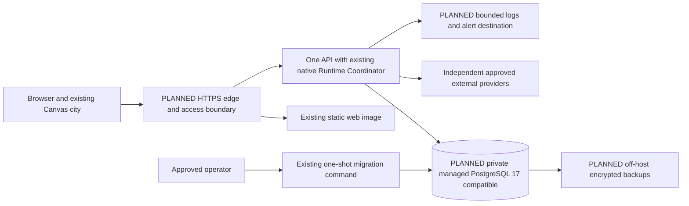
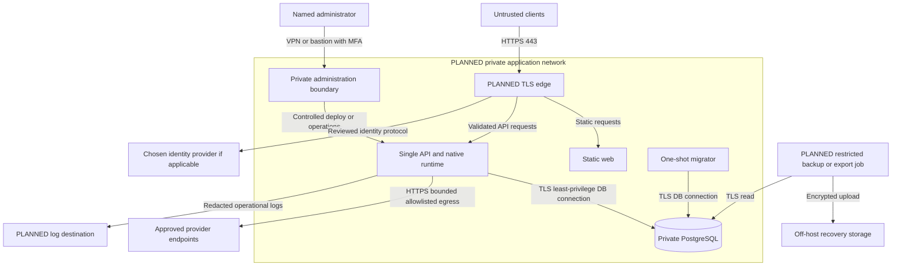
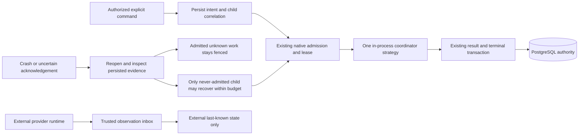

# Production architecture - proposed, not deployed

See [requirements and decisions](README.md). The tables below preserve the T01 audit/planning snapshot. T03?T05 subsequently implement private authentication/session/container contracts; [T06](edge-network.md) now implements locally verified TLS edge/private-network packaging. Actual hosting/DNS/database procurement and deployment remain PLANNED. Source references describe current behavior, not a claim that production hardening is already implemented.

## Audited repository and blockers

| Existing component / source | Operational finding / production action |
| --- | --- |
| [Bootstrap](../../../apps/api/src/main.ts), [application](../../../apps/api/src/application.ts) | Node 24/Nest/Express; validated configuration; bind address/port; no auto-migration in API serve. Request-body receive timeout 30s, header timeout 10s, keepalive 5s are not an overall native execution response deadline |
| [HTTP foundation](../../../apps/api/src/common/http-foundation.ts) | JSON/body limit 64 KiB, whitelist validation, safe errors, request IDs, no-store, nosniff, exact CORS; credentials false; SIGINT/SIGTERM hooks. No cookie auth, production CSRF/rate limiter, metrics/traces or configured proxy trust |
| [Local guard](../../../apps/api/src/common/local-access.guard.ts), registry/runtime configuration | Only development/test plus loopback token/Host/origin can use privileged features. Runtime/registry are rejected in production. A TLS reverse proxy is not a production authorization adapter |
| [Browser transport](../../../dist/js/runtime/http-transport.js) | Loopback origins only; request credentials omitted. Production same-origin API selection and secure session transport require explicit tested extensions, not a URL replacement |
| [Frontend app](../../../dist/js/app.js), [Vite](../../../vite.config.js), [build check](../../../scripts/build-web.mjs) | Maintained root dist/ plain static source, no React/SSR/Node web runtime; assets dynamically loaded. Vite is development only; web build verifier discards a temporary bundle |
| [Dockerfile](../../../Dockerfile), [Compose](../../../docker-compose.yml), [nginx](../../../docker/nginx.conf) | Existing non-root API/web images; web copies dist/ intact and serves 8080, no API proxy or TLS; API image defaults development, Node/nginx bases need reviewed immutable pins. Compose exposes local host ports and PG volume, integrations disabled, API stop grace 15s |
| [Database config](../../../apps/api/src/database/database-configuration.ts), [pool](../../../apps/api/src/database/pool.ts) | PG 17.11 pinned in local Compose; max pool default 5, configurable 1-20; connection 5s, idle 10s, SQL statement 30s defaults; production requires verify-full; no custom CA-file input yet |
| [Migrator](../../../apps/api/src/database/migrate.ts), migrations/ | Ten migrations 0000-0009; advisory lock, journal hash checks, separate command. App-role/migrator-role and private managed endpoint integration need production verification |
| [Runtime](../../../apps/api/src/runtime/runtime-coordinator.ts), runtime-persistence.service.ts | Execution awaited inside API; one process-local active slot, native DB lease 20s/heartbeat 5s. Shutdown rejects new admission, aborts active context, waits up to 5s before pool close. It does not naturally wait for every execution to finish |
| Collaboration and T07 ingestion | Owner-locked transactions, bounded native graph, explicit recovery, durable control audit and inbox. No worker/broker/Redis/outbox publisher; pending records are not automatically dispatched |
| [Health](../../../apps/api/src/health/health.controller.ts), [logs](../../../apps/api/src/common/api-logger.ts) | /health is constant process liveness, not DB/schema/ready-to-admit proof. JSON stdout/stderr and safe operation timings exist; no central log/metric/alert service is configured |
| [CI](../../../.github/workflows/verify.yml) | GitHub Actions verify:phase1, real isolated PG/browser regressions, profile and safe artifacts; no image publication, deploy credentials, staging or promotion workflow. Supplied workspace has no Git metadata; canonical checkout/commit provenance must be restored for release artifacts |

The [Phase 5 acceptance](../phase-5/acceptance.md) and Phase 1-4 ADRs are retained. Native scheduling/lease/result semantics and external execution ownership must not change merely to fit hosting.

## Production predicate inventory

The restriction is deeper than HTTP ingress. Current development/test or loopback checks also occur in runtime-persistence.service.ts, runtime/http/runtime-api.service.ts, lifecycle/task-lifecycle.service.ts, runtime/tools/tool-execution.service.ts, events/events.service.ts, city activity/binding/collaboration-activity services, collaboration-api.service.ts, all city/interaction/registry/runtime configuration and external-configuration.ts/ingestion-authority.ts. Several services derive the owner from one configured registry owner. T02 must inventory every predicate and trusted internal-command caller; T03/T10 must add explicit verified production principal/service scopes without deleting dev-mode checks, trusting client owner IDs or treating one global owner as public-account authorization. Changing only a guard, CORS or NODE_ENV would leave the application denied or unsafe. Public scope needs server-derived owner context all the way to repository/runtime/result/mapping access, with concurrent-context isolation tests.

## Deployment models and qualitative total operating cost

| Criterion | A: one VPS + Compose PostgreSQL | B: one VPS + managed PostgreSQL | C: managed containers + managed PostgreSQL |
| --- | --- | --- | --- |
| App shape | Static web, edge, one API/native process, local PG; no fictitious worker | Same app containers; PG outside host | Example: Cloud Run service for API, managed static/web container and PG; explicitly single instance initially |
| Direct cost drivers | VM CPU/RAM, persistent disks, off-host backup/object storage, bandwidth, optional logs/IdP | VM plus DB minimum compute/storage, backups/PITR where offered, private connectivity and egress | Container CPU/memory and minimum instances, request traffic from polling, networking, logs, database baseline, registry |
| Operator effort | Highest database patching, WAL/backup monitoring, storage management and recovery burden | Lower DB maintenance burden only for contracted/tested features; app host remains operator-owned | Lower host administration; more IAM/networking/runtime-contract/deployment coupling |
| Security | Private DB container network; no PG public mapping; harden host and backups | Private DB route + verified TLS, narrowly scoped roles and provider IAM | Private service-to-DB paths, service IAM/secret integration; explicit origin/auth mode still required |
| Failure domain | One host/disk loss affects API and DB together; off-host backups are essential | App-host failure need not lose DB, but managed instance/region failures still matter; HA not assumed | Platform and DB remain failure domains; instance retirement can interrupt in-process native execution |
| Scaling | Vertical first; no API multi-writer expansion until admission/leases proven | Same runtime constraints; independent DB sizing | Autoscaling defaults cannot be inherited safely; connection budgets, native slots and shutdown must be tested |
| Backup | Operator owns complete off-host protection and restore testing | Verify actual retention/PITR/export/recovery privileges; managed is not proof of recoverability | Same DB requirement plus versioned infrastructure/config artifacts |
| Fit now | Lowest service-count fallback if owner can operate PG and accepts correlated failure | **Recommended planning baseline**, conditional on approved TCO/private connectivity/restore result | Later option if cloud/IAM expertise and measured demand justify it; not initial recommendation |

Recommendation B keeps the application topology small while reducing app-host/database storage coupling. It is a risk/maintainability choice, not a statement that managed DB is always necessary or cheaper. Obtain comparable region/version/storage/retention/private-connectivity quotes and operator effort estimates before procurement. A is acceptable only after an explicit decision accepting its failure domain, named DB operator, measured backup/restore and maintenance burden. Do not silently substitute A when B is unaffordable. C is a supported model to evaluate later, not Kubernetes by default.

Docker documents single-server Compose as a deployment model, with production-specific configuration rather than unchanged development settings ([Docker production guidance](https://docs.docker.com/compose/how-tos/production/)). Cloud Run has its own concurrency and termination contract; the documented SIGTERM-to-SIGKILL window requires testing against Elyqreth's cancellation/finalization, not a presumption that long native requests survive instance recycling ([runtime contract](https://docs.cloud.google.com/run/docs/container-contract), [concurrency](https://docs.cloud.google.com/run/docs/about-concurrency)). No live platform compatibility or prices were verified in T01.

## Recommended topology

One Linux application host, one active NestJS API/runtime instance, existing static web, and one HTTPS edge. Private managed PG is selected as the planning dependency only; supplier/region/tier remain open. The external LangGraph deployment belongs to its provider/operator and is not installed beside the city. No app GPU, Redis, queue, scheduler or new native worker is required.

| Boundary | Public/private and persistence |
| --- | --- |
| Edge | Only public service listener; planned HTTPS/auth/routing. Identity provider, if selected, is external trusted auth dependency; no provider keys in browser |
| Web | Private static service reached through edge; durable content is its immutable image, not a writable asset directory |
| API/native coordinator | Private network listener; durable state in PG, but active native contexts/admission are process-local. It is not freely horizontally stateless |
| PG | Stateful private endpoint, no default Internet listener; app role separate from migration/backup/admin roles |
| Migration/backup commands | One-shot/scheduled operational jobs, not a new runtime worker/queue. Private DB access and audited least privilege |
| Log destination/backups | Planned operational dependency, bounded retention; off-host recovery access separate from app credentials |
| External runtimes/IdP/registry | Independently owned dependencies with explicit credential, endpoint and failure policies |

## Network trust boundary and justified flows

- Publish only 443; allow 80 solely for reviewed redirect/certificate issuance if needed. DNS/certificate ownership and renewal owner must be selected. No public 3001/8080/5432, Docker socket, operational CLI, migration endpoint or worker control port.
- Edge preserves /api/v1 routes and forwards only to API; / serves existing web. Both use one origin initially. Internal connectivity is through a dedicated private network. Pin trusted proxy hop/source and strip client-supplied forwarding/identity headers; default Express proxy trust must not be changed to trust all.
- Authenticate before protected access and validate production principal/scope in API. Direct API bypass must be blocked. A proxy must not rewrite a public request to fake localhost/development authorization.
- Database private connectivity must exist from the chosen app host. If a provider cannot supply it, re-evaluate provider/topology; do not open the database to the world or disable TLS. Verify CA/hostname failure tests with the actual Node pg client. Current URL parser rejects query parameters: use the separate validated SSL setting, not an invented URL sslmode override.
- Outbound DNS and HTTPS only as needed for reviewed providers, IdP, certificate/registry/patch/log/backup operations. Maintain destination policies; existing adapter DNS/peer pinning, TLS, no-redirect and response/time bounds remain defense in depth. No arbitrary URL proxy or public webhook is added.
- Administration requires named identities/MFA, restricted bastion/VPN, audit and revocation. Operational backup/monitoring traffic has separate identities. Container restrictions cannot by themselves enforce every external egress policy; selected host/provider controls need verification in T06.

## Frontend and API production contracts

The frontend is static and needs no Node server, SSR, new renderer, WebSocket or SSE. Retain shared REST polling (default 2s sweep, bounded pages/backoff/freshness), not one connection per NPC. HTTPS same-origin /api routing and public non-secret runtime configuration are planned. Existing localOrigin checks, credentials:omit and local token entry remain the development path; T04 must add a deliberate allowlisted production/session mode, logout/reauth clearing and regression tests. Never embed an operator key, provider key, database URL, session secret or private profile in static assets or cache.

Reuse the current Docker web image's complete maintained dist/ tree for the initial release. build:web is a verifier that deletes temporary output, not a retained deploy artifact. Produce web/API images once from the same canonical commit and promote their digests together. Current JS/asset names are not release-fingerprinted: retain no-cache/revalidation until versioned asset paths and dynamic sprite loads are proven. Never cache API/session responses; test cached old tabs against new API contracts and rollback. Plan CSP/frame/referrer/HSTS policies with actual Canvas/assets and login flow, not permissive wildcards or untested security headers.

API production work is explicit: extend existing audience/owner guards with verified principal context, keep object policies and dev/test restrictions, choose exact production origins and fail-closed configuration, add readiness and admission drain, trusted proxy configuration, authentication/route rate budgets and safe telemetry. Existing /health is liveness only. Readiness should validate DB reachability/schema compatibility/closing state with bounded checks; it must not restart native work because an optional external provider is down. Database startup connectivity checks do not replace ongoing readiness.

Secure session proposal, not current capability: reviewed OIDC/identity gateway plus API-verified issuer/audience/expiry or authenticated assertion and server-controlled owner grants, browser HttpOnly/Secure/SameSite cookies, revocation and bounded lifetime. T02 chooses the deployment/IdP integration; retain existing policy services rather than replacing authz. Cookie mode requires CSRF/origin controls for unsafe methods and explicit credential transport; today's credentials:false CORS and credentials:omit client do not implement that. Same-origin is the default design, not a reason to omit CSRF. Public account scope requires a real principal-to-owner/workspace model before enabling endpoints.

Set request/body/header/native/provider/proxy/client budgets as one tested contract. Node server.requestTimeout bounds incoming request receipt, not the entire awaited execution. Do not solve timeout mismatch with blanket infinite limits or proxy POST retries. Preserve controller/native deadlines and abort/disconnect semantics; reads may use bounded backoff, mutations require persisted identity/reconciliation.

## Runtime, collaboration, messaging and capacity

There is no separate native worker to deploy. The initial worker topology is the existing execution role inside one API process; collaboration coordination uses that boundary. QueueTask can persist pending native work but no daemon consumes it. event_outbox stores durable facts, not dispatch commands or a broker. The inbox/recovery path is explicit and bounded; no new Redis/RabbitMQ/database-job runner is justified. Backup scheduling/log shipping are operational jobs, not an orchestration engine.

Keep one native admission slot per process and one active API writer initially. Existing per-Agent DB leases do not prove a desired fleet-wide capacity when adding API replicas. Read scaling, multiple instances or extracting a private worker require a later reviewed admission/dispatch/fencing design with the existing coordinator, durable idempotency and race/fault tests. Do not create a second scheduler to fit a platform.

Shutdown currently aborts active native context, waits at most 5s, then database shutdown hooks close the pool; Compose grace is 15s. Plan a maintenance admission-stop/readiness-drain step before SIGTERM, wait for ordinary work to settle where possible, then verify bounded finalization and quarantine if interrupted. Do not promise transparent completion, automatic retry or zero downtime. Client/proxy disconnects can affect synchronous execution; deployment must preserve exact Task/Execution identities and never retry mutations blindly.

Bounded retry remains three explicit recovery dispatches for a never-admitted child. Admitted uncertain work remains linked WAITING/attention until safe operator diagnosis; expiry is not proof of stopped side effects. Native cancellation/timeouts/results and external authority remain unchanged. Operator observation/replay uses fresh authorized source grants after restart, not persisted in-memory grants.

Starting capacity is a topology constraint, not a user forecast: one app host, one API/native process, native concurrency one, DB pool default five pending measurement, no native fanout, existing 20-item read limits and external transport concurrency four. CPU/RAM/disk/traffic budgets must be measured in T14; T11/T12 small-fixture latencies are not production sizing. Pool budget must include every API instance plus migration/backup/monitoring/admin reserve within the selected DB limit; do not add PgBouncer before session/advisory-lock compatibility is proven.

Measure browser sweep pages/request rates and p95 API/SQL latency, process RSS/event-loop lag, active lease/finalization failures, capacity denials, inbox/outbox age, backup age and DB storage/connection usage. Trigger vertical sizing or architecture review from agreed sustained saturation/latency/error targets; do not auto-scale native writers from CPU alone. No new latency, throughput or uptime commitment is made in T01.

## External integrations and configuration/secrets

LangGraph remains one observation-only adapter with explicit connection/owner/namespace/generation. Preserve capability intersection, unknown/retired observations, raw provider provenance, same-owner mappings and terminal guards. No native Execution is allocated from an external event, no discovery creates internal Agents/NPCs automatically, and provider outage does not mark a run failed. Hosted provider version/auth/licensing and result-checkpoint compatibility require separate evidence before enabling a profile.

Trusted internal ingestion is the existing boundary; no public generic webhook or universal signature protocol is planned for the initial release. If a webhook becomes necessary later, it needs separate authentication/replay/body/ownership design and authorization. Provider polling stays explicit bounded operations unless a separately approved scheduler is designed; browser reads never poll the provider directly. Provider 429/timeout errors use bounded read backoff, not blind external mutation retries. Credential rotation does not by itself change source identity generation; namespace/incarnation changes need explicit mapping review.

| Configuration class | Planned location and access |
| --- | --- |
| Public frontend | Same-origin API selection, asset/release ID and harmless display flags only; validate bounded schema |
| Backend non-secret | Environment-specific allowlists, feature flags, pool/resource bounds, exact trusted proxy and identity issuer/audience |
| Database | Restricted app credential, separate migrator/backup/admin grants; verified TLS and protected CA trust material |
| Sessions/assertions | Server/gateway-only signing/verification or session secrets; lifetime/revocation decisions in T02/T03; no current session store is assumed |
| Providers/integrations | Existing credential-reference boundary, least-privilege provider token, no raw values in profile DTOs/audit/logs |
| CI/deploy/backup encryption | Separate service identities with manual environment approvals; recovery keys accessible through an independent break-glass path |

Use platform/host secret storage with restricted per-service read-only injection. Compose secret files are file mounts, not an automatically encrypted external vault ([Docker secrets](https://docs.docker.com/compose/how-tos/use-secrets/)). Current application accepts environment/file .env configuration, not arbitrary _FILE variables: T05 must add reviewed secret-file/CA loading or use a constrained launcher, test permissions/redaction/rotation and keep compatibility. Do not commit secrets, bake them into images/build args, put them in process arguments or give them to nginx. Keep secret values out of observability. Rotation, revocation and restore-time key recovery must be rehearsed; plaintext .env is local compatibility, not the production secret-management plan.
