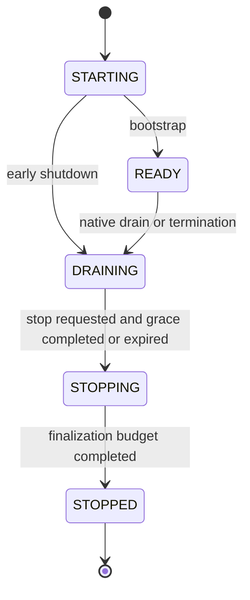

# Native runtime drain, restart and admission

**T09 COMPLETE for locally verified contracts (2026-11-05).** T09 extends the existing Runtime Coordinator, PostgreSQL claim/fencing and conservative recovery model. It adds no worker, queue, scheduler, external execution engine, migration or public administrative route. Implementation and executed evidence are recorded in [verification](verification-evidence/runtime-drain-verification.json). Production remains gated by the [decision register](implementation-plan.md).

## Recovered audit and execution paths

Before T09, durable lease tokens, database-clock expiry, heartbeats, cancellation quarantine, idempotent finalization and bounded collaboration recovery already existed. Shutdown aborted active work immediately; readiness, bootstrap and Nest installed separate signal handlers. A shared admission/drain lifecycle and active signal verification were missing. These are now implemented; existing ownership and schema are retained.

| Entry/path | Durable boundary and admission | Shutdown/recovery policy |
| --- | --- | --- |
| Task submission | Authorized `TasksService` transaction creates CREATED Task | Still permitted during native-only drain; persistence is not a promise of immediate execution |
| Direct HTTP / local CLI execute | `RuntimeCoordinator.executeTask` acquires a host operation; persistence checks before transaction and at its last mutation boundary | New request receives `RUNTIME_DRAINING` (HTTP 503), never business failure or a fabricated start |
| Explicit pending allocation | `RuntimeCoordinator.queueTask`, shared host gate and persistence transaction | No new coordinator allocation during drain; already committed PENDING/QUEUED work stays durable |
| Legacy lifecycle start | `TaskLifecycleService.startInTransaction` checks native authority before and after state changes | Prevents a second native RUNNING transition path bypassing drain; external lifecycle semantics unchanged |
| Collaboration activation | `NativeCoordinationService.prepare` checks at entry/precommit, then uses the coordinator | Preparation committed just before drain may leave one ACCEPTED delegation/CREATED child; receipt is 202 RECOVERY_REQUIRED, not FAILED |
| Collaboration recovery | `CollaborationRecoveryService.recover` gates entry and dispatch-audit transaction; coordinator gates actual dispatch | Existing limit of three recovery dispatch attempts remains; only never-admitted child work is eligible |
| Retry / timeout / reconciliation | No independent native background retry scheduler exists; supported dispatch uses the preceding paths | Terminal, uncertain and cancelled work is not silently reopened or replayed |
| Queue / workers | No native broker, consumer, acknowledgement or dedicated worker exists | Not applicable; future extraction needs a separate ADR and equivalent gate/fencing tests |
| External observation | Existing trusted ingestion, connection mapping, inbox/dedup and normalization | Not a native admission path; native drain neither cancels external work nor blocks trusted observation |

Admission checks are synchronous process decisions around asynchronous SQL. A drain observed before the final transactional gate rolls admission back. A claim may commit between that check and dispatch; the coordinator checks again before invoking any strategy. Such an interrupted committed claim is finalized with existing conservative CANCELLED/quarantine semantics, never declared successful. The cancellation/finalization/heartbeat paths remain available while draining.

## Host lifecycle and drain policy

`RuntimeHostService` is the single DI host per application. Production runs one HTTP/native writer per process. STARTING becomes READY after application bootstrap; production readiness independently requires existing schema/access/database checks. READY becomes DRAINING synchronously when drain begins. There is no in-place resume: replacing the process creates fresh in-memory state, while PostgreSQL remains authoritative.

The host registers operations before asynchronous admission and releases them once in `finally`. `activeExecutions` includes in-flight execution admission/finalization; `pendingQueueOperations` covers explicit pending-allocation transactions. These are process-local counts, not a fabricated count of all persisted RUNNING rows. No polling query or frontend projection determines shutdown.

`RUNTIME_DRAIN_TIMEOUT_MS` defaults to 15000, accepts integer 100..20000 only with `RUNTIME_ENABLED=true`, and is validated through the existing configuration framework. During grace, existing strategies may complete normally, retain heartbeats and commit genuine results. Stop then enters STOPPING, signals remaining scopes with existing CANCELLED semantics and permits a fixed 5000 ms finalization budget. If the database or handler remains unresponsive, state is not declared successful; outstanding counts and durable records remain available for diagnosis. A native-only drain reaching its grace deadline reports `drainTimedOut`; it does **not** abort work until stop is requested.

The actual HTTP entrypoint owns SIGTERM/SIGINT once per process; Linux SIGUSR2 requests native-only drain. Repeated signals are idempotent. Factories/test contexts do not install process handlers. The local runtime CLI owns its separate process handler and uses the same host stop policy. HTTP shutdown has a 30000 ms hard deadline (failure exit 1); production Compose retains 45s grace. Normal completion closes HTTP/database resources and exits 0. A hard-killed process cannot promise acknowledged completion of external effects.

## Ownership, restart and uncertainty

No new lease configuration or database grants are required. Existing leases are 20000 ms, heartbeats 5000 ms, with database-clock and token checks at finalization. Agent-level transactional locking and persisted RUNNING/uncertain fences prevent concurrent effective native ownership. Existing concurrency, stale-finalizer, cancellation-race and hard-process-crash tests remain the authority for those contracts.

On forced termination, persisted RUNNING state does not become success. Reconciliation recognizes expired ownership and preserves uncertain/cancellation outcomes. It does not blindly replay side-effecting LLM/tool work. Only a never-admitted CREATED collaboration child without an Execution may be dispatched through bounded authorized recovery. Parent/child IDs, cancellation intent, terminal state and external connection provenance survive restart. Restored database snapshots require the separate [backup reconciliation procedure](backup-recovery.md), not automatic execution replay.

**Operational limit:** drain is per process, not a fleet-wide distributed barrier. The approved deployment uses one native writer. Stop/fence every old writer before replacement; do not overlap rolling native writers or clear quarantine merely to regain capacity. PostgreSQL fencing rejects stale result commits but cannot undo an already issued external side effect. Manual effect review remains necessary for uncertain work; T09 adds no force-reset or automatic retry endpoint.

## Readiness and diagnostics

`/health` remains minimal process liveness during drain. Existing private `/ready` reports 503 outside READY or when database/schema/access checks fail. `/ready?runtime=true` adds only lifecycle, admission, process counts, drain timestamp, remaining grace and timeout flag, with the same real-loopback-namespace GET/HEAD access check. The edge still blocks `/ready`; forwarded client headers cannot grant access. No Task input, result, credentials or Execution identity is returned. No public drain endpoint is introduced.

Native-only drain leaves authorized reads, ordinary Task persistence, cancellation, collaboration observation and trusted external ingestion available. Once HTTP teardown begins, existing application-wide draining middleware rejects fresh business requests. Current frontend HTTP polling treats 503 as service unavailability, not authentication expiry or Execution success. Only its closed error-code list adds `RUNTIME_DRAINING`; city renderer, NPC movement, ownership and session transport are unchanged.

Safe structured events are `runtime.drain.started`, `runtime.drain.completed`, `runtime.drain.deadline`, `runtime.stopping`, `runtime.stopped`, plus existing correlated Execution logs. Lifecycle summaries include counts, not payloads. CLI stdout remains machine-readable; serving-only lifecycle logging avoids corrupting its result stream.

## Operator runbooks

Preconditions: reviewed production Compose inputs, authorized Docker operator, compatible migration journal and runtime-only credentials. These commands operate the selected installation; T09 verification used only labelled disposable fixtures. Never substitute a shared/production database into test scripts.

1. **Inspect:** `docker compose -f docker-compose.production.yml -f docker-compose.edge.yml exec -T api node -e "fetch('http://127.0.0.1:3001/ready?runtime=true').then(async r=>console.log(r.status,await r.text()))"`. Expect READY/admitting before maintenance. A 503 with DRAINING is expected during drain; inspect database readiness separately if state is READY.
2. **Native-only drain (Linux container):** `docker compose -f docker-compose.production.yml -f docker-compose.edge.yml kill -s SIGUSR2 api`. Repeat the private probe, expect DRAINING/admitting=false. Read-only inspection/external observation remain available. Do not wait forever for a zero count; inspect deadline/outcome and proceed to bounded stop. There is no resume signal.
3. **API/native writer restart or replacement:** stop ingress/admission for the maintenance window, drain, then `docker compose -f docker-compose.production.yml -f docker-compose.edge.yml stop -t 45 api`. Check exit status/logs. Only after old process exit, run the separately authorized T07 migration workflow if needed and `docker compose -f docker-compose.production.yml -f docker-compose.edge.yml up -d api`. Verify private readiness, auth, canonical Task/Execution and collaboration state. Do not start a fictional worker service.
4. **Deadline or forced termination:** keep admission closed, preserve logs and IDs, inspect canonical Execution/lease/reconciliation/cancellation records through existing authorized inspection. Do not infer success from HTTP disconnect. Use the documented bounded collaboration reconcile/recover operations only for eligible never-admitted child work. Uncertain effects require operator/provider audit; do not edit lease/result/terminal records or issue blind retries. If database finalization failed, repair availability then reconcile using existing lifecycle rules.
5. **Concurrent recovery/stuck child:** confirm one writer and owner, inspect delegation child references and recoveryAttempts, reconcile first, recover only if existing policy allows. A WAITING/requiresAttention or quarantine response is a safety outcome. Repeated recovery cannot create a second child Execution; stop and investigate at the existing attempt cap.
6. **External outage/event during drain:** preserve provider execution authority, existing trusted ingestion identity and dedup. Native drain is not a provider cancellation command. Use [external reconciliation](backup-recovery.md) and the existing integration guide; do not dispatch replacement provider work from stale observations.

## Local verification and limits

Run `npm run lint`, `npm run test:api`, `npm run test:db`, `npm run test:database-roles`, `npm run test:backup`, `npm test`, and `npm run build:web`. Real PostgreSQL drain tests use deterministic gates at strategy/admission/preparation cuts. Existing suites cover concurrent claims, lease expiry, cancellation/finalizer races and a real SIGKILL of a child process. No paid provider is needed.

Build the existing API verification image with `docker build --target api -t elyqreth-t05-api:verification .`, then run `node scripts/container-hardening.mjs --runtime-drain`. It uses the normal non-root read-only image with isolated TLS PostgreSQL/runtime credentials, and a **test-only mounted** bootstrap that pauses a compiled strategy. Real PID1 SIGUSR2/repeated SIGTERM prove clean completion and deadline cancellation; no test strategy is shipped in the production image. `npm run test:edge` supplies existing browser/TLS/session/city regression. Each harness cleans only its own labelled resources.

Evidence distinguishes executed local tests from production guarantees. No remote deployment, distributed writer admission, automatic uncertain-effect recovery, new queue, monitoring platform, strategy or city feature is delivered. T10 remains separate: External Production Connectivity & Ingestion Security.
