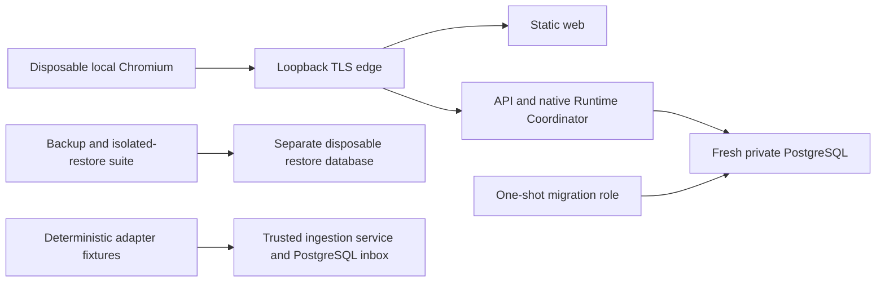

# T13 Isolated staging/UAT rehearsal

2026-11-06, Asia/Bangkok. **PARTIAL.** This task establishes a repeatable **local simulation**, not an approved hosted staging deployment or production acceptance. Publication/deployment stay closed under the user's T12 decision. No production target, credentials, external dispatch, cloud resource, notification or Git history is created. [Executed evidence](verification-evidence/staging-uat-verification.json) distinguishes current results from inherited evidence and blocked checks.

## Audit and recovered requirements

The supplied workspace has no `.git` and no applicable `AGENTS.md`. Git status/diff cannot establish staged or untracked state. A pre-change SHA256 inventory of 5320 existing files preserves earlier work; final comparison is recorded in evidence. T01 recommends one application host and privately reachable PostgreSQL. Current production packaging consists of static web, HTTPS edge, one API with its existing native Runtime Coordinator, and a separate migration command sharing the API image. There is no dedicated worker, broker, Redis, generic webhook, external dispatch implementation or standing staging environment.

T02–T11 already provide validated configuration, exclusive local/OIDC access, memory-only browser sessions, bounded secret files, least-privilege database roles, migration locks, encrypted backups, isolated restores, fenced native claims, drain/restart, restricted diagnostics and synthetic email-monitor tests. T12 provides candidate verification and promotion **plans**, not a publication/deployment executor. Existing disposable suites are reused; city/auth/runtime semantics are unchanged.

| Requirement group | Before T13 | Rehearsal scope / acceptance limit |
| --- | --- | --- |
| Isolated topology, configuration and TLS | COMPLETE reusable local harness | Fresh labelled containers/networks/volumes, random secrets, private roles and loopback edge; no shared database target |
| Repeatable UAT orchestration/evidence | MISSING | Fixed-command runner, explicit new evidence directory, recorded source content and local image IDs |
| Immutable artifact promotion | BLOCKED | Prebuilt Docker config IDs locked for local containers; no rebuild; registry digest/provenance acceptance remains blocked |
| Database/migration/auth/runtime/collaboration | COMPLETE existing suites | Rerun actual PostgreSQL and HTTP workflows; not a new orchestration engine |
| External integration | PARTIAL | Existing deterministic adapter/provider fixtures and inbox persistence; production activation closed |
| Signed webhook/external dispatch | MISSING because unsupported | Not applicable to the existing observation-only adapter; no new protocol added |
| Browser/city | COMPLETE existing TLS harness | Real Chromium login, expiry/logout, polling/reconnect, city asset/CSP checks; human visual/accessibility signoff not supplied |
| Drain/restart/restore | COMPLETE existing harnesses | Actual disposable process/container/database tests; not a production outage exercise |
| Observability/incident runbooks | PARTIAL | Local failure signals and fixtures; off-host alert delivery and responder ownership remain gates |
| Previous-release deployment rollback | BLOCKED | T12 synthetic manifest/plan gates only; no previous approved deployed release supplied |
| CI staging promotion | BLOCKED | Existing read-only CI retains its constituent verification gates; no deployment job/credentials added |

## Isolation and topology



The diagram groups independently owned test suites; it does not claim all scenarios share one long-lived deployment. The TLS/production configuration suite uses `NODE_ENV=production`, synthetic local operator credentials, verified database TLS, disposable certificates and the existing restrictive container flags. The wider database suite uses `NODE_ENV=test` and a fresh random database to exercise internal failpoints and owner isolation. It publishes only a random **127.0.0.1** PostgreSQL port for its host test runner. That loopback test mapping is not a production network exception. The production overlay itself does not publish database/API ports.

No messaging/cache resources exist to isolate. No production account or copied production dataset is needed. API runtime, migration and bootstrap secrets stay separated by the existing harness. Optional provider activation remains disabled. Existing trusted ingestion tests exercise service authority and durable inbox contracts; they do not open a public webhook. Browser authentication uses bearer credentials, not ambient session cookies, so cookie-CSRF and signed-webhook scenarios are not invented.

The runner derives `npm_execpath` from npm shipped beside the local Node installation for the existing genuine CLI acceptance test; it does not trust an inherited executable path. It strips inherited database/provider/SMTP/GitHub tokens, `NODE_OPTIONS`, live-test switches and Docker context/host overrides. It targets the standard local Docker Desktop Linux named pipe on Windows or local Unix socket on Linux. Remote/rootless/custom daemon targets are unsupported rather than inferred. Docker credentials may still be used by Docker itself to obtain the pinned official PostgreSQL dependency if absent; no application image push or registry login occurs. Tests can invoke local development provider fixtures, never a live production target. This is application-level isolation, not a claim of a host-wide egress firewall.

## Local artifact contract

`local-images.json` is explicitly `version:1`, `mode:LOCAL_SIMULATION`, with exactly `api`, `web`, `edge` SHA256 Docker **config IDs**. Mutable references, extra services and registry-manifest references are rejected by this contract. The initial existing verification tags only locate local images once. The harness then starts API, web and edge by the resolved content IDs, so later tag changes cannot substitute an application image. It never builds during the rehearsal.

The workspace code/config/test SHA256 inventory is a content snapshot, **not a Git commit or source-to-image provenance proof**. Prebuilt local images are not claimed to match that snapshot. The runner verifies the source snapshot remains unchanged during execution. T12's canonical release manifests, OCI graph checks, expected manifest SHA, promotion/backup/approval and exact-schema rollback gates run as synthetic tests inside the backend unit suite. They do not turn these local image IDs into registry digests or trusted release attestations.

An approved canonical checkout/candidate bundle, registry identities, provenance policy, reviewers and an explicitly designated staging target are required for actual immutable release deployment. No deployment executor was added to bypass those missing gates.

## Repeatable commands and safe cleanup

Prerequisites: Node24 dependencies installed with the existing lockfile, Docker Desktop/Linux local engine, existing verification images, Chromium and OpenSSL as documented in [container hardening](container-hardening.md). To prepare test images only when missing or deliberately refreshing verification assets, run separately:

```sh
docker build --target api -t elyqreth-t05-api:verification .
docker build --target web -t elyqreth-t05-web:verification .
docker build --target edge -t elyqreth-t06-edge:verification .
```

Those are **verification builds**, never promotable release candidates. Do not describe rebuilding them as registry promotion.

PowerShell, using a new local evidence path:

```powershell
node scripts/staging-rehearsal.mjs --run --output "$env:TEMP\elyqreth-t13-uat-new-run"
```

Linux equivalent:

```sh
node scripts/staging-rehearsal.mjs --run --output /tmp/elyqreth-t13-uat-new-run
```

The output directory must not already exist and must be outside the checkout. It is retained for review. The runner accepts no database URL, deployment target, arbitrary command, production mode or cleanup selector. It invokes a fixed sequential suite, stops on first failure, and persists non-sensitive command/exit/duration/count/hash evidence after each step. Raw child stdout/stderr is hashed, not copied into tracked evidence, because failure output may contain private diagnostics. Fixed-format failed test names are retained when available; rerun the recorded failing command in the same disposable harness for detailed local diagnosis. Successful container checks are copied as safe descriptions. A zero exit means the supported local suites passed, **not that T13 or production promotion is accepted**; the report remains PARTIAL.

Owned database/container suites validate exact generated names and labels before removing their resources in `finally`; restore targets are separate fresh databases. No `docker system prune`, wildcard volume removal, shared database reset or arbitrary recursive cleanup is used. If forcibly interrupted, inspect the exact run's labels and follow the owning suite's cleanup procedure; do not run global cleanup. A missing Docker/image preflight returns nonzero BLOCKED. Test failures return nonzero FAIL. An infrastructure or unsafe migration failure stops subsequent suites; do not edit migration metadata to continue.

## UAT and runbook evidence mapping

| Scenario | Command group | Evidence and limitation |
| --- | --- | --- |
| UAT-01 configuration/type/build compatibility | build-api, typecheck-web, syntax-web, build-web, backend-unit | Existing validators/typechecks and invalid production startup contracts |
| UAT-02 roles/migrations | database-roles | Positive/negative DML/DDL, ownership, future grants, concurrency, failure and journal checks on disposable PostgreSQL |
| UAT-03 authentication/authorization | database-uat, tls-city-drain | Real guards/PG/local account HTTP; wrong owner/viewer/forged claims, expiry/logout and state cleanup; OIDC cryptographic fixtures, no hosted issuer acceptance |
| UAT-04 native runtime | database-uat, tls-city-drain | Real rule-based execution, lifecycle/cancel/timeout, admission/fencing/recovery, actual process/container interruption |
| UAT-05 collaboration/mixed | database-uat | Native child and durable parent/child relationships, concurrent recovery, cancellation/failure, unified native/external projection; not unsupported automatic parent execution |
| UAT-06 external observation | backend-unit, database-uat | Deterministic reference transport/status/auth/outage and actual inbox/mappings; no live external work or dispatch/cancel capability |
| UAT-07 ingestion security | backend-unit, database-uat | Trusted authority rejection, duplicates/order/replay, cross-source/owner, disabled source and bounded payloads; no signature-based HTTP webhook exists |
| UAT-08 frontend/city | frontend-unit, database-uat, tls-city-drain | Actual PostgreSQL/Nest HTTPS browser login, Task save/native success, collaboration snapshot, logout/viewer/revocation; separate real container-edge session/city/polling/reconnect and component regressions. Human visual/accessibility signoff remains NOT RUN |
| UAT-09 drain/restart | database-uat, tls-city-drain | Clean/deadline PID1 shutdown, API recreation, durable terminal state, claim races, quarantine and external observations during native drain |
| UAT-10 backup/restore | backup-restore | Encrypted logical backup/checksum, separate restore, schema/journal/relationships/audit/inbox replay, bad artifact/retention/target guards |
| UAT-11 observability/runbooks | backend-unit, database-uat, tls-city-drain | Redaction/correlation/owner diagnostics, actual DB readiness outage/recovery, native drain logs, timeout and invalid authority fixtures; no external alert sent |
| UAT-12 rollback/promotion | backend-unit | Synthetic T12 rollback/approval/schema/backup/staging gates; actual previous-release rollback and hosted concurrency BLOCKED |

Runbook references: [database/migration failure](database-migrations.md), [backup/restore failure](backup-recovery.md), [runtime/stuck-work/drain](runtime-drain.md), [external outage/reconciliation](external-connectivity.md), [operational incident signals](observability.md), [email alerts](email-monitoring.md), [release/rollback](immutable-promotion.md). Rehearsal tests exercise their existing safety contracts; they are not a human incident-response tabletop. Preserve durable uncertain work, inspect read-only state and reconcile effects; never delete execution records, force success, reset leases, bypass authentication/signature checks, or replay external work to make UAT pass.

## Rehearsal invocation correction

The first runner attempt failed the database suite; its original child output was hashed rather than retained, limiting attribution of that first failure. A diagnostic direct-node command then identified the existing genuine CLI acceptance assertion: `npm_execpath` was absent. The diagnostic completed 232 checks with 231 passing and this one failure. The runner now derives the npm executable from the installed Node distribution, preserves the unchanged acceptance test, requests explicit TAP output, and records bounded failure names. The corrected rerun and its actual results are retained separately; an earlier failed run is never relabelled PASS.

## Release blockers and next step

| Severity | Finding / impact | Required correction / release gate |
| --- | --- | --- |
| High | No approved candidate/source provenance or registry promotion evidence | Complete T12 prerequisites in the canonical repository; retain closed publication/deployment |
| High | No previous deployed known-good release or actual rollback | Designate isolated target and exact compatible prior release, rehearse replacement and read-only smoke; no automatic down migration |
| High | No operational alert delivery or named responders | Complete T11 delivery/ownership and incident acceptance before production |
| High | No designated hosted staging/protection/approvers | Approve environment and isolation policy; local simulation alone cannot authorize production |
| Medium | No human visual/accessibility UAT or measured capacity acceptance | Operator review and T14 owner-approved workload/recovery/cost targets |

These are missing acceptance evidence, not newly discovered critical application vulnerabilities. Executed failures, if any, are recorded separately with exact command and status. T13 remains PARTIAL when required deployment/rollback or human checks are blocked. Next roadmap task is **T14 Security, Capacity & Disaster-Recovery Verification**; it is not implemented here and depends on the outstanding scope/targets.
