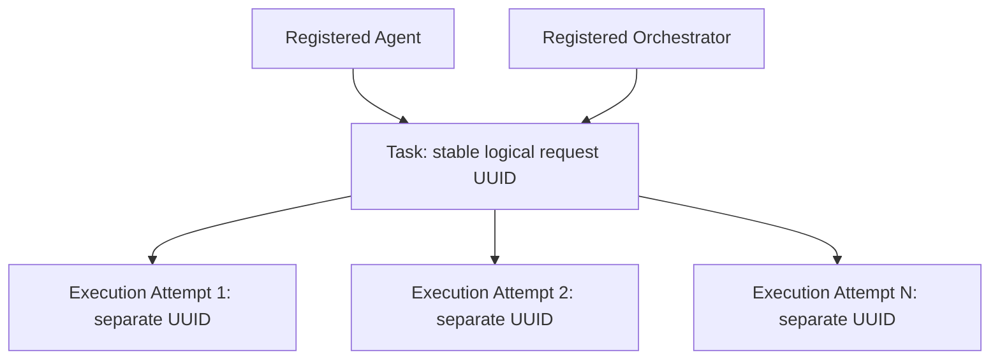

# T05 — Task & Execution Persistence

This is the historical T05 record. T06/T07 are now implemented as described in their guides; [T08 acceptance](phase-1-acceptance.md) verifies cross-module persistence, concurrency and restart behavior. No public Execution mutation or automatic execution was introduced.

Status: **IMPLEMENTED**, 2026-10-21. Reuses `apps/api`, NestJS, Drizzle, PostgreSQL, T03 entities and the T04 local-development access boundary. T06 lifecycle orchestration and all runtime execution remain **PLANNED**. No city files or runtime integration are changed.

## Domain and scope



This diagram represents persistence relationships, **not an active execution workflow**. A Task may have no attempts. New HTTP tasks are stored as CREATED with no Execution. The internal attempt primitive creates PENDING metadata only; it does not change Task status, set startedAt, call a runtime, or schedule work. No worker, retry loop, external API call or NPC action exists.

**Scope clarification to T01:** the earlier proposal described atomically queueing and creating an initial attempt at acceptance. The explicit T05 persistence-only instruction now takes precedence: creation stores CREATED alone. Atomic queue/attempt policy belongs to T06, using the transaction-aware primitive described below. Original T01 design records are retained as history.

Both agent and orchestrator relationships are required in T03. A task snapshots the selected agent's orchestrator ID; clients cannot independently select an orchestrator or owner. Task input and routing are database-immutable. Task identity is unrelated to execution UUIDs, attempt numbers, session NPC IDs or animations. Results remain attempt-owned in T03; there is no new task-level result field or result download API.

## Development access and startup

Use the existing [database setup/migrations](database-foundation.md) and [registry setup](agent-registry.md). Before testing new APIs against a local workspace, explicitly run `npm run db:migrate` to apply `0002_task_list_order.sql`. Startup never migrates automatically. No production/developer data is seeded by T05.

The existing environment settings `AGENT_REGISTRY_ENABLED`, `AGENT_REGISTRY_OWNER_ID` and `AGENT_REGISTRY_TOKEN` intentionally gate **all** protected registry/task/execution routes now. No second anonymous access mode or credentials system is introduced. Registry is disabled by default; enabling requires a configured database and existing owner, a random local bearer credential, NODE_ENV development/test and literal loopback bind. Production enablement fails startup validation; production/default routes return 404. Per-request socket, Host, Origin and constant-time bearer checks are shared through `common/local-access.guard.ts`; the Agent Registry retains its original body/query policy on top.

All requests require `Authorization: Bearer <local-credential>`. Every SQL lookup, idempotency scope and relationship is owner-scoped. Cross-owner task/execution reads return 404. Do not publish this single-operator development mode through tunnels/proxies. Full authentication, memberships, TLS and per-user authorization remain prerequisites for production exposure.

To create new task intent, the target agent must be ACTIVE and its registered same-owner orchestrator administratively ENABLED. T04 activation only enables the agent; no Orchestrator Registry API is added. An authorized local database administrator must deliberately enable the intended route when appropriate. Neither route enablement nor ACTIVE claims a real runtime is connected. Connectivity UNKNOWN/DISCONNECTED does not prevent storing intent; future T06 admission/dispatch must validate actual capability, configuration and runtime readiness independently.

## HTTP API

Uses the existing `/api/v1` prefix and safe error envelope.

| Method | Route | Behavior |
| --- | --- | --- |
| POST | `/api/v1/tasks` | Persist CREATED; 201 new / 200 idempotent replay |
| GET | `/api/v1/tasks/:id` | Read safe Task metadata; 200 / 404 |
| GET | `/api/v1/tasks` | Filtered bounded list; 200 |
| GET | `/api/v1/tasks/:taskId/executions` | Bounded attempt history; 200 / parent 404 |
| GET | `/api/v1/tasks/:taskId/executions/:executionId` | Read matching attempt; 200 / 404 |

There are no Task mutation, cancellation, retry, result-fetch or public Execution creation/update/delete endpoints. Unknown endpoints remain 404. UUID path parameters and all query/body structures are validated. Parent Task existence and ownership are checked even when an attempt list is empty. An Execution under the wrong Task returns 404, including a wrong Task belonging to the same owner.

### Create a task

```http
POST /api/v1/tasks
Authorization: Bearer <local-credential>
Content-Type: application/json

{
  "agentId": "5c355c08-102a-4c33-969b-3d8b0338354e",
  "input": {
    "instruction": "Summarize a document",
    "context": "Public document text"
  },
  "idempotencyKey": "document-summary:request-1"
}
```

Use a real eligible same-owner agent UUID. Request fields are exactly `agentId`, `input`, optional `idempotencyKey`. JSON content type is required (415 otherwise). Unknown/server-owned fields and raw prototype/constructor keys are rejected before transformation. Client timestamps, lifecycle, retry policy, execution state, orchestrator and owner cannot be assigned.

Input contract is deliberately narrow: an object containing a required nonblank `instruction` string (up to 16,000 JS string code units) and optional `context` string (up to 16,000). Unknown/nested fields, nulls, arrays and control characters except newline/tab/carriage return are rejected. Compact UTF-8 JSON must be at most **32,768 bytes**, below T03's 65,536-byte JSONB limit. Existing HTTP body limit remains 64 KiB.

Task input is untrusted stored data. It is never evaluated, rendered or sent to an AI. Dedicated credential fields cannot be supplied; common private-key, bearer-token, sk-style key, credential-assignment and user/password URL patterns are rejected. This is defense in depth, **not universal secret detection**: do not put secrets or sensitive documents in public task metadata. Future richer inputs need a reviewed versioned schema and data-retention/access policy, not arbitrary JSON acceptance. T05 does not encrypt input columns or load external artifacts.

Representative response (IDs/timestamps illustrative):

```json
{
  "id": "3833816f-a714-4df2-ae11-fce38bfbdcb9",
  "agentId": "5c355c08-102a-4c33-969b-3d8b0338354e",
  "orchestratorId": "84e642f1-2408-4aaa-8ca7-97f72ee493b4",
  "status": "CREATED",
  "version": 1,
  "createdAt": "2026-10-21T00:00:00.000Z",
  "updatedAt": "2026-10-21T00:00:00.000Z",
  "completedAt": null
}
```

Task detail/list/create responses deliberately omit input, request hashes, idempotency keys, owner IDs, statusReason and retry/runtime data. Creation does not echo potentially sensitive input. No unbounded attempt history is embedded. Reading input or results later requires a separate authorized, bounded contract.

### Idempotency

The body key is optional, 1–128 characters matching `[A-Za-z0-9._:-]`, and unique per **owner across all agents**. No Idempotency-Key header contract is implemented. Without a key, repeated POST requests create distinct tasks.

With a key, SHA-256 fingerprints the agent UUID (case-normalized) and the validated input with fixed property ordering. Object key order is irrelevant; string content/whitespace and absent versus empty context remain significant. The key is not included in its own hash. The derived orchestrator and current mutable configuration are intentionally not included: replay refers to the original request and saved route, even after later registry changes.

An owner/key transaction advisory lock serializes matching requests, including conflicting payloads or different agents. Existing `(owner_id,idempotency_key)` uniqueness is the final database guarantee, including non-cooperating writers; insert uses conflict handling and a subsequent scoped lookup. Hash collisions in the advisory-lock namespace only serialize unrelated work and cannot bypass uniqueness/fingerprint checks.

- First successful commit returns 201 and one Task, lifecycle fact, audit entry and outbox row.
- Same key and equivalent intent returns 200 with the existing Task's current safe metadata, no extra Task/Execution/history. Replay occurs after the access gate but before current eligibility checks, so disabling an agent does not erase a previously committed response.
- Conflicting intent returns 409. Keys are not expired or reusable in T05. Other owners can use the same textual key without seeing each other's records.
- Transaction failure rolls back the key reservation with all writes; a later retry can succeed.

### Listing and filters

```http
GET /api/v1/tasks?status=CREATED&agentId=5c355c08-102a-4c33-969b-3d8b0338354e&limit=20&offset=0
```

Optional filters: task `status` (CREATED/QUEUED/RUNNING/COMPLETED/FAILED/CANCELLED), UUID `agentId`, UUID `orchestratorId`, inclusive `createdFrom` / `createdTo`. Dates require complete UTC ISO timestamps `YYYY-MM-DDTHH:mm:ss[.SSS]Z`, years 1000–9999, valid calendar dates, optional fractions of one to three digits, and from <= to. Date-only/local/offset timestamps and invalid ranges are 400. Every SQL value is parameterized.

Pagination matches T04: limit default 20/range 1–100, offset default 0/range 0–10,000, one limit+1 query, no total/N+1 queries. Task order is `(createdAt ASC,id ASC)`; attempt history order is `(attemptNumber ASC,id ASC)` using the unique attempt key. Offset pagination is deterministic for a fixed dataset but not a snapshot across concurrent inserts/filter changes.

```json
{"items":[],"pagination":{"limit":20,"offset":0,"hasMore":false}}
```

Only list routes accept their documented query parameters; details accept none. Body/query field allowlists run alongside the established global ValidationPipe. Unknown parameters, repeated numeric parameters, malformed IDs and unbounded limits are rejected.

## Execution allocation boundary

`ExecutionsService` is exported from `ExecutionsModule` for future backend coordination. It exposes **no HTTP mutation route**.

```ts
await executions.createPending(taskId, 'NATIVE'); // or explicit 'EXTERNAL' authority
```

This method validates UUID and authority, opens a transaction, obtains the owner from the configured trusted development scope, locks the parent Task `FOR UPDATE`, and checks:

1. The same-owner Task exists and is not terminal.
2. No PENDING/RUNNING attempt or previous SUCCEEDED attempt exists.
3. Its registered agent is still ACTIVE and has the same owner and orchestrator as the immutable Task route.
4. The same-owner orchestrator remains ENABLED; no network/capability check is implied.
5. Current agent configuration conforms to the existing safe category/color metadata schema; legacy arbitrary JSON/credentials cannot be copied to the attempt.

It reads `max(attemptNumber)+1` under the parent lock, validates PostgreSQL integer bounds, and inserts a new UUID PENDING attempt with copied route IDs, explicit authority, current agent configuration snapshot and configVersion. The snapshot is taken **at allocation**, not Task creation. Later agent edits cannot rewrite that attempt snapshot. T06 must define when runtime configuration is frozen for queued work; no unavailable provider/runtime configuration is fabricated here.

Earlier attempts retain their identities and history. Existing unique `(task_id,attempt_number)` and one-PENDING/RUNNING partial index prevent collisions/parallel active attempts even if another writer skips the lock. Concurrent allocations for one idle Task produce one new attempt; the others conflict rather than creating multiple pending attempts. Allocating after a failed/timed-out/cancelled attempt is only a storage capability: T06 must authorize retry policy and call it explicitly. T05 never retries, terminalizes attempts, reopens terminal Tasks, or increments an attempt automatically.

For future atomic lifecycle work, `createPendingInTransaction(tx, taskId, authority)` performs the same checks/lock/writes using the caller's Drizzle transaction without independently committing. T06 can compose its own validated Task transition and attempt creation atomically; it must wrap the outer operation in safe error translation and own commit/rollback. No T06 transition is implemented now. Tests prove an outer rollback removes the attempt and associated history/outbox.

The primitive returns the safe serialized attempt. It is intended for trusted backend callers within the configured scope, not untrusted arbitrary owner/agent IDs. Authority is recorded explicitly instead of guessing framework behavior from the orchestrator type. Adapter selection and actual external/native execution remain future work.

### Read representation

Attempt DTOs expose id, taskId, agentId, orchestratorId, attemptNumber, status, version, createdAt, updatedAt, nullable startedAt/finishedAt, safe errorCode/errorMessage and resultAvailability. PENDING attempts have null started/finished timestamps. No raw error text, stack, configuration snapshot, lease, remote execution ID, submission key, credentials, result body or resultReference is returned.

FAILED/stored-error attempts use `EXECUTION_ERROR` / `Execution reported an error.`; TIMED_OUT uses `EXECUTION_TIMED_OUT` / `Execution timed out.`. Other attempts with no stored error expose null error fields. This intentionally sacrifices diagnostics for a safe initial read API; future authorized diagnostics need their own sanitizer/access policy. No URL/path result loader exists.

## Transactions, constraints and migration

All new Task/Execution writes are PostgreSQL transactions with atomic `task.created` or `execution.created` facts, accepted command audit and existing trigger-created outbox rows. Payloads contain status/version and, for attempts, attemptNumber only; no input/error/configuration. Outbox persistence does not publish a message. Existing owner stream ordering, stable event UUIDs and schemaVersion 1 are retained. T07 public contracts/replay remain planned. Reads, rejected requests and idempotent replays do not append events or accepted command rows. Audit actor remains the explicit T04 `local-development-operator` operational label, not a fabricated user.

T03 UUID defaults, owner/route composite foreign keys, RESTRICT actions, immutable Task routing/input/idempotency, attempt numbering, terminal history guards, timestamp checks, one active attempt per Task and one successful attempt per Task remain enforced. No history rows are deleted. All earlier migration SQL and snapshots remain unchanged.

Only migration **`0002_task_list_order.sql`** is added: btree `tasks_owner_created_idx(owner_id,created_at,id)` supports default owner-scoped ordered/date-range reads without relying on a leading status filter. Existing owner/status/created, owner/agent, owner/orchestrator and execution task/attempt indexes remain. No speculative JSON/search index, new table/column/status or ORM is introduced. The normal index build can hold write locks on large datasets; a future production rollout must review size/maintenance needs. Migration is explicit, not startup schema sync.

```sh
npm run db:check
npm run db:migrate
```

Follow [forward-fix and backup expectations](database-foundation.md); no reset/down migration is supplied. Tests create an isolated actual T03 schema using the original first two migrations, populate a Task, then run the production migration function and verify the record is unchanged and the new index exists. Fresh and repeated full migrations also pass.

## Error and security behavior

Existing envelope: `{statusCode,message,requestId}` with no raw DB query/parameters, stack, key or input. Missing IDs/invalid input/unknown agent or FK/CHECK violations yield 400; absent/mismatched scoped reads 404; disabled/archived eligibility, disabled orchestrator, conflicting idempotency, active attempt, terminal Task/history, invalid snapshot, uniqueness/serialization/deadlock conflicts 409. Invalid local credential is 401; disallowed socket/Host/Origin 403; non-JSON task creation 415; oversize HTTP body 413; recognized persistence availability failure 503; unexpected errors use the existing safe 500.

Input is excluded from responses, event/audit payloads and request logs. Idempotency lookup happens only after access checks and is owner-scoped. There is no frontend transport change or anonymous endpoint. Resource quotas/rate limits, universal DLP, encrypted sensitive-artifact storage, full user authentication and production operational controls remain future requirements before broader exposure. Current payload/pagination/DB timeout bounds are not a complete production abuse-prevention system.

## Verification and known limits

Run from repository root (`npm.cmd` works when PowerShell blocks npm.ps1):

```sh
npm run lint
npm run build
npm run test:all
npm run db:check
npm run db:generate
npm run test:db
```

`lint` means city syntax + strict API typecheck. The city is buildless and has no separate frontend build command. Docker database tests ignore developer DATABASE_URL, use only random labeled containers/volumes and isolated databases, and clean up their own resources. No developer/production migration or data reset is performed by verification.

Coverage includes DTO/secret/size/date validation, canonical fingerprints, safe DTOs/errors, access defaults/production closure, actual Task HTTP persistence and Nest restart, no implicit attempt/transition, route eligibility, concurrent equal/conflicting idempotency, owner isolation, stable tied-time ordering, attempt concurrency/numbering/history, route FK and snapshot integrity, legacy error/result redaction, outer/audit rollback, T03 migration upgrade and all previous registry/database/city regressions. Test-only SQL supplies terminal attempt fixtures; no transition API is implemented to manufacture passing tests.

Known limits: Task input is write-only, attempts expose only generic errors and no result reference; offset pagination is not a snapshot; no key expiry; configuration snapshot occurs on explicit allocation; no capability/runtime compatibility assertion; no public retry/cancel/update, worker, broker, LLM/provider/tools, external adapter or city event integration. Existing city simulation remains browser-local and independent. Next task is **T06 — Task Lifecycle Service**, not started automatically.

## Change inventory

Created:

- `apps/api/src/common/local-access.guard.ts`, `common/persistence.ts`
- `apps/api/src/tasks/tasks.module.ts`, `tasks.controller.ts`, `tasks.service.ts`, `task-request.guard.ts`, `dto/task.dto.ts`
- `apps/api/src/executions/executions.module.ts`, `executions.controller.ts`, `executions.service.ts`, `execution-read.guard.ts`
- `apps/api/migrations/0002_task_list_order.sql`, `migrations/meta/0002_snapshot.json`
- `apps/api/test/tasks.test.cjs`, `test/tasks.integration.cjs`
- This guide

Modified: `apps/api/src/app.module.ts`, `agents/registry.guard.ts` (shared unchanged access checks), `database/schema.ts` (index only); migration `_journal.json`; `apps/api/.env.example`; `apps/api/test/database.integration.cjs` (migration count and additional tests); root README/WORKSPACE; documentation README, architecture, domain-model, task-lifecycle, security-and-reliability and phase-1-implementation-plan (current checkpoint notes). Removed: none. Packages/lockfile, Docker/deployment settings and city source/assets/tests remain unchanged.

## Executed T05 verification

- `npm.cmd run test:all`: passed **51 original city tests + 34 backend unit/configuration/HTTP tests**, no failures/skips. After the final transaction-composition change, `npm.cmd run test:api` was rerun and all 34 passed.
- `npm.cmd run test:db`: final run passed **33 real PostgreSQL tests**, including all prior 15 persistence and 8 Agent Registry tests plus 10 new Task/Execution/upgrade cases. Concurrent equivalent requests created one Task; conflicting concurrent payloads produced 201/409; concurrent attempt allocation produced one PENDING attempt; outer/audit rollback and prior attempt/snapshot preservation passed.
- Real Nest HTTP verification included local access, scoped Task and Execution reads, safe error serialization, Task/attempt persistence after application restart, no implicit execution/status change and all previous registry behavior. Existing container-restart persistence verification also passed.
- Actual T03-to-T05 upgrade: initialized a separate database inside the test-owned container with the unchanged first two migrations, inserted existing owner/orchestrator/agent/task data, applied the production migrator, verified exact Task preservation and the new index. Fresh/repeated migration and actual root `npm run db:migrate` verification also passed inside isolated resources.
- `npm.cmd run lint` and `npm.cmd run build`: passed; the final source was typechecked again and built by the final test commands. `npm.cmd run db:check`: passed. `npm.cmd run db:generate`: reported no remaining schema changes. Migration tooling and Docker tests ran with the required Windows filesystem/daemon access.
- SHA-256 baseline comparison: **all 148 protected city source/assets/tests/hosting/reference files unchanged**, as were the four existing migration SQL/snapshot files. The only changed baseline migration file is the intentionally appended `_journal.json`. No browser/FPS or production deployment verification was performed, and no frontend build command exists for the buildless city.
- Local documentation links/fences checked. No labeled test containers or volumes remained after cleanup. No developer database was targeted or reset. Git diff/commit checks are unavailable because this export has no Git metadata.
- During initial test development, a raw constructor-field fixture caused class-transformer to throw before validation. The HTTP boundary rejects such raw fields before transformation; pure raw-input validation and actual HTTP rejection are both verified. No validation, database constraint or test timeout was weakened.

## T06 lifecycle checkpoint

T05 persistence/read APIs and their access restrictions remain unchanged. [T06](lifecycle-service.md) now provides the internal queue/start/terminal coordinator using createPendingInTransaction. Queue and its first attempt commit atomically only when explicitly requested; Task POST still creates CREATED without an attempt. Status changes, safe metadata and lifecycle history/audit/outbox are coordinated under locks and expected versions. No public lifecycle endpoint or execution worker is added. Earlier future-tense T06 statements in this T05 record describe the historical checkpoint.
