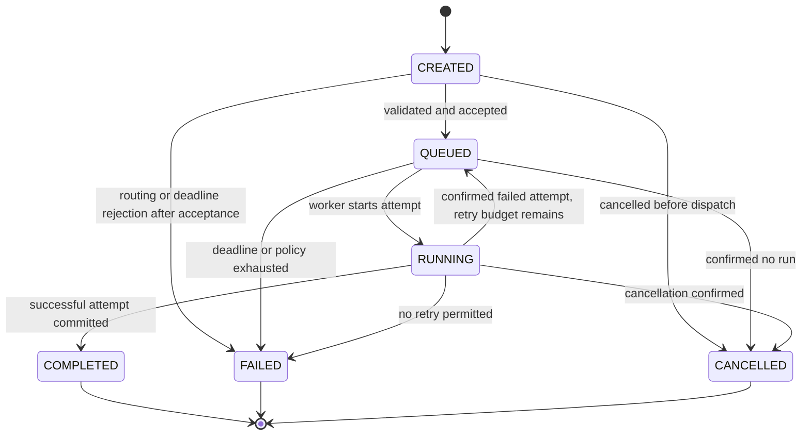

# Task and execution lifecycle

Status: **T01 historical proposal**, with implemented T06 persistence described in [Task Lifecycle Service](lifecycle-service.md). Worker/handler invocation, leases, recovery, retries and process-aware cancellation below remain **FUTURE**. Database-backed backend state replaces neither visual STATE nor existing simulated mission phases. This lifecycle is for real platform tasks only.

## States and ownership

Task states: `CREATED`, `QUEUED`, `RUNNING`, `COMPLETED`, `FAILED`, `CANCELLED`. These suffice for Phase 1 if additional fields describe scheduling, retry delay, cancellation and reconciliation. Execution states: `PENDING`, `RUNNING`, `SUCCEEDED`, `FAILED`, `CANCELLED`, `TIMED_OUT`. Keep `cancelRequestedAt`, `statusReason`, `nextEligibleAt`, observation freshness and reconciliation state separately. Do not label unknown external work FAILED merely to fit an enum.

| Entity/current | Allowed next state | Guard / consequence |
| --- | --- | --- |
| Task CREATED | QUEUED | Agent, owner, route and policy valid; atomically create first PENDING attempt |
| Task CREATED | FAILED/CANCELLED | Recorded reason; no execution launched |
| Task QUEUED | RUNNING | Current attempt claimed and actually started |
| Task QUEUED | FAILED/CANCELLED | Deadline/policy exhausted or cancellation before start; pending attempt finalized |
| Task RUNNING | COMPLETED | Current attempt SUCCEEDED and result/reference persisted; external result availability recorded separately |
| Task RUNNING | QUEUED | Current attempt FAILED/TIMED_OUT, known stopped, retry authorized; create next PENDING attempt |
| Task RUNNING | FAILED | Attempt failure/timeout confirmed and retry unavailable |
| Task RUNNING | CANCELLED | Confirmed termination/no continuing attempt; cancellation won race |
| Execution PENDING | RUNNING | Atomic valid claim and deadline/config/permission recheck |
| Execution PENDING | CANCELLED/FAILED/TIMED_OUT | Cancelled, unrecoverable preflight failure, or pending deadline expiry before invocation |
| Execution RUNNING | SUCCEEDED/FAILED/CANCELLED/TIMED_OUT | Runtime reports validated terminal fact; result/error/finishedAt committed |

Terminal task states: COMPLETED/FAILED/CANCELLED. Terminal execution states: SUCCEEDED/FAILED/CANCELLED/TIMED_OUT. All unlisted transitions are invalid. Terminal states never reopen. Retrying after terminal task failure requires a new task with a `retryOfTaskId` relationship (future explicit API); automatic/bounded manual attempt retries must occur while the logical task remains active under policy. This preserves immutable terminal history. No task completes from coordinates, arrival callbacks, progress=100 or client acknowledgement.

Pre-start failures finalize the PENDING attempt and aggregate task/retry scheduling atomically. A retryable PENDING failure can leave Task QUEUED with a new PENDING attempt; do not emit a RUNNING transition that never occurred. Attempts increment monotonically and do not reuse IDs. Task deadline and total attempt budget do not reset per retry.

## Coordination and concurrency

Phase 1 native handler is a small, real, allowlisted rule operation over supplied data (for example validate and summarize structured items). It requires no inference, arbitrary code, filesystem or network tool. It must not pretend to generate the simulated landing page. Work is invoked by backend worker after commit, never HTTP completion or GameLoop.

Persist a pending attempt before returning acceptance. Worker selects eligible pending rows under short transactions, claims task and agent capacity with a lease/fencing token, commits, then invokes the handler outside the transaction. Conditional writes compare current attempt/version/token. Heartbeats extend leases, and terminal writes from expired workers are rejected. `SELECT ... FOR UPDATE SKIP LOCKED` is a possible queue-claim primitive, not an exactly-once guarantee; PostgreSQL documents its queue-like use and inconsistent general-query view. [PostgreSQL SELECT locking documentation](https://www.postgresql.org/docs/current/sql-select.html).

At most one active attempt per task and one running native execution per agent in Phase 1. Concurrent API commands serialize through row/version guards. A bounded global worker limit prevents unbounded promises. Future increased concurrency needs transactional capacity claims, not a UI busy flag. Independent agents can run simultaneously; no global four-role pipeline is required.

## Failure and recovery policy

| Condition | Required behavior |
| --- | --- |
| Duplicate task POST | Same owner/key + canonical input hash returns same task; changed body with same key conflicts; unique DB constraint handles races |
| Duplicate worker delivery | Same execution/submission key, token and guarded status; do not create a second attempt automatically |
| Retryable failure | Bounded total attempts, exponential delay with jitter, recorded reason; configurable default max 3, no retry for validation/permission/unsupported errors |
| Cancellation while pending | Atomic cancel of task/attempt before claim; queued worker observes terminal state |
| Cancellation while running | Persist request, signal runtime; terminal CANCELLED only on confirmed stop. If success commits first, COMPLETED wins; cancellation response reports actual outcome |
| Unsupported remote cancel | Explicit capability error, keep status monitoring and cancellation audit; never fake CANCELLED |
| Timeout | Execution/overall deadlines, invoke cooperative abort. Native Phase 1 handler must be bounded; future noncooperative tool processes require hard isolation/termination. Do not retry unresolved side effects |
| Backend restart | Load durable pending work; reconcile expired running leases. Confirm previous native ownership ended and handler is safe to retry; mark interrupted attempt FAILED with PROCESS_INTERRUPTED then queue next if policy permits |
| Multiple backend instances | Database lease + fencing stops stale state writes, but cannot undo side effects. Side-effecting tools require idempotency or confirmation before retry |
| External submit outcome unknown | Reconcile by immutable submission key; no resubmission/new attempt unless safely idempotent or nonacceptance established |
| Orchestrator unavailable | Keep queued with bounded backoff until deadline, surface reason/freshness; auth/config errors require correction, not hot-loop retry |
| DB unavailable | Stop new claims and accepting work as successful; visible 503/readiness failure. No in-memory fallback queue |
| Browser disconnected/paused/reset | No execution effect; HTTP snapshot later restores display |

Transient status requests do not consume an attempt. Repeated delivery of the same terminal fact is idempotent. Older attempts cannot overwrite current task state. A retry may make task RUNNING → QUEUED → RUNNING while its identity remains constant; attempts stay individually immutable after terminalization. Operator resolution of ambiguous work must record actor/reason/evidence.

Initial runtime and API may share one process, but pending rows, claims and transitions must support later separate workers/broker delivery. Acceptance tests must kill/restart the backend and race worker/cancel/duplicate commands, not merely assert in-memory state.

## T05 checkpoint — storage, not lifecycle execution

The [implemented persistence APIs](task-execution-persistence.md) create CREATED without an execution, following the explicit T05 instruction. The earlier tables above remain the PLANNED T06 lifecycle. Internal-only allocation can create a PENDING record without changing its Task and enforces terminal/active-attempt/route constraints; it never starts, retries or terminalizes an attempt. The transaction-aware primitive permits future atomic lifecycle-plus-attempt operations. Tests use isolated SQL terminal fixtures to verify history; those fixtures are not a new production transition service.

## T06 current implementation

The [implemented lifecycle service](lifecycle-service.md) is the current persistence contract. CREATED can queue/cancel; QUEUED can start/cancel or fail on a pre-start failure/timeout; RUNNING can complete/fail/cancel. Attempts may fail/timeout before start without fabricating RUNNING. Terminal and repeated transitions conflict, and no retry is scheduled. Task/attempt/version/timestamp/history changes are atomic. Running cancellation records CANCELLATION_UNCONFIRMED rather than claiming real process termination. T01 handler/worker/lease/retry/recovery and confirmed-stop semantics above remain future work. T07 is next, not begun.
